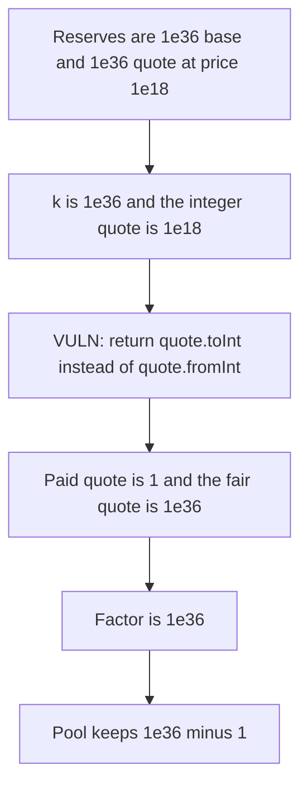

# Vertex — ammEquilibrium divides the quote by 1e18

> **Vulnerability classes:** vuln/arithmetic/decimal-mismatch · vuln/logic/price-calculation

<!-- non-defihacklabs -->
<!-- source-auditvault: https://github.com/Auditware/AuditVault/blob/main/findings/48376-improper-unit-conversion-in-ammequilibrium-ottersec-none-ver.md -->
<!-- date: 2023-01 -->

## Key info

| | |
|---|---|
| **Protocol** | Vertex |
| **Finding** | OtterSec OS-VTX-ADV-00, AuditVault 48376 |
| **Vulnerable code** | `MathHelper.ammEquilibrium` |
| **Harm** | The swap pays 1 quote unit instead of 1e36. The pool keeps 1e36 - 1. The factor is 1e36. |
| **Chain** | local synthetic |

## TL;DR

`ammEquilibrium` returns `(base.fromInt(), quote.toInt())`. `fromInt` multiplies by 1e18. `toInt` divides by 1e18. The quote leg should use `fromInt`. With base and quote reserves of 1e36 and price 1e18, the integer quote is 1e18, `toInt` returns 1, and `fromInt` would return 1e36. The pool transfers 1 and keeps 1e36 - 1. The control returns `quote.fromInt()` and pays 1e36.

## The vulnerable code

```solidity
int256 k = baseX18.toInt() * quoteX18.toInt();
int256 base = (MathHelper.sqrt(k) * 1e9) / MathHelper.sqrt(priceX18);
int256 quote = k / base;
// @> VULN: quote.toInt divides by 1e18; the quote should be quote.fromInt
return (base.fromInt(), quote.toInt());
```

The fix is `return (base.fromInt(), quote.fromInt())`.

## Root cause

PRBMath `toInt` strips 18 decimals and `fromInt` adds them. The base leg is scaled up and the quote leg is scaled down, so the quote is smaller than the fair value by 1e36. These reserves are what the perp engine uses for LP and position value.

## Preconditions

`baseX18` and `quoteX18` are 1e36. `priceX18` is 1e18. Both square roots are exact, so the result is not a rounding artifact. The pool is funded with 1e36 quote units before the swap. No timestamp warp.

## Attack walkthrough

1. The fair quote, `1e18 * 1e18`, is 1e36. That amount is minted onto the pool.
2. `swap` calls `ammEquilibrium`. `k` is 1e36. `base` before scaling is 1e18. `quote` before scaling is 1e18.
3. `base.fromInt()` returns 1e36. `quote.toInt()` returns 1.
4. The pool transfers 1 quote unit to the trader.
5. `1e36 / 1` is 1e36. The pool balance is 1e36 - 1.

The control uses `quote.fromInt()`, transfers 1e36, and leaves the pool at 0.

## Diagrams



## Impact

The trader receives 1 quote unit instead of 1e36. The pool retains 999999999999999999999999999999999999 units, which is 1e36 - 1. The equilibrium quote is off by a factor of 1e36. The fixed conversion pays 1e36 and empties the pool.

## Remediation

Change `quote.toInt()` to `quote.fromInt()` in the return of `ammEquilibrium`. That is the patch in Vertex pull request 116.

## How to reproduce

```bash
cd 48376-improper-unit-conversion-in-ammequilibrium-ottersec-none-ver_exp
forge test -vv
```

## Sources

- AuditVault finding: https://github.com/Auditware/AuditVault/blob/main/findings/48376-improper-unit-conversion-in-ammequilibrium-ottersec-none-ver.md
- OtterSec report: https://vertexprotocol.io/ (Vertex EVM assessment, final patch confirmation 12 January 2023)
- Vulnerable function: `contracts/libraries/MathHelper.sol` `ammEquilibrium`, as quoted in the finding. Fixed in pull request 116.
