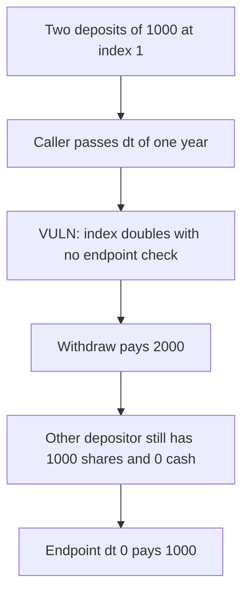

# Vertex — updateStates accepts any dt

> **Vulnerability classes:** vuln/access-control/missing-modifier · vuln/logic/reward-calculation

<!-- non-defihacklabs -->
<!-- source-auditvault: https://github.com/Auditware/AuditVault/blob/main/findings/48377-unauthorized-access-to-updatestates-ottersec-none-vertex-pro.md -->
<!-- date: 2023-03 -->

## Key info

| | |
|---|---|
| **Protocol** | Vertex |
| **Finding** | OtterSec, March 2023, AuditVault 48377 |
| **Vulnerable code** | `updateStates` has no `onlyEndpoint` |
| **Harm** | A one-year dt doubles the index. The caller withdraws 2000 USDC and leaves the other 1000 unbacked. Endpoint dt 0 pays 1000. |
| **Chain** | local synthetic (audited Ethereum contracts) |

## TL;DR

Spot `updateStates` is supposed to be called by the endpoint, which tracks `lastUpdated` and passes the real `dt`. The function is public. Any caller can pass any `dt`, and interest is linear in that `dt`.

Two deposits of 1000 USDC sit at index 1. A same-block endpoint call would pass `dt = 0`. `updateStates(365 days)` at a 100% annual rate sets the index to 2. The caller's 1000 shares withdraw 2000, which is the entire cash. The other depositor's shares are still 1000 and the cash is 0.

The endpoint path with `dt = 0` pays 1000 and leaves the other 1000 in the engine.

## The vulnerable code

```solidity
function updateStates(uint256 dt) external {
    // @> VULN: any caller can pass dt. onlyEndpoint is missing.
    index += index * dt / YEAR;
}
```

The fixed entrypoint:

```solidity
function updateStatesAsEndpoint(uint256 dt) external {
    require(msg.sender == endpoint, "onlyEndpoint");
    index += index * dt / YEAR;
}
```

## Root cause

`dt` is an argument instead of a difference the endpoint computed from stored timestamps. Without `onlyEndpoint`, the argument is an interest multiplier the caller chooses.

## Preconditions

The engine holds two 1000 USDC deposits at index 1. The rate in this reduction is 100% per year, so one supplied year doubles balances. The honest elapsed time in this single block is 0. No warp.

## Attack walkthrough

1. Index is 1. Cash is 2000 USDC. Caller shares are 1000.
2. Call `updateStates` with `365 days`.
3. Index becomes 2.
4. Withdraw pays `1000 * 2 = 2000`.
5. Cash left is 0. The other depositor's shares are still 1000.
6. `2000 - 1000 = 1000` of the withdrawal is their deposit.

Control calls `updateStatesAsEndpoint(0)` and withdraws 1000. Cash left is 1000.

## Diagrams



## Impact

The caller receives 2000 USDC. Their fair balance at the real elapsed time is 1000 USDC. The other depositor's 1000 USDC is what makes up the difference, and it can no longer be withdrawn.

## Remediation

Add `onlyEndpoint` and pass `dt` from the endpoint's stored `lastUpdated`, not from the caller.

## How to reproduce

```bash
cd 48377-unauthorized-access-to-updatestates-ottersec-none-vertex-pro_exp
forge test -vv
```

## Sources

- AuditVault finding: https://github.com/Auditware/AuditVault/blob/main/findings/48377-unauthorized-access-to-updatestates-ottersec-none-vertex-pro.md
- Vertex audit: https://vertexprotocol.io/
