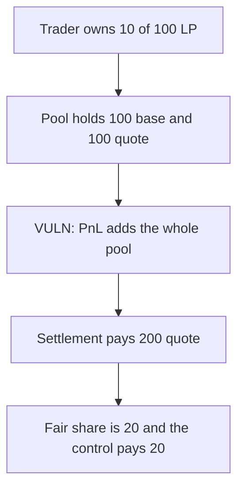

# Vertex PerpEngine — settlement pays the whole AMM instead of the LP share

> **Vulnerability classes:** vuln/logic/price-calculation · vuln/logic/wrong-condition

<!-- non-defihacklabs -->
<!-- source-auditvault: https://github.com/Auditware/AuditVault/blob/main/findings/48378-improper-settlement-calculation-ottersec-none-vertex-protoco.md -->
<!-- date: 2024-01 -->

## Key info

| | |
|---|---|
| **Protocol** | Vertex PerpEngine |
| **Finding** | OtterSec, Shiva Shankar, AuditVault 48378 |
| **Vulnerable code** | `PerpEngine.settle` position PnL |
| **Harm** | Paid 200 quote. The trader's 10 percent LP share is fairly 20. Extra 180. |
| **Chain** | local synthetic |

## TL;DR

`getSettlementState` adds the AMM's entire base and quote into the trader's PnL. Only `amountLp / supply` of that inventory belongs to the trader. With price 1, 100 base, 100 quote, and a 10 of 100 LP position, settlement pays 200 quote. The fair figure is 20. A second engine that scales by the LP share pays 20.

## The vulnerable code

```solidity
// @> VULN: adds the entire AMM base and quote, not amountLp/supply of the pool
positionPnlX18 = priceX18.mul(balance.amountX18 + ammBaseX18) + balance.vQuoteBalanceX18 + ammQuoteX18;
```

The fix multiplies `ammBaseX18` and `ammQuoteX18` by `amountLp / supply` before adding them.

## Root cause

The settlement formula treats pool inventory as if the settler owned all of it. Every LP who settles is credited with the same full pool value, so the quote vault can be drained down to the last settler's full-pool claim.

## Preconditions

The trader has a non-zero LP balance that is less than the total supply, and the AMM holds base and quote. No oracle update is required. Price is 1.0 in this run so the quote units are the raw inventory.

## Attack walkthrough

1. The trader deposits 10 LP against a supply of 100. Position base and vQuote are 0.
2. The pool holds 100 base and 100 quote.
3. `settle` at price 1 computes `1 * (0 + 100) + 0 + 100 = 200` and transfers 200 quote.
4. The fair PnL is `1 * (0 + 10) + 10 = 20`.
5. The control engine pays 20.

## Diagrams



## Impact

The settler receives 200 quote instead of 20. The extra 180 is other LPs' inventory. Repeating the settle for every LP would credit the full pool once per LP.

## Remediation

Scale `ammBase` and `ammQuote` by `amountLp / supply` before adding them to the position PnL.

## How to reproduce

```bash
cd 48378-improper-settlement-calculation-ottersec-none-vertex-protoco_exp
forge test -vv
```

## Sources

- AuditVault finding: https://github.com/Auditware/AuditVault/blob/main/findings/48378-improper-settlement-calculation-ottersec-none-vertex-protoco.md
- Vertex: https://vertexprotocol.io/
- The finding says the PnL was changed to the `amountLp/supply` ratio in patch #130.
