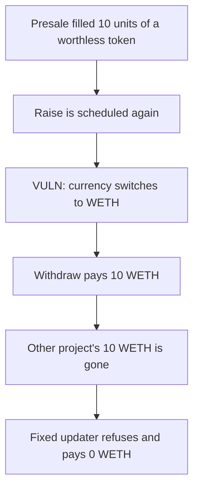

# Entertainmint — a creator retargets raise currency after minting

> **Vulnerability classes:** vuln/logic/incorrect-state-transition · vuln/logic/missing-check

<!-- non-defihacklabs -->
<!-- source-auditvault: https://github.com/Auditware/AuditVault/blob/main/findings/48439-stealing-tokens-from-protocol-ottersec-none-entertainmint-pd.md -->
<!-- date: 1970-01 -->

## Key info

| | |
|---|---|
| **Protocol** | Entertainmint |
| **Finding** | OtterSec, AuditVault 48439. The public finding is copyright 2024 and does not state a month. |
| **Vulnerable code** | `updateCurrency` while the raise is scheduled after presale minting |
| **Harm** | The creator withdraws 10 WETH that another project deposited. The fixed updater pays 0 WETH. |
| **Chain** | local synthetic (audited Ethereum contracts) |

## TL;DR

A creator can edit raise currency while the raise is Scheduled. Scheduled is true before presale and again between presale end and public-sale start. Presale minting has already happened by the second window, and the update does not care.

This run starts in that gap: the goal of 10 units of a worthless 18-decimal token is already minted, and `raise.balance` is 10 ether units. Another project has 10 WETH in the same contract. `updateCurrency` points the raise at WETH. `withdraw` pays `raise.balance` of the current currency, so 10 WETH moves to the creator. The other project is still owed 10 WETH and the contract's WETH balance is 0.

The fix requires `block.timestamp < presaleStart`. That check returns false here, so the currency stays the worthless token and no WETH moves.

## The vulnerable code

```solidity
function updateCurrency(address next) external {
    require(msg.sender == attackerRaise.owner, "owner");
    require(scheduled(), "scheduled");
    // @> VULN: currency changes after presale tokens were already minted.
    attackerRaise.currency = next;
}
```

```solidity
function updateCurrencyFixed(address next) external returns (bool) {
    if (block.timestamp >= attackerRaise.presaleStart) return false;
    attackerRaise.currency = next;
    return true;
}
```

## Root cause

Currency and the numeric balance are independent fields. Withdraw pays the balance in whatever currency is set at the end. The scheduled-gap update runs after `minted` is already the goal, so a filled presale in a cheap token becomes a claim on a valuable token.

## Preconditions

The caller is a registered creator and the owner of this raise, not the protocol admin. Presale has filled 10 units. Another raise's 10 WETH sits in the contract. The timestamp is inside the gap after presale and before the public sale. One block, no warp: presale bounds are already in the past relative to the replay timestamp.

## Attack walkthrough

1. The raise is scheduled. `minted` is 10 ether. Currency is the worthless token.
2. The contract holds 10 WETH credited to the other project.
3. `updateCurrency` sets WETH. `updateCurrencyFixed` returns false.
4. Close the raise. The goal is already met.
5. Withdraw transfers 10 WETH to the creator.
6. Contract WETH is 0. `otherWeth` is still 10 ether.

## Diagrams



## Impact

The creator receives 10 WETH. Those tokens were another project's deposit. The fixed updater does not change currency, and the WETH withdrawal is 0.

## Remediation

Reject raise and tier edits once `block.timestamp` reaches `presaleStart`, including the scheduled gap after presale.

## How to reproduce

```bash
cd 48439-stealing-tokens-from-protocol-ottersec-none-entertainmint-pd_exp
forge test -vv
```

## Sources

- AuditVault finding: https://github.com/Auditware/AuditVault/blob/main/findings/48439-stealing-tokens-from-protocol-ottersec-none-entertainmint-pd.md
- Protocol: https://www.entertainmint.com/
