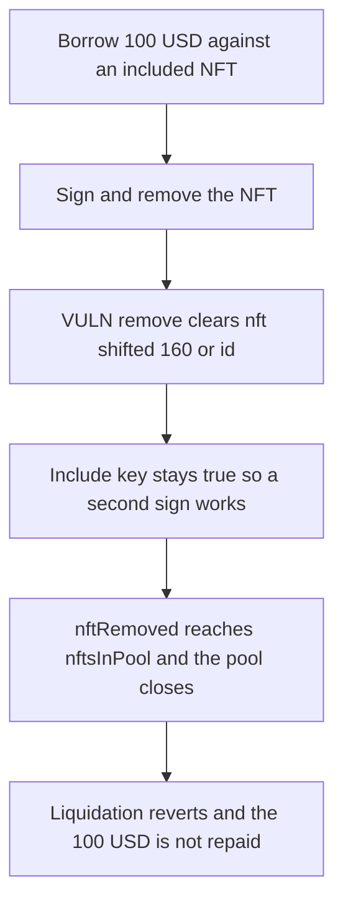

# Abacus: remove clears the wrong tokenMapping key and closes the pool

> **Vulnerability classes:** `vuln/logic/incorrect-state-transition` · `vuln/dos/frozen-funds`

<!-- non-defihacklabs -->
<!-- source-auditvault: https://github.com/Auditware/AuditVault/blob/main/findings/48698-inconsistency-in-usage-of-tokenmapping-ottersec-none-abacus.md -->
<!-- date: 2022-07 -->

## Key info

| Field | Value |
|---|---|
| **Loss** | Liquidation reverts. The borrower keeps 100 USD and the NFT still shows as held |
| **Vulnerable contract** | `Vault.remove` |
| **Attacker EOA** | `0x1111111111111111111111111111111111111111` |
| **Attack contract** | `Exploit` |
| **Attack tx** | `Exploit.run()` |
| **Chain / block / date** | Ethereum model · block 0 · 2022-07 |
| **Compiler** | solc 0.8.27, cancun, via IR |

## TL;DR

`includeNft` and `getHeldTokenExistence` use `id << 160 | nft`. `remove` writes `nft << 160 | id`. The real slot stays true, so the owner can sign the same NFT again. Each remove increments `nftRemoved`. With `nftsInPool` equal to 2, two sign-and-remove cycles on one NFT close the pool. `liquidate` then reverts and the 100 USD loan is not repaid. The consistent-key control clears the include slot, leaves the pool open, and lets liquidation zero the debt.

## The vulnerable code

```solidity
function remove(address nft, uint256 id) external {
    uint256 tempStorage = removeKey(nft, id);
    tokenMapping[tempStorage] = false;
    Factory(factory).updateNftInUse(nft, id); // @> VULN: the slot cleared above is nft<<160|id, not the includeNft key
}
```

`removeKey` is `uint256(uint160(nft)) << 160 | id`. `includeKey` is `id << 160 | uint256(uint160(nft))`. OtterSec's patch used one encoding everywhere and updated the mapping after `updateNftInUse`. The control does that: it checks existence, increments `nftRemoved`, then clears the include key.

## Root cause

Two functions pack the same pair in opposite orders. A write through the remove key does not delete the include key, so every later existence check still succeeds and every remove still counts.

## Preconditions

- The pool tracks two NFTs. The attacker owns one of them and can sign and remove it. That is the report's PoC, not an admin action.
- Lend has 100 USD and accepts the NFT while the include key is set and the pool is open.

## Attack walkthrough

1. Both NFT ids are included. The attacker borrows 100 USD against id 1.
2. The attacker signs id 1 and removes it. The wrong slot is cleared. Existence stays true. `nftRemoved` becomes 1.
3. The attacker signs and removes id 1 again. `nftRemoved` becomes 2 and the pool closes.
4. `liquidate` reverts with `pool closed`.
5. The debt is still 100 USD. That balance is the attacker's.

## Diagrams



## Impact

One NFT owner forces `closePool` while the collateral still shows as held. The lender cannot liquidate, so the 100 USD loan stays with the borrower. The report's second note, that a correct key written before `updateNftInUse` would make remove revert, is why the control clears the include key only after the existence check.

## Remediation

Use one key in `includeNft`, `remove`, `closeNft`, and `getHeldTokenExistence`, and clear it after the factory has finished its existence check. The control then removes the NFT once, refuses a second signature, and lets `liquidate` clear the debt.

## How to reproduce

```bash
cd 48698-inconsistency-in-usage-of-tokenmapping-ottersec-none-abacus_exp
forge test -vv
```

`test_exploit_wrong_key_closes_pool_and_bricks_liquidation` asserts a closed pool, a reverted liquidation, a 100 USD debt, and unequal keys. `test_control_consistent_key_removes_once_and_liquidation_works` asserts the pool stays open and the debt is cleared.

## Sources

- AuditVault finding: https://github.com/Auditware/AuditVault/blob/main/findings/48698-inconsistency-in-usage-of-tokenmapping-ottersec-none-abacus.md
- OtterSec Abacus report, OS-ABC-ADV-02, assessment 11-26 July 2022: https://osec.io/reports/d8d3097b-0974-469d-b8cc-b59f905c9704
- The finding quotes both key expressions and the `nftRemoved == nftsInPool` close. The reduction keeps those expressions. Fixed in commit `c48c3cb` per the finding.
