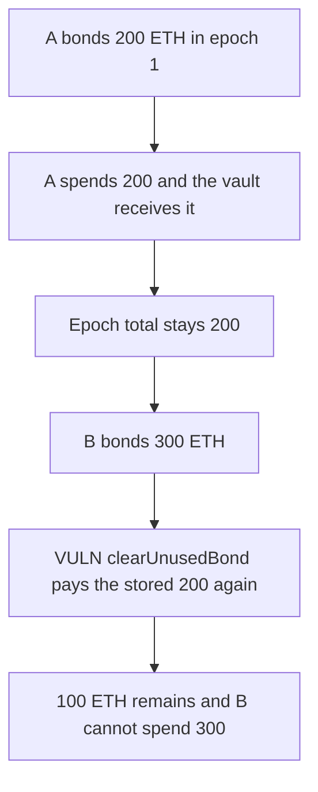

# Abacus: clearUnusedBond pays 200 ETH that was already sent to the vault

> **Vulnerability classes:** `vuln/logic/state-update` · `vuln/dos/griefing`

<!-- non-defihacklabs -->
<!-- source-auditvault: https://github.com/Auditware/AuditVault/blob/main/findings/48699-dos-by-draining-creditsbonds-using-clearunusedbond-ottersec.md -->
<!-- date: 1970-01 -->

## Key info

| Field | Value |
|---|---|
| **Loss** | The caller receives 200 ETH of credit already delivered to the vault. User B's 300 ETH ticket payment reverts with 100 ETH left in the contract |
| **Vulnerable contract** | `CreditBonds.clearUnusedBond` |
| **Attacker EOA** | `0x1111111111111111111111111111111111111111` |
| **Attack contract** | `Exploit` |
| **Attack tx** | `Exploit.run()` |
| **Chain / block / date** | Ethereum model · block 0 · month not stated in the finding |
| **Compiler** | solc 0.8.27, cancun, via IR |
| **Bug class** | Used credit stays in totalCreditPerEpoch and is paid out again |

## TL;DR

`sendToVault` forwards a bond to the vault and does not decrement `totalCreditPerEpoch`. `clearUnusedBond` later pays that stored total. User A bonds 200 ETH in epoch 1 and spends it in epoch 2, so the vault already holds 200 ETH while the epoch-1 bucket still says 200. User B bonds 300 ETH. Clearing epoch 1 sends 200 ETH to the caller. B's attempt to spend 300 ETH reverts. The contract has 100 ETH left and B's credit record is still 300.

## The vulnerable code

```solidity
function sendToVault(address user, uint256 payload) external {
    uint256 epoch = currentEpoch - 1;
    userCredit[epoch][user] -= payload;
    (bool ok,) = vault.call{value: payload}("");
    require(ok, "vault");
}

// @> VULN: totalCreditPerEpoch still includes bonds already sent to the vault
uint256 payout = totalCreditPerEpoch[epoch];
```

The OtterSec fix subtracts `payload` from `totalCreditPerEpoch` inside `sendToVault`. The finding's step list says `clearUnusedBond(epoch 2)` pays 200; the mechanism that produces a 200 payout after A spent 200 is a clear of epoch 1, which is what this reduction runs.

## Root cause

The spent amount is removed from `userCredit` and sent as ETH, and the epoch total used by the clear is left unchanged.

## Preconditions

- A bonds 200 ETH in epoch 1 and spends that credit in epoch 2.
- B bonds 300 ETH in epoch 2.
- Anyone calls `clearUnusedBond(1)` in epoch 3.

## Attack walkthrough

1. A bonds 200. The contract balance is 200.
2. A spends it. The vault balance is 200. The epoch-1 total is still 200. The contract balance is 0.
3. B bonds 300. The contract balance is 300.
4. Clear epoch 1. The caller receives 200. The contract balance is 100.
5. B's 300 spend reverts.

## Diagrams



## Impact

The caller takes 200 ETH that was B's deposit. B cannot buy the ticket the 300 credit was for. With the decrement in `sendToVault`, the clear pays nothing and B's 300 ETH transfer succeeds.

## Remediation

Decrement `totalCreditPerEpoch` by the amount `sendToVault` forwards, which is the patch cited in the finding.

## How to reproduce

```bash
cd 48699-dos-by-draining-creditsbonds-using-clearunusedbond-ottersec_exp
forge test -vv
```

## Sources

- AuditVault finding: https://github.com/Auditware/AuditVault/blob/main/findings/48699-dos-by-draining-creditsbonds-using-clearunusedbond-ottersec.md
- Report: https://abacus.wtf/ (OtterSec, copyright 2022; the finding states no month)
- Reduced source: `test/48699-dos-by-draining-creditsbonds-using-clearunusedbond-ottersec.sol`
