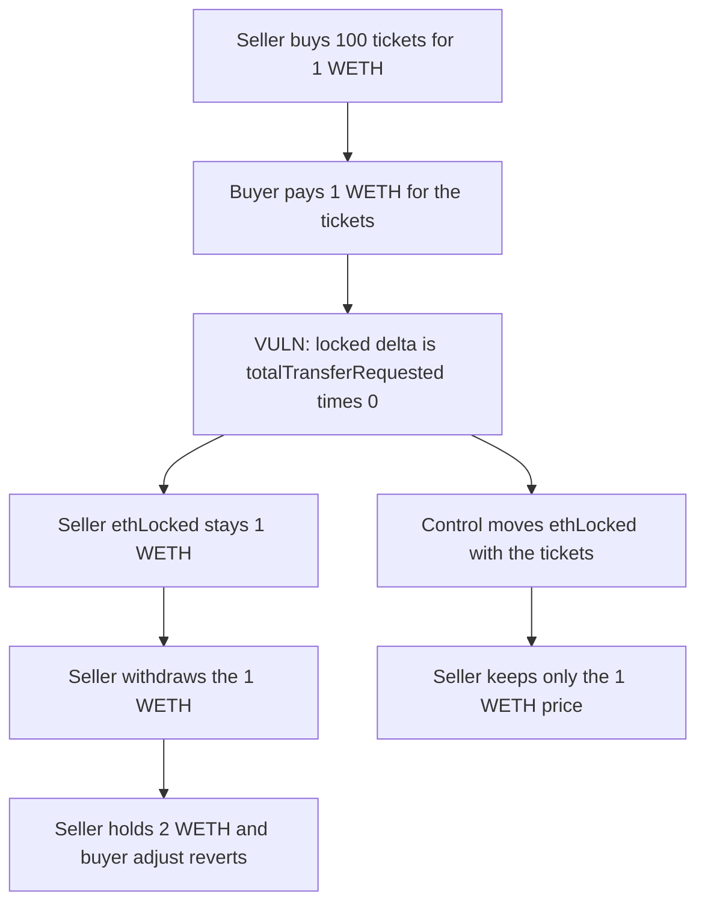

# Abacus: transferFrom leaves ethLocked with the seller

> **Vulnerability classes:** `vuln/logic/state-update` · `vuln/logic/missing-validation`

<!-- non-defihacklabs -->
<!-- source-auditvault: https://github.com/Auditware/AuditVault/blob/main/findings/48700-vaults-transferfrom-is-not-transferring-locked-ether-otterse.md -->
<!-- date: 1970-01 -->

## Key info

| Field | Value |
|---|---|
| **Loss** | Seller ends with 2 WETH after posting 1. Buyer holds 100 tickets, 0 ethLocked, and adjust reverts |
| **Vulnerable contract** | `Vault.transferFrom` |
| **Attacker EOA** | `0x1111111111111111111111111111111111111111` |
| **Attack contract** | `Exploit` |
| **Attack tx** | `Exploit.run()` |
| **Chain / block / date** | Ethereum model · block 0 · undated public note, copyright 2022 |
| **Compiler** | solc 0.8.27, cancun, via IR |

## TL;DR

`transferFrom` moves the tickets and then subtracts `totalTransferRequested * 0.001 ether / 100` from the sender's `ethLocked`. Nothing ever writes `totalTransferRequested` from the tickets being moved, so the product is 0. The seller keeps 1 WETH of locked credit after the tickets are gone, withdraws it, and also keeps the 1 WETH the buyer paid. The buyer's `ethLocked` stays 0, so `adjust` underflows. The seller's balance goes from 1 WETH to 2 WETH.

## The vulnerable code

```solidity
trader[from].tickets = 0;
trader[to].tickets += moved;
uint256 lockedMoved = totalTransferRequested * 0.001 ether / 100; // @> VULN: totalTransferRequested was never computed, so this is 0
trader[from].ethLocked -= lockedMoved;
_createNewPosition(to, totalTransferRequested * 0.001 ether / 1e18, lockedMoved);
```

The OtterSec note says to compute `totalTransferRequested` from the positions being transferred. The fixed branch in this reduction moves `trader[from].ethLocked` with the tickets.

## Root cause

`totalTransferRequested` is a storage word that the transfer never assigns. Both of the quoted scalings, `* 0.001 ether / 100` and `* 0.001 ether / 1e18`, therefore evaluate to 0. The sender's `ethLocked` is unchanged. The recipient's new position is created with 0 locked ETH. `withdraw` still pays whatever `ethLocked` says, and `adjust` subtracts from the recipient's empty balance.

## Preconditions

- The seller buys a position: 1 WETH in, 100 tickets, `ethLocked` of 1 WETH.
- The buyer pays the seller 1 WETH for those tickets.
- `transferPosition` moves every ticket and uses the unfixed formula.

## Attack walkthrough

1. The seller purchases. The vault holds 1 WETH and credits the seller.
2. The buyer transfers 1 WETH to the seller.
3. The tickets move to the buyer. `ethLocked` on the seller stays 1 WETH. The buyer's lock stays 0.
4. The seller withdraws and receives that 1 WETH back.
5. The seller's balance is 2 WETH. The vault is empty.
6. The buyer's `adjust(1)` underflows.
7. The control moves the 1 WETH lock to the buyer. The seller's withdraw pays 0, so the seller keeps only the sale price, and the vault still holds the collateral.

## Diagrams



## Impact

The buyer paid 1 WETH and received tickets that cannot be adjusted, because `ethLocked` is 0. The seller recovered the original collateral on top of the sale price, a gain of 1 WETH against the starting balance. The vault that should still custody that collateral is empty.

## How to reproduce

```bash
cd 48700-vaults-transferfrom-is-not-transferring-locked-ether-otterse_exp
forge test -vv
```

`test_exploit_seller_withdraws_locked_eth_after_transfer` asserts the seller's balance rose from 1 WETH to 2, the buyer has 100 tickets and 0 locked, and `adjust` reverted. `test_control_locked_eth_follows_the_tickets` asserts the buyer receives the 1 WETH lock and the seller keeps only the price.

## Sources

- AuditVault finding: https://github.com/Auditware/AuditVault/blob/main/findings/48700-vaults-transferfrom-is-not-transferring-locked-ether-otterse.md
- OtterSec Abacus note: https://abacus.wtf/
- The public note is copyright 2022 and does not name a month, so the date marker is 1970-01 rather than an invented month.
