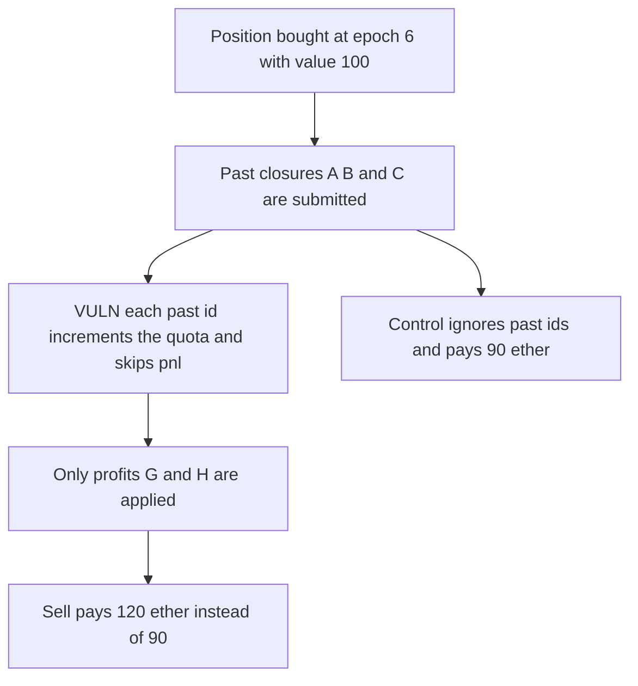

# Past Abacus closures fill the adjustment quota and skip 30 ether of losses

> **Vulnerability classes:** `vuln/logic/missing-check` · `vuln/logic/incorrect-state-transition`

<!-- non-defihacklabs -->
<!-- source-auditvault: https://github.com/Auditware/AuditVault/blob/main/findings/48701-bypass-internaladjustment-by-using-past-closures-ottersec-no.md -->
<!-- date: 2023-10 -->

## Key info

| Field | Value |
|---|---|
| **Loss** | 30 ether of closure losses not applied. Withdrawal is 120 ether instead of 90 |
| **Vulnerable contract** | `Vault.adjustTicketInfo` |
| **Attacker EOA** | `0x1111111111111111111111111111111111111111` |
| **Attack contract** | `Exploit` |
| **Attack tx** | `Exploit.run()` |
| **Chain / block / date** | Ethereum model · block 0 · 2023-10 |
| **Compiler** | solc 0.8.27, cancun, via IR |
| **Bug class** | Out-of-range closure counts as an adjustment |

## TL;DR

The trader buys at epoch 6 with value 100 ether. Closures D, E, and F inside the position are 10 ether losses. G and H are 10 ether profits. Calling `adjustTicketInfo` on past closures A, B, and C increments `adjustmentsMade` and returns before the pnl. Together with G and H the counter reaches 8, the sell is allowed, and the trader withdraws 120 ether. The control vault does not count past ids. Applying D, E, F, G, and H pays 90 ether and leaves the 30 ether of losses in the vault.

## Background

OtterSec's Abacus review, published 30 October 2023. `adjustTicketInfo` increments `adjustmentsMade` and returns when `trader.startEpoch > epochOfClosure`. The report's steps are three past closures, then only the profitable new closures, then a sell once the counter matches `adjustmentsRequired`.

## The vulnerable code

```solidity
adjustmentsMade[user][nonce]++; // @> VULN: a past closure counts and skips internalAdjustment
// FIX: do not increment adjustmentsMade when epoch < startEpoch
return true;
```

The change that removes the harm:

```diff
- adjustmentsMade[user][nonce]++;
- return true;
+ return false;
```

## Root cause

The quota does not care which closure was adjusted. A past id is enough to increment it, and the early return skips `internalAdjustment`. The in-range losses are simply never submitted.

## Preconditions

- Purchase sets `adjustmentsMade` to 3 and `adjustmentsRequired` to 8.
- Past epochs are 1, 2, and 3. The position starts at epoch 6 and unlocks at epoch 10.
- The vault holds 120 ether, which is enough to pay the inflated value.

## Attack walkthrough

1. Past ids 1, 2, and 3 each increment the counter and return.
2. Ids 7 and 8 add 10 ether of profit each. Value is 120 ether.
3. `sell` sees 8 adjustments and transfers 120 ether.
4. The control ignores the past ids, applies the three losses, and pays 90 ether.

## Diagrams



## Impact

The seller receives 30 ether more than the position is worth after D, E, and F. That 30 ether is the loss the vault should have kept.

## Remediation

Do not increment `adjustmentsMade` for a closure whose epoch is before `startEpoch`. The OtterSec patch removed the early return; this reduction refuses to count the past id at all, which is what stops the quota from being filled without the losses.

## How to reproduce

```bash
cd 48701-bypass-internaladjustment-by-using-past-closures-ottersec-no_exp
forge test -vv
```

`test_exploit` is the harm. The control test is the guarded path. Captured output is `output.txt`.

## Sources

- AuditVault finding: https://github.com/Auditware/AuditVault/blob/main/findings/48701-bypass-internaladjustment-by-using-past-closures-ottersec-no.md
- OtterSec report: https://osec.io/reports/d8d3097b-0974-469d-b8cc-b59f905c9704
- Fix commit noted in the finding: e25baa9
