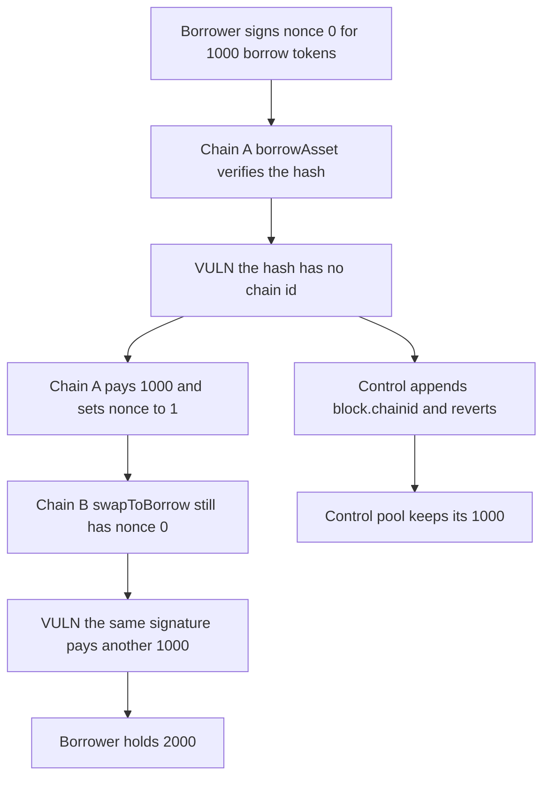

# RWA: one borrow signature draws a second 1,000 on the other chain

> **Vulnerability classes:** `vuln/auth/signature-replay`

<!-- non-defihacklabs -->
<!-- source-auditvault: https://github.com/Auditware/AuditVault/blob/main/findings/48929-h-01-cross-chain-replay-in-borrowasset-swaptoborrow-kann-aud.md -->
<!-- date: 2025-01 -->

## Key info

| Field | Value |
|---|---|
| **Loss** | 2,000 borrow tokens released for one signature. Chain B pays 1,000 that a chain-id hash rejects |
| **Vulnerable contract** | `BorrowPool.borrowAsset` and `BorrowPool.swapToBorrow` |
| **Attacker EOA** | `0x1111111111111111111111111111111111111111` |
| **Attack contract** | `Exploit` |
| **Attack tx** | `Exploit.run()` |
| **Chain / block / date** | Two-chain model · block 0 · 2025-01 |
| **Compiler** | solc 0.8.27, cancun, via IR |
| **Bug class** | Borrow authorization hash omits `block.chainid` |

## TL;DR

`borrowAsset` and `swapToBorrow` recover a signer over `keccak256(abi.encode(collateral id, borrow id, collateral amount, borrow amount, borrower, nonce))`. The hash has no chain id. Chain A and chain B both start at nonce 0, so the same signature passes both. The signed borrower receives 1,000 from each pool. A pool that appends `block.chainid` reverts that signature and keeps its 1,000.

## Background

Kann Audits, 19 January 2025, RWA finding H-01. The recommended hash adds `block.chainid` after the nonce. The same omission is what lets a borrow signed for one deployment pay out on another.

## The vulnerable code

```solidity
// @> VULN: chain id is not in the borrow hash, so this signature is valid on every chain
bytes32 borrowHash = keccak256(abi.encode(collatId, borrowId, collatAmt, borrowAmt, borrower, nonce));
// FIX: keccak256(abi.encode(collatId, borrowId, collatAmt, borrowAmt, borrower, nonce, block.chainid))
bytes32 digest = keccak256(abi.encodePacked("\x19Ethereum Signed Message:\n32", borrowHash));
require(ecrecover(digest, v, r, s) == borrower, "signer");
```

`borrowAsset` and `swapToBorrow` both call this draw. The signature used here was produced for nonce 0, collateral id 1, borrow id 1, 1,500 collateral, and 1,000 borrow tokens, by the key for `0x70997970C51812dc3A010C7d01b50e0d17dc79C8`.

## Root cause

The authorization is replayable across deployments that share the nonce and the borrow terms. Incrementing the nonce on chain A does not increment it on chain B.

## Preconditions

- Both pools use the same hash and start at nonce 0 for the borrower.
- Each pool holds 1,000 borrow tokens.
- The caller can escrow 1,500 collateral on each chain.
- The signature covers those amounts and nonce 0, and does not cover a chain id.

## Attack walkthrough

1. Chain A `borrowAsset` verifies the signature and sends 1,000 to the borrower. It escrows 1,500 collateral and sets the nonce to 1.
2. Chain B still has nonce 0. `swapToBorrow` verifies the same signature.
3. Chain B sends another 1,000. Its inventory is empty.
4. The borrower holds 2,000.
5. The control pool hashes `block.chainid` as a seventh field. `ecrecover` does not return the borrower. The pool reverts and still holds 1,000.

## Diagrams



## Impact

Lenders on chain B release 1,000 borrow tokens for a signature that was already consumed on chain A. The borrower is paid 2,000 in total. The chain-id pool pays nothing and keeps its 1,000. Each chain also locks 1,500 of the caller's collateral, so the second draw is a second loan, not an uncollateralized transfer. It is still a loan chain B never authorized.

## Remediation

Add `block.chainid` to the `borrowAsset` and `swapToBorrow` hash, which is the change Kann recommended. A deadline field, from the same report's M-01, is a separate fix and is not what stops this replay.

## How to reproduce

```bash
cd 48929-h-01-cross-chain-replay-in-borrowasset-swaptoborrow-kann-aud_exp
forge test -vv
```

`test_exploit_one_signature_draws_both_chains` asserts the borrower received 2,000 and both pools drew 1,000. `test_control_chainid_rejects_the_same_signature` asserts the chain-id pool reverts and keeps 1,000. Captured output is `output.txt`.

## Sources

- AuditVault finding: https://github.com/Auditware/AuditVault/blob/main/findings/48929-h-01-cross-chain-replay-in-borrowasset-swaptoborrow-kann-aud.md
- Kann Audits report: https://github.com/solodit/solodit_content/blob/main/reports/Kann/2025-01-19-RWA.md
