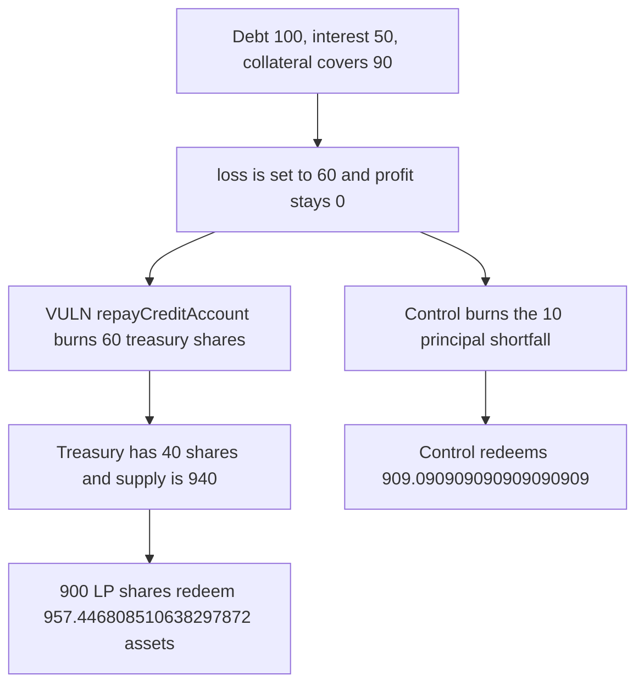

# Bad-debt liquidation burns 60 treasury shares instead of 10 and the LP is overpaid

> **Vulnerability classes:** vuln/logic/liquidation-logic · vuln/logic/state-update

<!-- non-defihacklabs -->
<!-- source-auditvault: https://github.com/Auditware/AuditVault/blob/main/findings/49112-h-02-cdpvaultsolliquidatepositionbaddebt-doesnt-correctly-ha.md -->
<!-- date: 2024-10 -->

## Key info

| Field | Value |
|---|---|
| **Loss** | Treasury shares fall from 100 to 40. The LP's 900 shares redeem 957.446808510638297872 assets instead of 909.090909090909090909 |
| **Vulnerable contract** | `CDPVault.liquidatePositionBadDebt` |
| **Attacker EOA** | `0x2863113936d013722cb88be6a89b41e0677aaf6f` (an LP) |
| **Attack contract** | `Exploit` |
| **Attack tx** | `Exploit.run()` |
| **Chain / block / date** | Ethereum model · block 0 · 2024-10 |
| **Compiler** | solc 0.8.27, cancun, via IR |
| **Bug class** | Loss passed to the pool is total debt minus repayment, and profit is 0, so the treasury is charged the interest as well as the principal shortfall |

## TL;DR

Debt is 100, accrued interest is 50, and the seized collateral is worth 90. `liquidatePositionBadDebt` sets `loss` to `150 - 90 = 60` and `profit` to 0, because 90 is not greater than the 100 principal. `PoolV3.repayCreditAccount` burns 60 treasury shares. The principal shortfall is 10. After the burn the pool has 1,000 assets and 940 shares, so 900 LP shares withdraw 957.446808510638297872. Burning 10 shares leaves 990 shares and pays 909.090909090909090909.

## Background

Code4rena's October 2024 LoopFi contest, H-02, from pkqs90. It follows the July 2024 H-12 fix, which started passing a profit figure but still computes that profit as `repayAmount - debt` and still uses `else if (loss > 0)`. The sponsor confirmed the report. The numbers below are the warden's example: repay 90 should burn 10 shares, not 60.

## The vulnerable code

```solidity
uint256 loss = debtData.debt + debtData.accruedInterest - repayAmount;
uint256 profit;
if (repayAmount > debtData.debt) {
    profit = repayAmount - debtData.debt;
}
lastLoss = loss;
lastProfit = profit;
// @> VULN: loss is the full 60 shortfall and profit is 0, so the pool burns 60 treasury shares instead of 10
pool.repayCreditAccount(debtData.debt, profit, loss);
```

With profit at 0 the pool takes the `else if (loss > 0)` branch and burns `_convertToShares(60)`.

## Root cause

The loss argument is the whole unpaid total, including interest that was never given to the treasury as profit. The principal gap is `debt - repayAmount`, which is 10. Burning 60 shares removes 50 shares of treasury claim that belong to the interest accounting, and the remaining LP shares absorb it as a higher redemption price.

## Preconditions

- Pool assets are 1,000, LP shares are 900, treasury shares are 100. The share price is 1.
- The position's debt is 100, accrued interest is 50, and collateral redeems at 90.
- Anyone can call the bad-debt liquidation. No admin key is required.

## Attack walkthrough

1. Seed the pool and open the 100 / 50 / 90 position.
2. Liquidation computes loss 60 and profit 0.
3. The pool burns 60 treasury shares. The treasury has 40 left. Supply is 940.
4. The LP redeems 900 shares and receives `1000 * 900 / 940 = 957.446808510638297872` assets.
5. Burning 10 instead leaves supply at 990 and pays `909.090909090909090909`.
6. The difference, 48.355899419729206963 assets, is the extra treasury value taken by the LP.

## Diagrams



## Impact

The treasury buffer loses 60 shares instead of 10. LP shares that remain are claims on the same 1,000 assets with a smaller supply, so this LP withdraws 48.355899419729206963 more assets than the 10-share burn pays. That amount comes out of the stakers' buffer.

## Remediation

Pass the principal shortfall as the loss (`debt - repayAmount` when repayment is below principal) and account interest separately. In `repayCreditAccount`, apply a non-zero profit and a non-zero loss independently instead of `else if`.

## How to reproduce

```bash
cd 49112-h-02-cdpvaultsolliquidatepositionbaddebt-doesnt-correctly-ha_exp
forge test -vv
```

`test_exploit_treasury_burned_60_and_lp_overpaid` asserts 40 treasury shares and a redemption of 957.446808510638297872. `test_control_burning_10_pays_the_lp_909` asserts 90 treasury shares and a redemption of 909.090909090909090909. Captured output is `output.txt`.

## Sources

- AuditVault finding: https://github.com/Auditware/AuditVault/blob/main/findings/49112-h-02-cdpvaultsolliquidatepositionbaddebt-doesnt-correctly-ha.md
- Code4rena report: https://code4rena.com/reports/2024-10-loopfi
