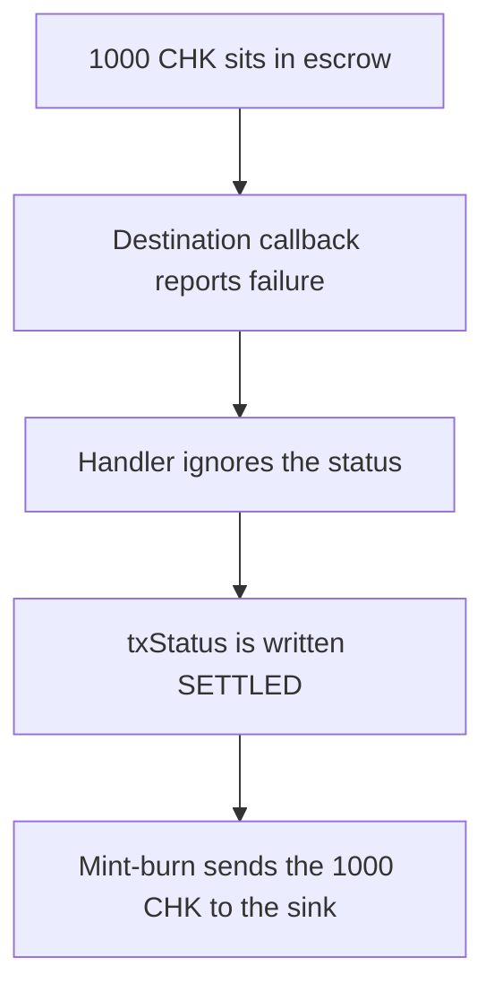

# Chakra: a failed destination message still settles and burns the escrow

> **Vulnerability classes:** `vuln/logic/wrong-condition` · `vuln/logic/state-update`

<!-- non-defihacklabs -->
<!-- source-auditvault: https://github.com/Auditware/AuditVault/blob/main/findings/49145-h-12-handlers-receive-cross-chain-callback-will-always-set-t.md -->
<!-- date: 2024-08 -->

## Key info

| Field | Value |
|---|---|
| **Loss** | 1000 CHK escrow burned and the message marked settled after a failed destination |
| **Vulnerable contract** | `Handler.receiveCrossChainCallback` |
| **Attacker EOA** | `0x1111111111111111111111111111111111111111` |
| **Attack contract** | `Exploit` |
| **Attack tx** | `Exploit.run()` |
| **Chain / block / date** | Local synthetic · 2024-08 |
| **Compiler** | solc 0.8.27, cancun, via IR |
| **Bug class** | Callback ignores the destination status in mint-burn mode |

## TL;DR

The Code4rena report is about the Cairo handler: `receive_cross_chain_callback` writes `tx_status = SETTLED` and, in mint-burn mode, burns the escrow even when the destination message failed. This playground is that handler in Solidity. A failed status still settles the source message and burns 1000 CHK. The contest's Solidity handler burns only on success.

## The vulnerable code

```solidity
function receive_cross_chain_callback(uint256 id, uint8 crossChainMsgStatus) external returns (bool) {
    Created memory createdTx = created[id];
    if (mode == MODE_MINT_BURN) {
        token.transfer(sink, createdTx.amount);
    }
    created[id] = Created({amount: createdTx.amount, status: SETTLED});
    return true;
}
```

The status argument is unread. A failed destination should leave the escrow in place and must not mark the source message settled.

## Root cause

The callback treats every destination result as success. Mint-burn mode then destroys the tokens that were waiting on the source chain.

## Preconditions

- Mint-burn mode, with 1000 CHK escrowed on the handler.
- The destination reports failure.

## Attack walkthrough

1. The handler holds 1000 CHK for a pending message.
2. The callback arrives with status failed.
3. `txStatus` is written as settled anyway.
4. The 1000 CHK is transferred to the burn sink. The handler balance is 0.

## Diagrams



## Impact

A failed cross-chain message still destroys the source escrow. This run burns 1000 CHK that should have stayed claimable.

## How to reproduce

```bash
cd 49145-h-12-handlers-receive-cross-chain-callback-will-always-set-t_exp
forge test -vv
```

## Sources

- AuditVault finding: https://github.com/Auditware/AuditVault/blob/main/findings/49145-h-12-handlers-receive-cross-chain-callback-will-always-set-t.md
- Code4rena report: https://code4rena.com/reports/2024-08-chakra
