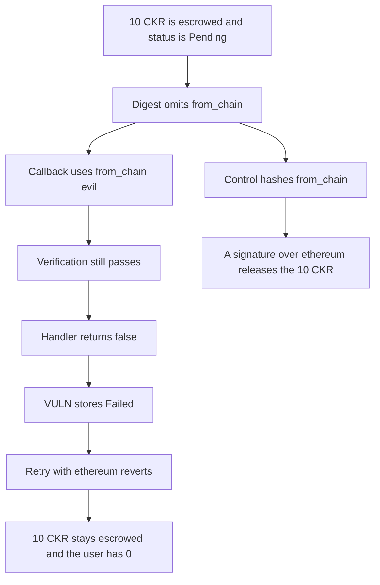

# Chakra: a callback digest without from_chain marks the escrow Failed and locks 10 CKR

> **Vulnerability classes:** `vuln/bridge/missing-validation` · `vuln/auth/signature-validation`

<!-- non-defihacklabs -->
<!-- source-auditvault: https://github.com/Auditware/AuditVault/blob/main/findings/49147-h-14-malicious-actors-can-manipulate-the-cross-chain-callbac.md -->
<!-- date: 2024-08 -->

## Key info

| Field | Value |
|---|---|
| **Loss** | 10 CKR stuck in the settlement |
| **Vulnerable contract** | `Settlement.receive_cross_chain_callback` |
| **Attacker EOA** | `0x1111111111111111111111111111111111111111` |
| **Attack contract** | `Exploit` |
| **Attack tx** | `Exploit.run()` |
| **Chain / block / date** | Ethereum model · block 0 · 2024-08 |
| **Compiler** | solc 0.8.27, cancun, via IR |
| **Bug class** | Validator digest omits `from_chain`, so a bad chain stores Failed |

## TL;DR

`verifySignature` hashes `txid`, `from_handler`, `to_handler`, and `status`. It does not hash `from_chain`. One commitment therefore verifies for every chain string. A callback with `from_chain` set to `evil` passes verification, the handler returns false, and the tx is stored as Failed. The retry with `ethereum` reverts. The 10 CKR escrow is not paid to the user. The control puts `from_chain` in the digest and a signature over `ethereum` releases the 10 CKR.

## Background

Code4rena's August 2024 Chakra contest, finding H-14 by MrPotatoMagic. `receive_cross_chain_callback` is permissionless. The handler's `is_valid_handler` accepts only the chain string `ethereum` with handler id 42. A false return from the handler writes `CrossChainMsgStatus.Failed`. The judge kept the issue at high because the final callback leg of every tx can be forced into that state. This model runs on one chain: the bug is the local callback, not a second execution environment.

## The vulnerable code

```solidity
bytes32 message_hash = keccak256(abi.encodePacked(txid, from_handler, to_handler, status));
require(signatureVerifier.verify(message_hash, signatures, sign_type), "Invalid signature");

if (is_valid_handler(from_chain, from_handler) == false) {
    return false;
}

if (Handler(to_handler).receive_cross_chain_callback(...)) {
    create_cross_txs[txid].status = status;
} else {
    // @> VULN: from_chain was not signed, so a forged chain stores Failed and the escrow cannot be retried
    create_cross_txs[txid].status = CrossChainMsgStatus.Failed;
}
```

viaIR folds the Failed store into the `if` at the handler call. The playground anchors that branch.

## Root cause

The commitment is identical for `evil` and `ethereum`. The handler still rejects the unknown chain, and the settlement treats that rejection as a permanent failure instead of leaving the tx Pending.

## Preconditions

- Tx 7 is Pending with 10 CKR escrowed for the user.
- The caller can submit the digest of `(txid, from_handler, to_handler, Success)`. Because `from_chain` is not in that digest, the evil chain verifies.
- `is_valid_handler` is true only for `ethereum`.

## Attack walkthrough

1. 10 CKR is escrowed for tx 7. Status is Pending.
2. The attacker builds the digest without a chain string.
3. `receive_cross_chain_callback` is called with `from_chain = "evil"` and that commitment.
4. Verification passes. The handler returns false.
5. The branch stores Failed.
6. The same commitment with `ethereum` reverts on `AlreadySettled`.
7. The settlement still holds 10 CKR. The user holds 0.

## Diagrams



## Impact

The user's 10 CKR is locked in the settlement. A correct chain string cannot complete the callback after the status is Failed. The control releases the 10 CKR to the user and leaves the settlement empty.

## Remediation

Include `from_chain` in the signed digest, and do not overwrite a Pending tx with Failed when the only failure is an unexpected chain string.

## How to reproduce

```bash
cd 49147-h-14-malicious-actors-can-manipulate-the-cross-chain-callbac_exp
forge test -vv
```

`test_exploit_forged_chain_locks_10_tokens` asserts Failed, a reverted retry, and 10 CKR still escrowed. `test_control_signing_from_chain_releases_the_escrow` signs the digest that includes `ethereum` and asserts the user receives 10 CKR. Captured output is `output.txt`.

## Sources

- AuditVault finding: https://github.com/Auditware/AuditVault/blob/main/findings/49147-h-14-malicious-actors-can-manipulate-the-cross-chain-callbac.md
- Code4rena report: https://code4rena.com/reports/2024-08-chakra
