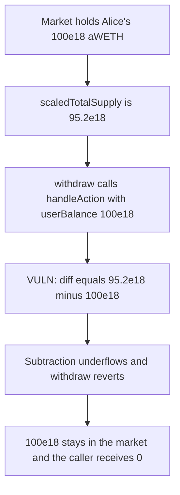

# Cod3x — handleAction underflows and sticks a minipool withdraw

> **Vulnerability classes:** vuln/arithmetic/underflow · vuln/logic/reward-calculation

<!-- non-defihacklabs -->
<!-- source-auditvault: https://github.com/Auditware/AuditVault/blob/main/findings/49175-rewardscontroller-uses-inconsistent-scaling-in-handleaction.md -->
<!-- date: 2024-12 -->

## Key info

| | |
|---|---|
| **Protocol** | Cod3x Lend |
| **Finding** | Spearbit, AuditVault 49175 |
| **Vulnerable code** | `RewardsController.handleAction` |
| **Harm** | Withdraw reverts. 100e18 of aWETH stays in the market. The caller receives 0. |
| **Chain** | local synthetic |

## TL;DR

When the user is an ERC6909 minipool, `handleAction` sets `totalSupplyAsset` from `scaledTotalSupply` and then computes `diff = totalSupplyAsset - userBalance`. `scaledTotalSupply` is 95.2e18, on the minipool index. `userBalance` is 100e18, on the main lending-pool index. 95.2e18 - 100e18 underflows, so the aToken withdraw reverts and the 100e18 deposit never leaves the market. The control reads `totalSupply`, which is 105e18 on the same scale as the balance. `diff` is 5e18, and the withdraw pays 100e18.

## The vulnerable code

```solidity
(uint256 assetID,) = IAERC6909(user).getIdForUnderlying(IAToken(msg.sender).WRAPPER_ADDRESS());
// @> VULN: scaledTotalSupply is minipool-scaled; userBalance is main-pool-scaled
uint256 totalSupplyAsset = IAERC6909(user).scaledTotalSupply(assetID);
uint256 diff = totalSupplyAsset - userBalance;
```

The fix is `IAERC6909(user).totalSupply(assetID)`, so both sides of the subtraction use the main-pool scale.

## Root cause

`scaledTotalSupply` is divided by the minipool liquidity index. The aToken balance and `totalSupply` passed into `handleAction` are not. Subtracting those quantities underflows whenever the minipool index is above 1, which is the report's 1.05 example. The revert is inside the transfer hook, so the withdraw cannot complete.

## Preconditions

The user is flagged as an ERC6909 minipool. The market holds 100e18 aWETH. `scaledTotalSupply` is 95.2e18. The consistent `totalSupply` is 105e18. `handleAction` is called with `userBalance` 100e18. No timestamp warp.

## Attack walkthrough

1. The minipool flag is set and the market is wired to the vulnerable controller.
2. 100e18 is minted onto the market. That is Alice's deposit from the report.
3. `scaledTotalSupply` is checked at 95.2e18.
4. `withdraw` calls `handleAction(minipool, 100e18, 100e18)`.
5. `totalSupplyAsset` is 95.2e18. `95.2e18 - 100e18` reverts.
6. The transfer of 100e18 does not run. The market still holds 100e18. The caller holds 0.

The control uses `totalSupply` of 105e18. `diff` is 5e18. `withdraw` transfers 100e18 and the market ends at 0.

## Diagrams



## Impact

Alice cannot withdraw. 100e18 aWETH remains in the market and the caller receives 0. The same withdraw with one scale pays 100e18 and leaves the market empty. The broken subtraction is short by 4.8e18 before it reverts, which is 100e18 - 95.2e18.

## Remediation

In the minipool branch, replace `scaledTotalSupply(assetID)` with `totalSupply(assetID)` so `diff` is computed in the same units as `userBalance`. That is the change verified in commit `92f8ffaf`.

## How to reproduce

```bash
cd 49175-rewardscontroller-uses-inconsistent-scaling-in-handleaction_exp
forge test -vv
```

## Sources

- AuditVault finding: https://github.com/Auditware/AuditVault/blob/main/findings/49175-rewardscontroller-uses-inconsistent-scaling-in-handleaction.md
- Spearbit report: https://github.com/spearbit/portfolio/blob/master/pdfs/Cod3x-Spearbit-Security-Review-December-2024.pdf
- Vulnerable function: `RewardsController.sol` `handleAction` around the `scaledTotalSupply` read, as quoted in the finding. Fixed in commit `92f8ffaf`.
