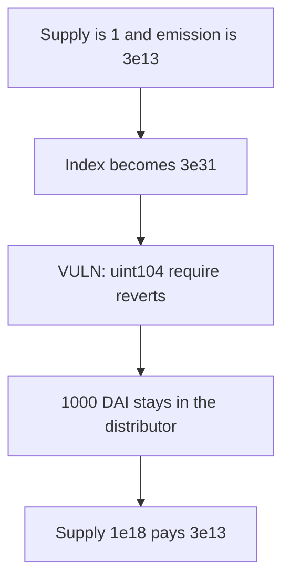

# Cod3x RewardsDistributor — dust supply overflows the uint104 index and locks the claim

> **Vulnerability classes:** vuln/arithmetic/overflow · vuln/dos/frozen-funds

<!-- non-defihacklabs -->
<!-- source-auditvault: https://github.com/Auditware/AuditVault/blob/main/findings/49176-index-can-reach-typeuint104max-when-asset-totalsupply-is-dus.md -->
<!-- date: 2024-12 -->

## Key info

| | |
|---|---|
| **Protocol** | Cod3x RewardsDistributor |
| **Finding** | Spearbit, Saw-mon and Natalie, AuditVault 49176 |
| **Vulnerable code** | index update `require(newIndex <= type(uint104).max)` |
| **Harm** | 1000 DAI stuck. The dust claim reverts. A 1e18 supply pays 3e13. |
| **Chain** | local synthetic |

## TL;DR

The reward index is `emissionPerSecond * timeDelta * 10**decimals / totalBalance`. With emission `3e13`, one second, 18 decimals, and `totalBalance == 1`, the index is `3e31`. `type(uint104).max` is about `2.028e31`, so the require reverts and the claim never transfers. 1000 DAI funded into that distributor stays there. The same emission against a `1e18` supply advances the index by `3e13` and pays `3e13` to the holder.

## The vulnerable code

```solidity
return (EMISSION * timeDelta * (10 ** DECIMALS)) / totalBalance + currentIndex;

if (newIndex != oldIndex) {
    // @> VULN: dust totalBalance makes newIndex exceed uint104, so this require reverts and the claim never pays
    require(newIndex <= type(uint104).max, "Index overflow");
    rewardConfigIndex = uint104(newIndex);
}
```

Distribution end is 1 and the last update is 0, so the elapsed time is one second on both Foundry's timestamp and the playground timestamp.

## Root cause

The index scales rewards by `10**decimals / totalBalance`. A dust supply, even for a single second, blows a `uint104` index. The overflow check is inside the claim path, so the revert locks the rewards instead of skipping the update.

## Preconditions

`totalBalance` is 1 while emission and decimals are the values above. The distributor already holds the reward tokens the claim would pay.

## Attack walkthrough

1. Preview index on supply 1 is `30000000000000000000000000000000`, above `uint104` max `20282409603651670423947251286015`.
2. 1000 DAI is transferred into the dust distributor.
3. `claim` calls `updateIndex`, the require reverts, and the 1000 DAI is still there.
4. The control distributor has supply `1e18`. Its claim pays `30000000000000`.

## Diagrams



## Impact

Reward claims and any later action that updates the index revert for as long as the dust supply is what the formula divides by. The 1000 DAI cannot be pulled out through `claim`. Depositors on a normal supply are unaffected: the control pays.

## Remediation

Skip the index update when normalized supply is below a threshold, or widen the index so this emission cannot hit the cap. Do not put a reverting overflow check on the claim path.

## How to reproduce

```bash
cd 49176-index-can-reach-typeuint104max-when-asset-totalsupply-is-dus_exp
forge test -vv
```

## Sources

- AuditVault finding: https://github.com/Auditware/AuditVault/blob/main/findings/49176-index-can-reach-typeuint104max-when-asset-totalsupply-is-dus.md
- Spearbit report: https://github.com/spearbit/portfolio/blob/master/pdfs/Cod3x-Spearbit-Security-Review-December-2024.pdf
- The finding says Cod3x fixed this in PR 34.
