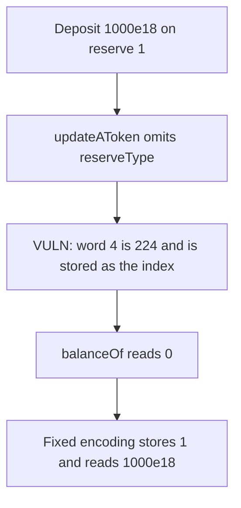

# Cod3x LendingPoolConfigurator — updateAToken stores the wrong reserve index

> **Vulnerability classes:** vuln/data/wrong-encoding · vuln/logic/state-update

<!-- non-defihacklabs -->
<!-- source-auditvault: https://github.com/Auditware/AuditVault/blob/main/findings/49177-in-updateatoken-and-updatevariabledebttoken-of-the-lendingpo.md -->
<!-- date: 2024-12 -->

## Key info

| | |
|---|---|
| **Protocol** | Cod3x LendingPoolConfigurator |
| **Finding** | Spearbit, Saw-mon and Natalie, AuditVault 49177 |
| **Vulnerable code** | `updateAToken` `abi.encodeWithSelector` |
| **Harm** | Reported balance is 0. The deposit on reserve 1 is 1000e18. Off by 1000e18. |
| **Chain** | local synthetic |

## TL;DR

`updateAToken` builds the aToken `initialize` payload without `reserveType` after `decimals`. The aToken reads word 4 of that payload as its reserve index. Word 4 is the ABI offset of the name string, 224, not reserve type 1. `balanceOf` then returns the balance at index 224, which is 0. The user deposited 1000e18 at reserve 1. The fixed encoder inserts `reserveType = 1`, and that token's `balanceOf` returns 1000e18.

## The vulnerable code

```solidity
bytes memory encodedCall = abi.encodeWithSelector(
    IInitializableAToken.initialize.selector,
    cachedPool,
    input.asset,
    input.incentivesController,
    input.decimals, // reserveType is missing after this word
    input.name,
    input.symbol,
    input.params
);

// @> VULN: word 4 is the next argument, not reserveType, because the encoder skipped it
assembly {
    w := calldataload(add(data.offset, add(4, mul(i, 32))))
}
```

`initialize` is supposed to take `reserveType` between `decimals` and `name`. The word the callee stores is 224.

## Root cause

`abi.encodeWithSelector` was not updated when `reserveType` was added to the initializer. Every argument after `decimals` shifts by one word. The aToken's reserve index becomes the name offset instead of the reserve the deposit was recorded on.

## Preconditions

The user has a balance on reserve type 1. An admin calls `updateAToken` with the short encoding. No other reserve is required for the misread: index 224 is simply empty.

## Attack walkthrough

1. Reserve 1 holds 1000e18 for the depositor. Reserve 224 holds 0.
2. `updateAToken` encodes pool, asset, incentives, decimals, name, symbol, params.
3. The aToken loads word 4 and stores 224.
4. `balanceOf` is 0. Fair balance is 1000e18. The difference is 1000e18.
5. The fixed encoding stores 1, and `balanceOf` returns 1000e18.

## Diagrams



## Impact

After the update, the aToken reports a balance that is off by the user's entire deposit, 1000e18. Later pool calls that key on the stored reserve type read or update the wrong reserve. The control token, given the missing word, still reports 1000e18.

## Remediation

Pass `reserveType` after `decimals` in both `updateAToken` and `updateVariableDebtToken`. Prefer `abi.encodeCall` so a missing argument does not compile.

## How to reproduce

```bash
cd 49177-in-updateatoken-and-updatevariabledebttoken-of-the-lendingpo_exp
forge test -vv
```

## Sources

- AuditVault finding: https://github.com/Auditware/AuditVault/blob/main/findings/49177-in-updateatoken-and-updatevariabledebttoken-of-the-lendingpo.md
- Spearbit report: https://github.com/spearbit/portfolio/blob/master/pdfs/Cod3x-Spearbit-Security-Review-December-2024.pdf
- The finding says the encoding was fixed in commit `8bc4648c`.
