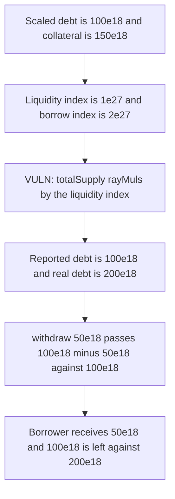

# Cod3x — debt totalSupply is scaled by the liquidity index

> **Vulnerability classes:** vuln/logic/price-calculation · vuln/arithmetic/decimal-mismatch

<!-- non-defihacklabs -->
<!-- source-auditvault: https://github.com/Auditware/AuditVault/blob/main/findings/49178-atokenerc6909totalsupply-for-debt-tokens-uses-the-liquidity.md -->
<!-- date: 2024-12 -->

## Key info

| | |
|---|---|
| **Protocol** | Cod3x Lend |
| **Finding** | Spearbit, AuditVault 49178 |
| **Vulnerable code** | `ATokenERC6909.totalSupply` |
| **Harm** | Reported debt is 100e18. Real debt is 200e18. Withdraw pays 50e18 and leaves 100e18 of collateral against 200e18 of debt. |
| **Chain** | local synthetic |

## TL;DR

`totalSupply` rayMuls every id by `getReserveNormalizedIncome`. A debt id has to use `getReserveNormalizedVariableDebt`. Scaled debt is 100e18. The liquidity index is 1e27, so the reported supply is 100e18. The variable borrow index is 2e27, so the real debt is 200e18. Withdraw checks `collateral - amount >= reported`. With 150e18 of collateral that check allows a 50e18 withdrawal. The position left behind has 100e18 of collateral against 200e18 of debt. The control uses the borrow index, reports 200e18, and the same withdrawal reverts.

## The vulnerable code

```solidity
uint256 currentSupplyScaled = super.totalSupply(id);
if (currentSupplyScaled == 0) {
    return 0;
}
// @> VULN: debt ids are scaled by the liquidity index, not the borrow index
return currentSupplyScaled.rayMul(POOL.getReserveNormalizedIncome(_underlyingAssetAddresses[id]));
```

The fix selects the index:

```solidity
uint256 index = isDebtToken(id)
    ? POOL.getReserveNormalizedVariableDebt(_underlyingAssetAddresses[id])
    : POOL.getReserveNormalizedIncome(_underlyingAssetAddresses[id]);
return currentSupplyScaled.rayMul(index);
```

## Root cause

The function assumes every id is an aToken. Debt tokens accrue with the variable borrow index, which is higher than the liquidity index here. Callers that trust `totalSupply` — a health check, a liquidation, or an interest-rate read — see a debt that is too small.

## Preconditions

Debt id 1 has scaled supply 100e18. `getReserveNormalizedIncome` returns 1e27. `getReserveNormalizedVariableDebt` returns 2e27. The market holds 150e18 of collateral. The withdraw amount is 50e18. No timestamp warp.

## Attack walkthrough

1. 150e18 of collateral is minted onto the market.
2. `totalSupply(1)` returns `100e18 * 1e27 / 1e27 = 100e18`.
3. `realDebt(1)` returns `100e18 * 2e27 / 1e27 = 200e18`.
4. `withdraw(50e18)` reads the reported 100e18. `150e18 - 50e18 >= 100e18` passes.
5. The market transfers 50e18 to the borrower. 100e18 of collateral remains.
6. 100e18 is less than the real debt of 200e18.

The control's `totalSupply` returns 200e18. `150e18 - 50e18 >= 200e18` fails. The withdrawal reverts, `paid` stays 0, and the market still holds 150e18.

## Diagrams



## Impact

The borrower receives 50e18 of collateral that the real debt does not support. The market is left with 100e18 against 200e18 of debt, short by 100e18. The same withdrawal on the borrow index pays 0 and leaves the 150e18 collateral in place. The reported supply is wrong by 100e18, which is 200e18 - 100e18.

## Remediation

If the id is a debt token, rayMul by `getReserveNormalizedVariableDebt`. Otherwise keep `getReserveNormalizedIncome`. That is the check added in commit `f8cd1275`.

## How to reproduce

```bash
cd 49178-atokenerc6909totalsupply-for-debt-tokens-uses-the-liquidity_exp
forge test -vv
```

## Sources

- AuditVault finding: https://github.com/Auditware/AuditVault/blob/main/findings/49178-atokenerc6909totalsupply-for-debt-tokens-uses-the-liquidity.md
- Spearbit report: https://github.com/spearbit/portfolio/blob/master/pdfs/Cod3x-Spearbit-Security-Review-December-2024.pdf
- Vulnerable function: `ATokenERC6909.sol` `totalSupply` around lines 615-625, as quoted in the finding. Fixed in commit `f8cd1275`.
