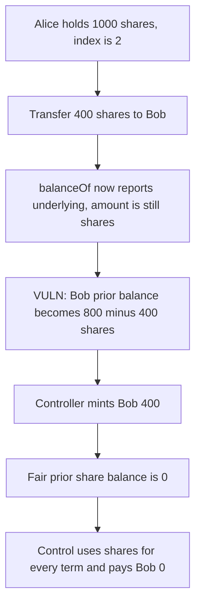

# Cod3x: `_afterTokenTransfer` adds shares to an underlying balance and pays Bob 400 for a prior balance of 0

> **Vulnerability classes:** vuln/arithmetic/decimal-mismatch · vuln/logic/reward-calculation

<!-- non-defihacklabs -->
<!-- source-auditvault: https://github.com/Auditware/AuditVault/blob/main/findings/49180-mix-of-scaled-and-non-scaled-parameters-in-aftertokentransf.md -->
<!-- date: 2024-12 -->

## Key info

| | |
|---|---|
| **Protocol** | Cod3x Lend |
| **Finding** | Spearbit, AuditVault 49180 |
| **Vulnerable code** | `AToken._afterTokenTransfer` |
| **Harm** | A 400-share transfer to an empty recipient reports a prior balance of 400 and mints 400 incentive. The fair prior share balance is 0, so the fair payment is 0. The one-scale control pays 0 |
| **Chain** | local synthetic |

## TL;DR

`_afterTokenTransfer` receives `amount` in shares from ERC6909. `balanceOf` and `totalSupply` return shares times the liquidity index. The transfer branch then does `oldFromBalance + amount` and `oldToBalance - amount` and passes those mixed numbers to `handleAction`. With index 2, Alice's 1000 shares are worth 2000. She sends 400 shares to Bob, who had none. Bob's balance after the transfer is 800 underlying. `800 - 400 shares` is 400, and the controller mints Bob 400. His real prior share balance is 0. The control hook reads shares for every term, reports 0, and mints Bob nothing.

## The vulnerable code

```solidity
uint256 oldSupply = totalSupply(id); // not scaled
uint256 oldFromBalance = balanceOf(from, id); // not scaled
uint256 oldToBalance = balanceOf(to, id); // not scaled
// @> VULN: amount is scaled shares and oldFromBalance is unscaled underlying
oldFromBalance = oldFromBalance + amount; // mix: (not scaled) + (scaled)
// @> VULN: unscaled recipient balance minus scaled shares
oldToBalance = oldToBalance - amount; // mix: (not scaled) - (scaled)
```

The fix reads `super.totalSupply` and `super.balanceOf`, which are the share balances the ERC6909 hook is denominated in.

## Root cause

The hook runs after the share balances have moved, and it tries to rebuild the pre-transfer balances by adding the amount back to the sender and subtracting it from the recipient. That only works when `amount` and `balanceOf` use the same unit. Here `amount` is shares and `balanceOf` is shares times the index. The incentives controller is paid in whatever number comes out.

## Preconditions

Index is 2. Alice holds 1000 shares, so `balanceOf` is 2000. Bob holds 0. The transfer moves 400 shares. The controller mints its reward token one-for-one with the reported prior balance. `run()` does not warp.

## Attack walkthrough

1. Seed Alice with 1000 shares.
2. Transfer 400 shares to Bob. Alice has 600 shares left (1200 underlying). Bob has 400 shares (800 underlying).
3. `oldFromBalance = 1200 + 400 = 1600`. Alice's real prior share balance is 1000.
4. `oldToBalance = 800 - 400 = 400`. Bob's real prior share balance is 0.
5. `handleAction` mints 400 INC to Bob.
6. The control token does the same transfer using share balances only. Bob's prior balance is `400 - 400 = 0`. He is paid nothing more. Alice's prior share balance is 1000.

## Diagrams



## Impact

Bob receives 400 INC. He had no shares before the transfer, so the same-scale hook pays 0. Alice is reported at 1600 instead of her 1000 prior shares, so her incentive base is wrong by 600 as well. A later index above 1 makes every transfer, mint, and burn hand the controller a mixed balance. An index below 1 makes `oldToBalance - amount` underflow and the transfer revert.

## How to reproduce

```bash
cd 49180-mix-of-scaled-and-non-scaled-parameters-in-aftertokentransf_exp
forge test -vv
```

`run()` does not warp. Bob is paid 400. The control pays him 0.

## Sources

- AuditVault finding: https://github.com/Auditware/AuditVault/blob/main/findings/49180-mix-of-scaled-and-non-scaled-parameters-in-aftertokentransf.md
- Spearbit Cod3x review (December 2024): https://github.com/spearbit/portfolio/blob/master/pdfs/Cod3x-Spearbit-Security-Review-December-2024.pdf
- The report locates the bug at `ATokenERC6909.sol` lines 396-432 and says Cod3x fixed it in commit `92f8ffaf`, verified by Spearbit.
