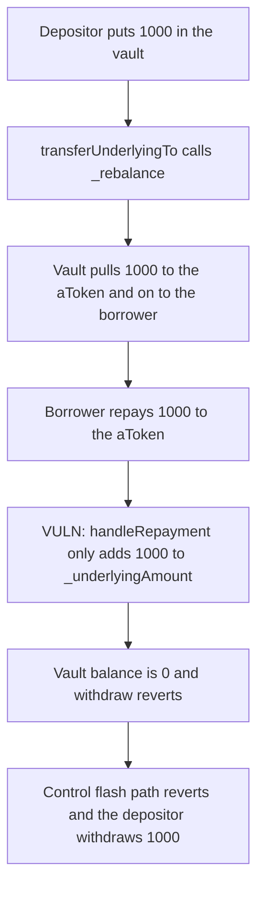

# Cod3x: a flash loan pulls 1000 out of the vault and `handleRepayment` never puts it back

> **Vulnerability classes:** vuln/dos/frozen-funds · vuln/logic/state-update

<!-- non-defihacklabs -->
<!-- source-auditvault: https://github.com/Auditware/AuditVault/blob/main/findings/49181-dosing-vault-rehypothecation-through-flashloans-spearbit-non.md -->
<!-- date: 2024-12 -->

## Key info

| | |
|---|---|
| **Protocol** | Cod3x Lend |
| **Finding** | Spearbit, AuditVault 49181 |
| **Vulnerable code** | `AToken.handleRepayment` |
| **Harm** | A flash loan pulls 1000 from the rehypothecation vault. Repayment leaves that 1000 on the aToken. The vault balance is 0, so the depositor's withdraw of 1000 reverts. The control aToken blocks the flash path and the depositor withdraws 1000 |
| **Chain** | local synthetic |

## TL;DR

`transferUnderlyingTo` calls `_rebalance(amount)`, which pulls the underlying out of the vault, then transfers it to the flash-loan borrower. `handleRepayment` only does `_underlyingAmount = _underlyingAmount + amount`. The repaid tokens sit on the aToken. The vault is empty, and the depositor still has a 1000 credit, so `withdraw` reverts with `vault empty`. The control `transferUnderlyingTo` reverts with `flash blocked` before any pull, and that depositor withdraws 1000.

## The vulnerable code

```solidity
function transferUnderlyingTo(address target, uint256 amount) external returns (uint256) {
    _rebalance(amount);
    _underlyingAmount = _underlyingAmount - amount;
    IERC20(_underlyingAsset).safeTransfer(target, amount);
    return amount;
}

function handleRepayment(address user, address onBehalfOf, uint256 amount) external {
    // @> VULN: repayment does not return the tokens to the vault, so the depositor cannot withdraw
    _underlyingAmount = _underlyingAmount + amount;
}
```

The report says `_rebalance` should not run on the ordinary repayment and liquidation paths, because a paused vault or a deposit cap would DoS those flows. It should run for the flash-loan return so the vault is refilled. This reduction blocks the flash path in the control instead, which is the same end state for the depositor: the vault is not drained.

## Root cause

The outbound flash-loan leg moves tokens from the vault to the borrower. The inbound leg updates an accounting variable and does not move tokens. After a repaid flash loan the aToken's token balance and `_underlyingAmount` agree, and the vault's token balance does not. Anyone whose credit still points at the vault cannot withdraw.

## Preconditions

The vault holds 1000 of the depositor's underlying and the aToken's `_underlyingAmount` is 1000. The borrower is the caller. The flash loan is 1000, repaid in the same call with a plain `transfer` into the aToken followed by `handleRepayment`. `run()` does not warp.

## Attack walkthrough

1. Deposit 1000 into the vault and book 1000 on the aToken.
2. `transferUnderlyingTo` pulls 1000 from the vault and sends it to the borrower. The vault balance is 0.
3. The borrower transfers 1000 back to the aToken and calls `handleRepayment`.
4. `_underlyingAmount` returns to 1000. The vault is still empty.
5. `withdraw(1000)` reverts at `vault empty`. The depositor receives 0. The aToken holds 1000.
6. On the control vault, `transferUnderlyingTo` reverts with `flash blocked`. The vault still holds 1000. `withdraw` pays the depositor 1000.

## Diagrams



## Impact

The depositor cannot withdraw 1000. Those tokens sit on the aToken after a fully repaid flash loan. The next rehypothecation that expects the vault to hold the deposit also fails. The control path never pulls, and the depositor receives 1000.

## How to reproduce

```bash
cd 49181-dosing-vault-rehypothecation-through-flashloans-spearbit-non_exp
forge test -vv
```

`run()` does not warp. The vulnerable vault ends at 0. The control depositor is paid 1000.

## Sources

- AuditVault finding: https://github.com/Auditware/AuditVault/blob/main/findings/49181-dosing-vault-rehypothecation-through-flashloans-spearbit-non.md
- Spearbit Cod3x review (December 2024): https://github.com/spearbit/portfolio/blob/master/pdfs/Cod3x-Spearbit-Security-Review-December-2024.pdf
- The report locates the bug at `AToken.sol` line 388 and says Cod3x fixed it in commit `4605e906`, verified by Spearbit.
