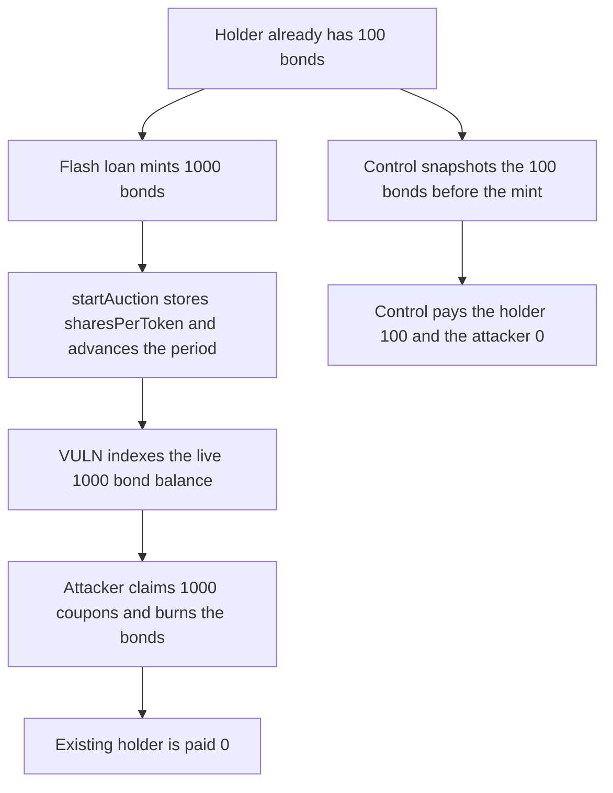

# Plaza: a flash-minted bond balance takes all 1000 coupons

> **Vulnerability classes:** `vuln/governance/flash-loan-attack` · `vuln/logic/reward-calculation`

<!-- non-defihacklabs -->
<!-- source-auditvault: https://github.com/Auditware/AuditVault/blob/main/findings/49235-h-6-malicious-user-can-leverage-flash-loans-to-claim-all-cou.md -->
<!-- date: 2024-12 -->

## Key info

| Field | Value |
|---|---|
| **Loss** | 1000 coupons claimed by a flash mint. The existing 100-bond holder is paid 0 |
| **Vulnerable contract** | `BondToken.getIndexedUserAmount` |
| **Attacker EOA** | `0x1111111111111111111111111111111111111111` |
| **Attack contract** | `Exploit` |
| **Attack tx** | `Exploit.run()` |
| **Chain / block / date** | Ethereum model · block 0 · 2024-12 |
| **Compiler** | solc 0.8.27, cancun, via IR |
| **Bug class** | `startAuction` indexes the live bond balance, so a same-transaction mint is paid |

## TL;DR

Anyone can call `startAuction` once `distributionPeriod` has passed. This pool uses a period of 0, so the check passes in the deployment block. `getIndexedUserAmount` adds `balance * sharesPerToken` for each period since the user was last updated, and `balance` is the live balance. A flash loan mints 1000 bonds, `startAuction` records 1e18 shares per bond, and the attacker claims all 1000 coupons, then burns the bonds. The holder who already had 100 bonds is paid 0 because the distributor is empty. A snapshot taken before the mint pays that holder 100 and the attacker 0.

## Background

Sherlock's December 2024 Plaza Finance contest, issue 725, H-6. `Pool.startAuction` calls `BondToken.increaseIndexedAssetPeriod`. `Distributor.claim` pays one coupon per indexed share. The report's attack is one transaction: flash-mint bonds, start the auction, distribute, claim, burn, repay.

## The vulnerable code

```solidity
for (uint256 i = userPool.lastUpdatedPeriod; i < period; i++) {
    // @> VULN: the live bond balance is indexed for the period, so a same-transaction flash mint is paid
    shares += (balance * sharesPerTokenAt[i]) / (10 ** SHARES_DECIMALS);
}
```

`startAuction` stores `sharesPerToken` for the current period and increments the period. The claim then walks that period with whatever `balanceOf` is at claim time. The flash-minted 1000 bonds are still held, so the shares equal the full 1000 coupon distribution.

## Root cause

The index uses the balance at claim time, not a balance snapshotted before the auction. `startAuction` is permissionless, so the mint and the period change fit in one transaction. `distributionPeriod` of 0 makes the timestamp check true without warping the clock.

## Preconditions

- An existing holder has 100 bonds. The distributor will receive 1000 coupons.
- `sharesPerToken` is 1e18, so one bond earns one coupon share.
- `lastDistribution` is 0 and `distributionPeriod` is 0. `block.timestamp` is 1, and `auctionPeriod` still covers this block.

## Attack walkthrough

1. The flash lender mints 1000 bonds to the attacker.
2. `startAuction` passes both time checks and stores the share index.
3. `distribute` moves 1000 coupons into the distributor.
4. The indexed share math credits the 1000-bond live balance.
5. The attacker is paid 1000 coupons, then burns the bonds to repay the flash loan.
6. The original holder's claim pays 0. Their 100 bonds are still in the wallet.
7. The control snapshots balances before the mint. The holder receives 100 coupons and the attacker receives 0.

## Diagrams



## Impact

The existing holder receives none of the 1000 coupons. The attacker keeps the coupons after the flash loan is repaid. Every later distribution can be taken the same way by minting just before `startAuction`.

## Remediation

Snapshot bond balances before the period is closed, and pay from that snapshot. Do not let an arbitrary caller turn the period in the same transaction that minted the balance being indexed.

## How to reproduce

```bash
cd 49235-h-6-malicious-user-can-leverage-flash-loans-to-claim-all-cou_exp
forge test -vv
```

`test_exploit_flash_mint_takes_every_coupon` asserts the attacker holds 1000 coupons, the holder is paid 0, and the bond flash loan is repaid. `test_control_snapshot_pays_the_existing_holder` asserts the holder receives 100 and the post-snapshot mint receives 0. Captured output is `output.txt`.

## Sources

- AuditVault finding: https://github.com/Auditware/AuditVault/blob/main/findings/49235-h-6-malicious-user-can-leverage-flash-loans-to-claim-all-cou.md
- Sherlock issue 725: https://github.com/sherlock-audit/2024-12-plaza-finance-judging/issues/725
