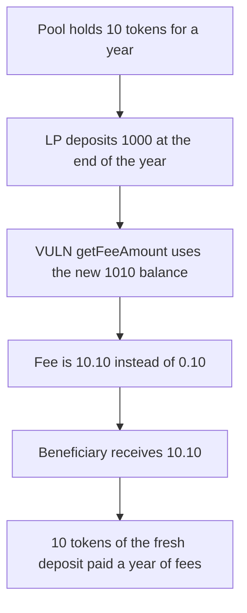

# Plaza: a year of fees is charged on the balance after the deposit

> **Vulnerability classes:** `vuln/logic/fee-calculation` · `vuln/logic/state-update`

<!-- non-defihacklabs -->
<!-- source-auditvault: https://github.com/Auditware/AuditVault/blob/main/findings/49237-h-8-fee-is-charged-current-reservetoken-pool-balance-to-time.md -->
<!-- date: 2024-12 -->

## Key info

| Field | Value |
|---|---|
| **Loss** | Beneficiary takes 10.10 tokens. The fair fee on a 10 token year is 0.10. The extra 10 comes from a deposit made at the end |
| **Vulnerable contract** | `Pool.getFeeAmount` |
| **Attacker EOA** | `0x1111111111111111111111111111111111111111` |
| **Attack contract** | `Exploit` |
| **Attack tx** | `Exploit.run()` |
| **Chain / block / date** | Ethereum model · block 0 · 2024-12 |
| **Compiler** | solc 0.8.27, cancun, via IR |
| **Bug class** | Fee uses the current balance for the whole elapsed time |

## TL;DR

`getFeeAmount` is `balance * fee * timeSinceLastClaim / (PRECISION * SECONDS_PER_YEAR)`. `fee` is 1e16, one percent, and `PRECISION` is 1e18. The pool holds 10 tokens for a year. An LP then deposits 1000 and the beneficiary calls `claimFees` without an accrual on the old balance. The fee is 1 percent of 1010, which is 10.10, instead of 1 percent of 10, which is 0.10. Claiming first, then depositing, charges 0.10 and leaves the new deposit with a zero fee.

## Background

Sherlock's December 2024 Plaza Finance contest, issue 842. `Pool.claimFees` and `getFeeAmount` charge from `lastFeeClaimTime` to now against `reserveToken.balanceOf` at the moment of the claim. `create` and `redeem` change that balance without claiming. The team fixed it in Convexity-Research/plaza-evm pull 164 by accruing inside those flows.

## The vulnerable code

```solidity
function getFeeAmount() public view returns (uint256) {
    return (reserveToken.balanceOf(address(this)) * fee * (block.timestamp - lastFeeClaimTime)) / (PRECISION * SECONDS_PER_YEAR); // @> VULN
}
```

The fix is to call `claimFees` at the start of `create` and `redeem`, while the balance is still the pre-change amount, and to reset `lastFeeClaimTime`.

## Root cause

The fee integral uses one balance sample for the whole interval. Any token that arrives at the end of the interval is priced as if it had been there from the start.

## Preconditions

- `lastFeeClaimTime` is 365 days before this block. `fee` is 1 percent.
- The pool holds 10 reserve tokens across that year.
- An LP deposits 1000, and the beneficiary claims before anyone accrues on the old balance.

## Attack walkthrough

1. `arm` sets `lastFeeClaimTime` to this block minus 365 days. The 10 token balance is already on the pool.
2. The LP's `create` pulls 1000 tokens. No fee is checkpointed.
3. `claimFees` reads a balance of 1010 and a full year. The fee is 10.10 tokens.
4. Those 10.10 tokens are transferred to the beneficiary.
5. The control claims while the balance is still 10, collects 0.10, then accepts the deposit. A second `getFeeAmount` is 0 because no time has passed.

## Diagrams



## Impact

The beneficiary extracts 10.10 reserve tokens. 10 of that is the overcharge on capital that was not in the pool during the year, taken from the LP who just deposited 1000. The control collects only the 0.10 that the 10 token balance actually owes.

## How to reproduce

```bash
cd 49237-h-8-fee-is-charged-current-reservetoken-pool-balance-to-time_exp
forge test -vv
```

`test_exploit_overcharges_fresh_deposit` asserts a 10.10 token fee. `test_control_claim_before_deposit_charges_0_10` asserts the 0.10 accrual and a zero fee after the deposit. Output is `output.txt`.

## Sources

- AuditVault finding: https://github.com/Auditware/AuditVault/blob/main/findings/49237-h-8-fee-is-charged-current-reservetoken-pool-balance-to-time.md
- Sherlock issue 842: https://github.com/sherlock-audit/2024-12-plaza-finance-judging/issues/842
- Pool.sol: https://github.com/sherlock-audit/2024-12-plaza-finance/blob/14a962c52a8f4731bbe4655a2f6d0d85e144c7c2/plaza-evm/src/Pool.sol
- Fix: https://github.com/Convexity-Research/plaza-evm/pull/164
