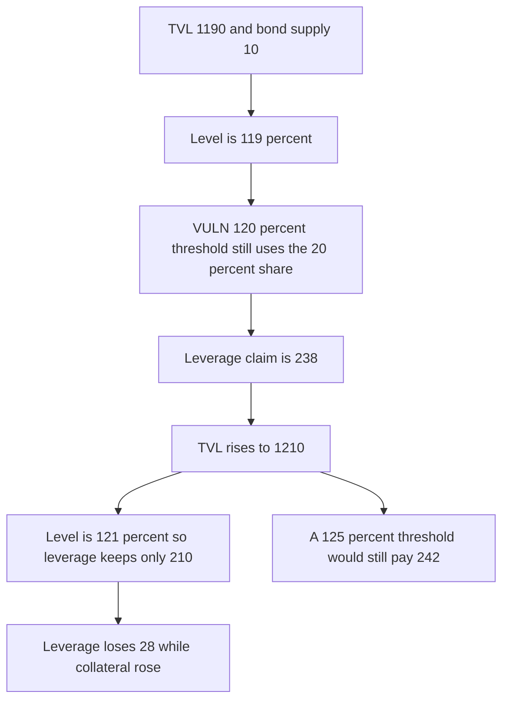

# Plaza Finance: a 120 percent collateral threshold jumps the leverage claim from 238 to 210

> **Vulnerability classes:** `vuln/logic/price-calculation` · `vuln/logic/wrong-condition`

<!-- non-defihacklabs -->
<!-- source-auditvault: https://github.com/Auditware/AuditVault/blob/main/findings/49238-h-9-collateral-threshold-should-be-set-to-125-instead-of-120.md -->
<!-- date: 2024-12 -->

## Key info

| Field | Value |
|---|---|
| **Loss** | Leverage claim falls from 238 to 210 while TVL rises from 1190 to 1210 |
| **Vulnerable contract** | `Pool.getRedeemAmount` |
| **Attacker EOA** | `0x1111111111111111111111111111111111111111` |
| **Attack contract** | `Exploit` |
| **Attack tx** | `Exploit.run()` |
| **Chain / block / date** | Ethereum model · block 0 · 2024-12 |
| **Compiler** | solc 0.8.27, cancun, via IR |
| **Bug class** | Discontinuous redeem curve at the 120 percent threshold |

## TL;DR

`COLLATERAL_THRESHOLD` is 1_200_000, which is 120 percent at the contract's 1e6 precision. Below it, leverage is 20 percent of TVL. Above it, leverage keeps only `tvl - bondSupply * 100`. The report's pool has bond supply 10. TVL 1190 pays leverage 238. TVL 1210 pays 210. Leverage holders lose 28 while the collateral rises. A 125 percent threshold still uses the 20 percent branch at 1210 and pays 242.

## Background

Sherlock's December 2024 Plaza Finance contest, issue 895, reported by KupiaSec, makeWeb3safe, werulez99, and zraxx. `Pool.getRedeemAmount` in `plaza-evm/src/Pool.sol` switches formulas at `COLLATERAL_THRESHOLD`. The constants are `POINT_TWO = 200000`, `PRECISION = 1000000`, and `BOND_TARGET_PRICE = 100`.

## The vulnerable code

```solidity
if (collateralLevel <= COLLATERAL_THRESHOLD) { // @> VULN: 120% cliff, not the continuous 125%
    redeemRate = ((tvl * multiplier) / assetSupply);
} else if (tokenType == TokenType.LEVERAGE) {
    redeemRate = ((tvl - (bondSupply * BOND_TARGET_PRICE)) / assetSupply) * PRECISION;
} else {
    redeemRate = BOND_TARGET_PRICE * PRECISION;
}
```

The inputs are the report's: bond supply 10, leverage supply 10, deposit 10, ETH price 1, oracle decimals 0, market rate 0. `toBaseUnit` and `fromBaseUnit` divide and multiply by `10 ** decimals`, which is 1 when decimals are 0.

## Root cause

Eighty percent of 120 is 96, not 100. Crossing 120 percent therefore jumps the bond claim from at most 96 percent of a 120 TVL up to `bondSupply * 100`. The extra bond claim is taken from leverage. Continuity needs the switch at 125 percent, because 80 percent of 125 is 100.

## Preconditions

- Bond supply is 10 and leverage supply is 10.
- TVL moves from 1190 to 1210, so the collateral level moves from 119 percent to 121 percent.
- `marketRate` is 0, so it does not clip the redeem rate.

## Attack walkthrough

1. Quote a full leverage redemption at reserves 1190. The level is 1_190_000, the proportional branch runs, and the payout is 238.
2. Raise reserves to 1210. The level is 1_210_000.
3. The comparison fails and the leverage residual branch runs. The payout is 210.
4. The loss is 28. The same 1210 reserves under a 1_250_000 threshold return 242.

## Diagrams



## Impact

Leverage holders who could redeem 238 before the price increase can redeem only 210 after it. The 20 of new collateral does not reach them. It is absorbed, together with 28 of their previous claim, by the bond tranche's jump to the target price of 100. The 125 percent control pays 242, which is 20 percent of 1210.

## Remediation

Set `COLLATERAL_THRESHOLD` to 1_250_000 so the proportional branch stays active until the bond share of TVL actually meets the target price of 100.

## How to reproduce

```bash
cd 49238-h-9-collateral-threshold-should-be-set-to-125-instead-of-120_exp
forge test -vv
```

`test_leverage_loses_28_when_tvl_crosses_120` asserts 238, 210, a loss of 28, and a fair quote of 242. Captured output is `output.txt`.

## Sources

- AuditVault finding: https://github.com/Auditware/AuditVault/blob/main/findings/49238-h-9-collateral-threshold-should-be-set-to-125-instead-of-120.md
- Sherlock issue 895: https://github.com/sherlock-audit/2024-12-plaza-finance-judging/issues/895
- Audited function: https://github.com/sherlock-audit/2024-12-plaza-finance/blob/main/plaza-evm/src/Pool.sol
