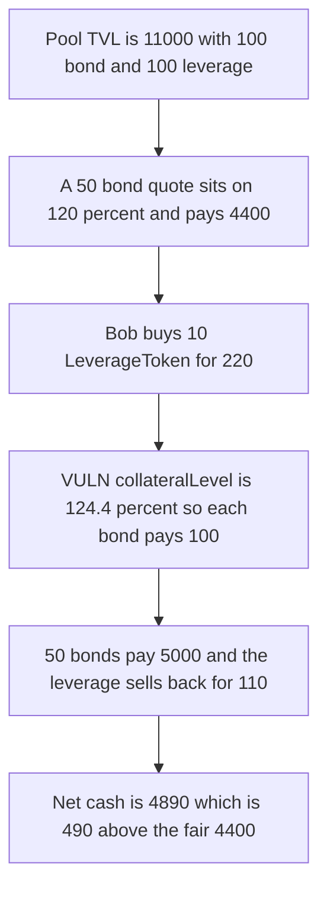

# Plaza Finance: a leverage buy lifts BondToken over the 120% price

> **Vulnerability classes:** `vuln/logic/price-calculation` · `vuln/logic/wrong-condition`

<!-- non-defihacklabs -->
<!-- source-auditvault: https://github.com/Auditware/AuditVault/blob/main/findings/49239-h-10-users-can-sell-bondtoken-at-a-higher-price-by-manipulat.md -->
<!-- date: 2024-12 -->

## Key info

| Field | Value |
|---|---|
| **Loss** | 490 underlying taken from the pool above the fair 4400 redemption |
| **Vulnerable contract** | `Pool.getRedeemAmount` |
| **Attacker EOA** | `0x1111111111111111111111111111111111111111` (the bond holder) |
| **Attack contract** | `Exploit` |
| **Attack tx** | `Exploit.run()` |
| **Chain / block / date** | Ethereum model · block 0 · 2024-12 |
| **Compiler** | solc 0.8.27, cancun, via IR |
| **Bug class** | Collateral threshold uses a same-transaction TVL that a leverage purchase can push over 120% |

## TL;DR

`getRedeemAmount` pays BondToken 80% of TVL per token while `collateralLevel` is at or under 120%, and the full target price of 100 once it is over. On the report's pool (100 bond, 100 leverage, TVL 11000) a 50-bond redeem sits exactly on 120% and pays 4400. Buying 10 LeverageToken for 220 moves the level to 124.4%. The same 50 bonds then pay 5000, and selling the leverage back returns 110. Net cash is 4890, which is 490 more than the fair redemption. The other depositors fund that 490.

## Background

Sherlock's December 2024 Plaza Finance contest, issue 896 (H-10), reported by 056Security and others. Bond and leverage tokens share one TVL. The bond price is the discounted 80% share only while collateral is at or below 120% of the bond target. Above that line the bond price is hard-coded to the target price of 100. The protocol fixed the pricing in Convexity-Research/plaza-evm pull 155.

## The vulnerable code

```solidity
if (collateralLevel <= COLLATERAL_THRESHOLD) {
    redeemRate = (tvl * multiplier) / assetSupply;
} else if (tokenType == 1) {
    redeemRate = ((tvl - (bondSupply * BOND_TARGET_PRICE)) / assetSupply) * PRECISION;
} else {
    // @> VULN: collateralLevel above 120% pays BondToken the full target price of 100
    redeemRate = BOND_TARGET_PRICE * PRECISION;
}
```

`collateralLevel` for a bond redeem is `(tvl - depositAmount * 100) * 1e18 / ((bondSupply - depositAmount) * 100)`. It is computed from the TVL after the attacker's own leverage purchase, not from a snapshot taken before it.

The recommended direction from the contest is to change the price mechanism so a same-position leverage buy cannot select the target-price branch. Snapshotting `collateralLevel` before the buy keeps the 80% price:

```diff
- redeemRate = BOND_TARGET_PRICE * PRECISION;
+ redeemRate = (tvlBeforeBuy * POINT_EIGHT) / bondSupply;
```

## Root cause

The branch at the 120% line is a price, not a solvency check, and the input to the branch is the caller's own TVL. A holder who already has bonds can buy a little leverage, cross the line, redeem the bonds at 100, and sell the leverage back. The leverage sale is priced on the post-redemption pool, so most of the 220 comes back.

## Preconditions

- The pool matches issue 896: `levSupply` 100, `bondSupply` 100, TVL 11000.
- The attacker already holds 50 BondToken and 220 underlying.
- `BOND_TARGET_PRICE` is 100 and `COLLATERAL_THRESHOLD` is 120% (`1.2e18`).

## Attack walkthrough

1. Quote 50 BondToken. `collateralLevel` is exactly 120%. The price is `(11000 * 0.8) / 100 = 88`. The fair payout is 4400.
2. Buy 10 LeverageToken. The sub-threshold leverage price is 22, so the cost is 220. TVL is 11220 and `levSupply` is 110.
3. Redeem 50 BondToken. `collateralLevel` is `(11220 - 5000) / (50 * 100) = 124.4%`. The else branch pays 100 each, so 5000 underlying.
4. Sell the 10 LeverageToken. The above-threshold leverage price is `(6220 - 5000) / 110 = 11`. The sale returns 110.
5. Net cash is `-220 + 5000 + 110 = 4890`. The excess over 4400 is 490.
6. The control redeems the 50 bonds without the leverage buy and receives 4400.

## Diagrams



## Impact

The bond redeemer receives 4890 underlying. The fair redemption of the same 50 bonds is 4400, so the pool pays an extra 490 to that holder. That 490 is collateral that belonged to the remaining bond and leverage positions. The control, which does not buy leverage first, pays exactly 4400 and leaves the 80/20 split intact.

## Remediation

Do not let a same-sequence leverage purchase select the target-price branch. Price the bond redemption off the collateral level from before that purchase, which is the change tracked in plaza-evm pull 155.

## How to reproduce

```bash
cd 49239-h-10-users-can-sell-bondtoken-at-a-higher-price-by-manipulat_exp
forge test -vv
```

`test_exploit_bond_redeemer_extracts_490_extra` asserts the 4400 fair quote, the 5000 manipulated payout, the 110 leverage unwind, and the 490 excess. `test_control_without_leverage_buy_pays_4400` asserts the untouched path pays 4400. Captured output is `output.txt`.

## Sources

- AuditVault finding: https://github.com/Auditware/AuditVault/blob/main/findings/49239-h-10-users-can-sell-bondtoken-at-a-higher-price-by-manipulat.md
- Sherlock issue 896: https://github.com/sherlock-audit/2024-12-plaza-finance-judging/issues/896
- Blamed lines: https://github.com/sherlock-audit/2024-12-plaza-finance/tree/main/plaza-evm/src/Pool.sol#L511-L518
- Fix: https://github.com/Convexity-Research/plaza-evm/pull/155
