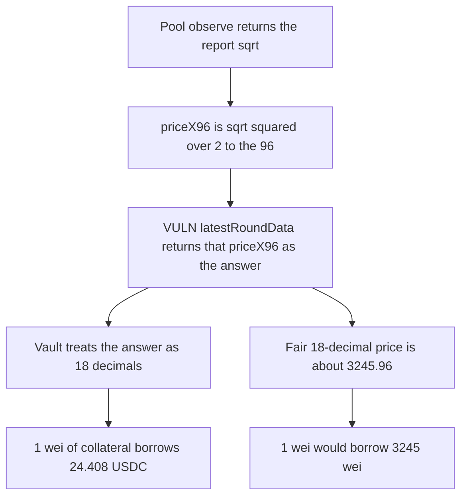

# Plaza Finance: BondOracleAdapter returns a Q64.96 price as a Chainlink answer

> **Vulnerability classes:** `vuln/oracle/wrong-feed` · `vuln/arithmetic/decimal-mismatch`

<!-- non-defihacklabs -->
<!-- source-auditvault: https://github.com/Auditware/AuditVault/blob/main/findings/49240-h-11-incorrect-price-representation-sherlock-plaza-finance-g.md -->
<!-- date: 2024-12 -->

## Key info

| Field | Value |
|---|---|
| **Loss** | 1 wei of collateral borrows 24.408 USDC. The 18-decimal price of the same observation is about 3245.96 |
| **Vulnerable contract** | `BondOracleAdapter.latestRoundData` |
| **Attacker EOA** | `0x1111111111111111111111111111111111111111` |
| **Attack contract** | `Exploit` |
| **Attack tx** | `Exploit.run()` |
| **Chain / block / date** | Ethereum model · block 0 · 2024-12 |
| **Compiler** | solc 0.8.27, cancun, via IR |
| **Bug class** | `latestRoundData` returns `sqrtPrice^2 / 2^96` with no decimal conversion |

## TL;DR

Sherlock issue 1016 feeds a USDC/WETH sqrt of `1390618563380010078436460929963734` through `getPriceX96FromSqrtPriceX96` and gets `24408239790603697707980053009065971527`. That is the number `latestRoundData` returns. Scaled to 18 decimals the same observation is `3245959692053023671448`, about 3245.96 USDC per WETH. A vault that treats the answer as an 18-decimal Chainlink price lends `answer / 1e18` against 1 wei of collateral and pays out 24.408 USDC. At the fair price, 1 wei is worth 3245 wei.

## The vulnerable code

```solidity
return (uint80(0), int256(getPriceX96FromSqrtPriceX96(getSqrtTwapX96)), block.timestamp, block.timestamp, uint80(0)); // @> VULN
```

The report's conversion, for a 6-decimal token0 and an 18-decimal token1, is:

```solidity
return (10 ** 30) * Q96 / priceX96;
```

## Root cause

`getPriceX96FromSqrtPriceX96` divides the square of the sqrt price by `2^96`. That quotient is still a Q64.96 price. `latestRoundData` puts it in the Chainlink `answer` slot, whose consumers divide by `10^decimals`. Nothing in the adapter applies the token decimals or the `2^96` scale a second time.

## Preconditions

- The pool's `observe` returns the tick window from the report: cumulative delta `12000000` over a 60 second `twapInterval`, tick 200000.
- That tick's sqrt is the report's `sqrtPriceX96`. The product fits in a uint256, so `FullMath.mulDiv` and a plain multiply match.
- The vault prices collateral as `answer * amount / 1e18` and holds exactly that many quote tokens.

## Attack walkthrough

1. `latestRoundData` reads the pool and returns the raw priceX96. The exploit checks it against `24408239790603697707980053009065971527` and checks the 18-decimal conversion against `3245959692053023671448`.
2. The vault is funded with `priceX96 / 1e18`, which is `24408239790603697707` wei, about 24.408 tokens.
3. `borrow(1)` multiplies the oracle answer by 1 wei and divides by 1e18.
4. The vault transfers that whole amount. Its balance is 0. The borrower holds 24.408 USDC against 1 wei of collateral.

## Diagrams



## Impact

Every consumer that assumes an 18-decimal Chainlink answer mis-values the asset by many orders of magnitude. In this vault, 1 wei of collateral extracts 24.408 USDC, the entire funded balance. The fair value of that wei at the report's own converted price is 3245 wei. The same wrong answer feeds every other calculation the adapter is wired into.

## How to reproduce

```bash
cd 49240-h-11-incorrect-price-representation-sherlock-plaza-finance-g_exp
forge test -vv
```

`test_priceX96_is_lent_as_an_18_decimal_price` asserts the raw answer, the fair 18-decimal price, and a borrower balance of `24408239790603697707`.

## Sources

- AuditVault finding: https://github.com/Auditware/AuditVault/blob/main/findings/49240-h-11-incorrect-price-representation-sherlock-plaza-finance-g.md
- Sherlock judging issue 1016: https://github.com/sherlock-audit/2024-12-plaza-finance-judging/issues/1016
- Adapter: https://github.com/sherlock-audit/2024-12-plaza-finance/blob/14a962c52a8f4731bbe4655a2f6d0d85e144c7c2/plaza-evm/src/BondOracleAdapter.sol#L99
- Fix: https://github.com/Convexity-Research/plaza-evm/pull/158
