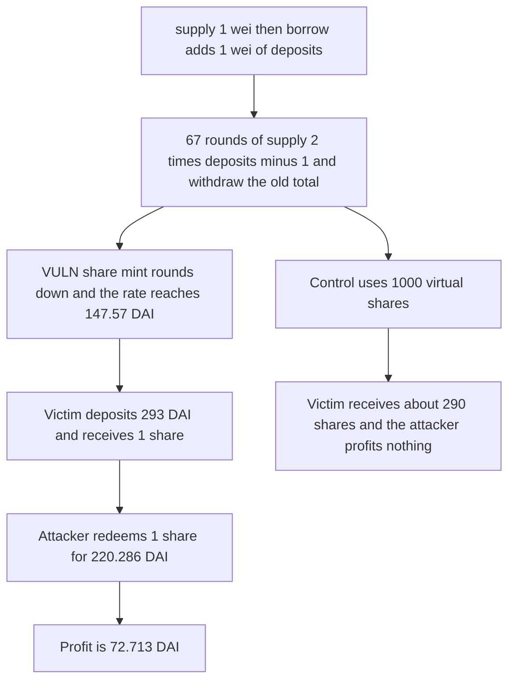

# Liquorice: 67 inflation rounds make a 293 DAI deposit mint 1 share, and the attacker keeps 72.713 DAI

> **Vulnerability classes:** vuln/arithmetic/rounding · vuln/logic/missing-check

<!-- non-defihacklabs -->
<!-- source-auditvault: https://github.com/Auditware/AuditVault/blob/main/findings/49433-inflation-attack-mixbytes-none-liquorice-markdown.md -->
<!-- date: 2025-02 -->

## Key info

| Field | Value |
|---|---|
| **Loss** | 72.713 DAI taken from a 293 DAI deposit, about 25 percent. The victim receives 1 wei of shares |
| **Vulnerable contract** | `LendingPool.supply` |
| **Attacker EOA** | `0x1111111111111111111111111111111111111111` |
| **Attack contract** | `Exploit` |
| **Attack tx** | `Exploit.run()` |
| **Chain / block / date** | Ethereum model · block 0 · 2025-02 |
| **Compiler** | solc 0.8.27, cancun, via IR |
| **Bug class** | Share mint is `amount * totalSupply / totalDeposits` with no virtual offset |

## TL;DR

`borrow()` increases `totalDeposits` without minting shares, so 1 share backs 2 wei. `supply` then mints `amount * totalSupply / totalDeposits`. Each round deposits `2 * totalDeposits - 1` and withdraws the previous total, which is the sequence in the MixBytes report. After 67 rounds the rate is `147573952589676412929`, about 147.57 DAI per share. The victim's 293 DAI deposit rounds down to 1 share. The attacker withdraws half the pool and profits `72713023705161793535` wei, 72.713 DAI. A pool with the report's 1000 wei virtual shares gives the victim about 290 shares and the attacker no profit.

## Background

MixBytes' Liquorice audit, timeline 22 October 2024 through 21 February 2025. Finding 3, "Inflation attack", shows `borrow()` nudging `totalDeposits` while `totalSupply` stays put, then an exponential deposit/withdraw loop. Step 67 in the report reaches an exchange rate of about 147 ether per share. The victim deposits 293 ether and the attacker profits about 25 percent. The recommended mitigation is virtual shares, with 1000 wei named in the report.

## The vulnerable code

```solidity
} else if (virtualShares == 0) {
    // @> VULN: shares round down against totalDeposits / totalSupply with no virtual offset
    shares = amount * totalSupply / totalDeposits;
}
```

`borrow` is the seed:

```solidity
function borrow(uint256 amount) external {
    require(dai.transferFrom(msg.sender, address(this), amount), "pull");
    totalDeposits += amount;
}
```

## Root cause

The share price is `totalDeposits / totalSupply` with a floor on the way in. One extra wei of deposits against one share starts a doubling recurrence. A later depositor whose amount is below two rates receives one share for almost two shares of assets, and the attacker redeems half.

## Preconditions

- The attacker can `supply` and `borrow` against DAI. This run starts from an empty pool.
- The victim holds 293 DAI and deposits after the 67 rounds.
- No virtual shares are configured. The control uses 1000.

## Attack walkthrough

1. `supply(1)` mints 1 share. `borrow(1)` makes `totalDeposits` 2 and leaves `totalSupply` at 1.
2. Sixty-seven times, `supply(2 * totalDeposits - 1)` then `withdraw(old totalDeposits)`. The attacker ends holding 1 share backed by `147573952589676412929` wei.
3. The victim deposits 293 DAI. `293e18 / rate` floors to 1 share.
4. `withdrawAll` pays the attacker's share: half of `rate + 293 DAI`, which is `220286976294838206464` wei.
5. Profit versus the attacker's starting 300 DAI is `72713023705161793535` wei. The victim's DAI balance is 0.
6. The control runs the same 67 rounds with 1000 virtual shares. The victim receives more than 290 shares and the attacker's ending DAI is below the start.

## Diagrams



## Impact

The victim pays 293 DAI and receives 1 wei of shares. The attacker, who left about 147.57 DAI in the pool, withdraws 220.286 DAI. The difference, 72.713 DAI, is about 24.8 percent of the victim's deposit, matching the report's "approximately 25%". The virtual-share control does not profit.

## Remediation

Mint and burn shares against `totalSupply + VIRTUAL` and `totalDeposits + VIRTUAL`. The report's suggested virtual amount is 1000 wei. This run's control uses that offset.

## How to reproduce

```bash
cd 49433-inflation-attack-mixbytes-none-liquorice-markdown_exp
forge test -vv
```

`test_exploit_inflated_rate_takes_72_ether_from_victim` asserts the rate, a 1-share victim mint, and profit `72713023705161793535`. `test_control_virtual_shares_give_victim_about_290` asserts the victim receives more than 290 shares and the attacker ends below the starting balance. Captured output is `output.txt`.

## Sources

- AuditVault finding: https://github.com/Auditware/AuditVault/blob/main/findings/49433-inflation-attack-mixbytes-none-liquorice-markdown.md
- Report: https://github.com/mixbytes/audits_public/blob/master/Liquorice/README.md#3-inflation-attack
