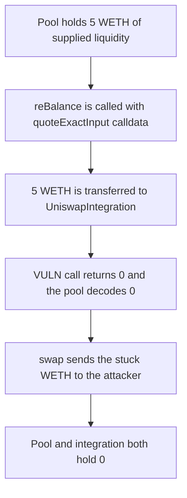

# Liquorice: reBalance calls quoteExactInput and the supplied WETH is taken

> **Vulnerability classes:** `vuln/access-control/missing-auth`

<!-- non-defihacklabs -->
<!-- source-auditvault: https://github.com/Auditware/AuditVault/blob/main/findings/49434-arbitrary-call-in-lendingpoolrebalance-leads-to-asset-theft.md -->
<!-- date: 2024-10 -->

## Key info

| Field | Value |
|---|---|
| **Loss** | 5 WETH of supplied liquidity leaves the pool and ends with the caller |
| **Vulnerable contract** | `LendingPool.reBalance` |
| **Attacker EOA** | `0x1111111111111111111111111111111111111111` |
| **Attack contract** | `Exploit` |
| **Attack tx** | `Exploit.run()` |
| **Chain / block / date** | Ethereum model · block 0 · 2024-10 |
| **Compiler** | solc 0.8.27, cancun |
| **Bug class** | `_swapData` is an unrestricted call into `UniswapIntegration` |

## TL;DR

`reBalance` transfers the pool's WETH to `UniswapIntegration` and then `call`s whatever `_swapData` the caller supplies. `quoteExactInput` returns 0, `abi.decode` accepts that 0, and nothing is swapped back. A following `swap` on the integration sends the stuck 5 WETH to the attacker. The pool and the integration both end at 0.

## The vulnerable code

```solidity
weth.transfer(address(uni), amount);
(bool ok, bytes memory result) = address(uni).call(_swapData); // @> VULN: _swapData can call any UniswapIntegration function, not only swap()
require(ok, "call");
decodedOut = abi.decode(result, (uint256));
```

```diff
- (bool ok, bytes memory result) = address(uni).call(_swapData);
+ (bool ok, bytes memory result) = address(uni).call(
+     abi.encodeWithSelector(uni.swap.selector, tokenIn, address(this), amount)
+ );
```

## Root cause

The intended callee is `swap`. The parameter is raw calldata, so `quoteExactInput` is a valid target. Its `uint256` return decodes as the expected amount-out and happens to be 0, which the pool does not reject. There is also no `minAmount` check. The tokens were transferred before the call, so a 0 result leaves them in the integration, where `swap` is permissionless.

## Preconditions

- The lending pool holds 5 WETH of supplier liquidity.
- `UniswapIntegration.quoteExactInput` returns 0.
- `swap` transfers whatever token balance the integration holds.

## Attack walkthrough

1. 5 WETH sits in the pool.
2. The attacker calls `reBalance` with `quoteExactInput` selector data.
3. The pool transfers 5 WETH to the integration.
4. The arbitrary call returns 0. The pool decodes 0 and does not pull tokens back.
5. The attacker calls `swap` and receives the 5 WETH.
6. Pool and integration balances are 0.

## Diagrams



## Impact

Suppliers lose 5 WETH. The attacker holds the full amount. A hard-coded `swap` call, with a minimum amount out, would not leave the tokens sitting in the integration.

## How to reproduce

```bash
cd 49434-arbitrary-call-in-lendingpoolrebalance-leads-to-asset-theft_exp
forge test -vv
```

## Sources

- AuditVault finding: https://github.com/Auditware/AuditVault/blob/main/findings/49434-arbitrary-call-in-lendingpoolrebalance-leads-to-asset-theft.md
- MixBytes Liquorice report: https://github.com/mixbytes/audits_public/blob/master/Liquorice/README.md
- Audited `LendingPool.reBalance`: https://github.com/Liquorice-HQ/contracts/blob/a5b4c6a56df589b8ea4f6c7b8cb028b1723ad479/src/contracts/LendingPool.sol#L229
