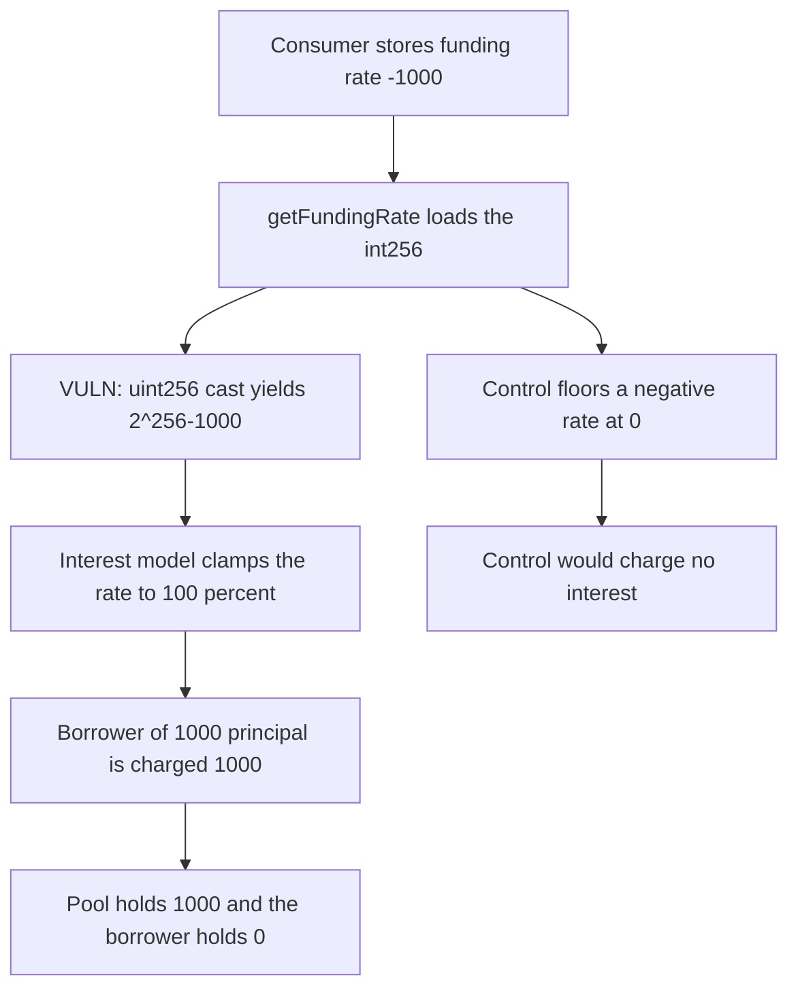

# Liquorice: a negative funding rate casts to 2^256-1000 and the borrower pays it

> **Vulnerability classes:** `vuln/oracle/price-manipulation` · `vuln/arithmetic/underflow`

<!-- non-defihacklabs -->
<!-- source-auditvault: https://github.com/Auditware/AuditVault/blob/main/findings/49435-underflow-of-rate-value-leads-to-incorrect-interest-rate-cal.md -->
<!-- date: 2025-02 -->

## Key info

| Field | Value |
|---|---|
| **Loss** | Borrower pays 1000 units of interest. A negative rate should have charged 0 |
| **Vulnerable contract** | `FundingRateOracle.getFundingRate` |
| **Attacker EOA** | `0x1111111111111111111111111111111111111111` |
| **Attack contract** | `Exploit` |
| **Attack tx** | `Exploit.run()` |
| **Chain / block / date** | Ethereum model · block 0 · 2025-02 |
| **Compiler** | solc 0.8.27, cancun, optimizer off so the cast stays on its own line |
| **Bug class** | Signed-to-unsigned cast of a funding rate |

## TL;DR

`getFundingRate` loads an `int256` and returns `uint256(rate)`. The MixBytes test uses -1000. That cast is `type(uint256).max - 999`. The interest model clamps anything above 100% down to 100%, so a 1000 principal is charged 1000 of interest. The borrower is left at 0. A negative rate floored at 0 would have charged nothing.

## Background

MixBytes' Liquorice review, committed for audit at `a5b4c6a56df589b8ea4f6c7b8cb028b1723ad479` on 22 October 2024 and closed 21 February 2025. `FundingRateConsumer` stores the API rate as `int256`. `FundingRateOracle.getFundingRate` casts it to `uint256`. `InterestRateModel` then clamps the value into its configured bounds, so the huge unsigned rate becomes the maximum rate rather than a discount. The report's test asserts the returned rate is not `uint256(-expectedRate)` for `expectedRate = -1000`.

## The vulnerable code

```solidity
int256 rate = consumer.rates(tickers[asset]);
uint256 unsignedRate = uint256(rate); // @> VULN: a negative int256 cast to uint256 underflows to 2^256+rate
return unsignedRate;
```

```diff
- uint256 unsignedRate = uint256(rate);
- return unsignedRate;
+ require(rate > type(int256).min, "min");
+ if (rate < 0) return 0;
+ return uint256(rate);
```

The audit text only asks for a check against `type(int256).min`. That check still leaves every other negative value underflowing on the cast, so the control also floors negatives at 0.

## Root cause

A signed funding rate is forced through an unsigned return. Every negative value becomes a number near 2^256. The interest model's upper bound then selects the maximum rate instead of rejecting the value.

## Preconditions

- The consumer has stored a negative rate for the asset. This run stores -1000, the value in the report's test.
- A borrower has principal outstanding and has approved the pool. This run uses 1000 units.
- The model caps the rate at 100% per update.

## Attack walkthrough

1. The consumer stores -1000 for the test ticker.
2. `getFundingRate` casts that int256. The raw unsigned rate is `type(uint256).max - 999`.
3. `charge` clamps the rate to 1e18 and computes interest equal to the 1000 principal.
4. `transferFrom` pulls 1000 from the borrower into the pool. The borrower balance is 0.

## Diagrams



## Impact

The borrower pays 1000 units, the entire principal, as one period of interest. The pool's balance increases by that 1000. With the rate floored at 0 the charge is 0. The same cast hits every later read of this oracle, so every borrower on the asset is priced at the maximum rate for as long as the published funding rate stays negative.

## Remediation

Do not cast a negative rate to `uint256`. Floor it at 0, or keep the funding adjustment signed and subtract it from the base rate. The `type(int256).min` check in the report is necessary for negation but is not sufficient on its own.

## How to reproduce

```bash
cd 49435-underflow-of-rate-value-leads-to-incorrect-interest-rate-cal_exp
forge test -vv
```

`test_exploit_negative_rate_charges_full_principal` asserts the raw rate is `type(uint256).max - 999` and the pool received 1000 from the borrower. `test_control_negative_rate_floors_to_zero` asserts the fixed oracle returns 0 for -1000. Captured output is `output.txt`.

## Sources

- AuditVault finding: https://github.com/Auditware/AuditVault/blob/main/findings/49435-underflow-of-rate-value-leads-to-incorrect-interest-rate-cal.md
- MixBytes report: https://github.com/mixbytes/audits_public/blob/master/Liquorice/README.md
- Audited commit: https://github.com/Liquorice-HQ/contracts/tree/a5b4c6a56df589b8ea4f6c7b8cb028b1723ad479
