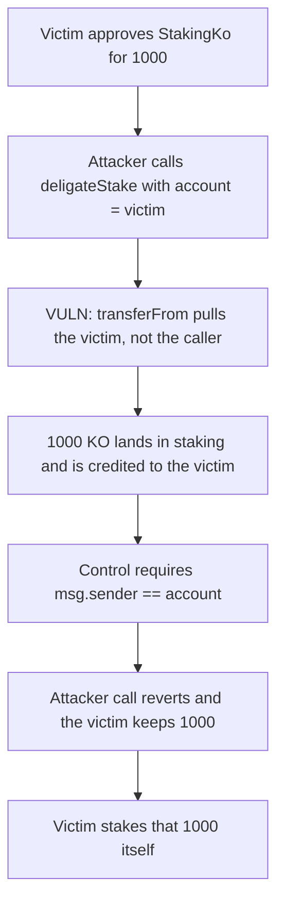

# Beraji KO: `deligateStake` pulls 1000 from a victim allowance into staking

> **Vulnerability classes:** vuln/access-control/missing-auth · vuln/logic/missing-check

<!-- non-defihacklabs -->
<!-- source-auditvault: https://github.com/Auditware/AuditVault/blob/main/findings/49513-h-01-attacker-can-redirect-funds-to-staking-via-allowances-s.md -->
<!-- date: 2025-03 -->

## Key info

| | |
|---|---|
| **Protocol** | Beraji KO |
| **Finding** | Shieldify H-01, AuditVault 49513 |
| **Vulnerable code** | `StakingKo.deligateStake` |
| **Harm** | An attacker calls `deligateStake` for a victim who has approved the staking contract and pulls 1000 KO into staking. The control requires the caller to be that account, so the attacker is rejected and the victim keeps 1000 until the victim stakes it |
| **Chain** | local synthetic |

## TL;DR

`deligateStake` does `safeTransferFrom(_account, address(this), _amount)`. `_account` comes from the caller. After a user or the owner approves `StakingKo`, anyone can front-run the intended call and stake that allowance. Here the victim approves 1000 and the attacker stakes it. The tokens land in staking and the stake is credited to the victim, who did not choose the lock. The control reverts unless `msg.sender == _account`. The victim's own call then stakes the remaining 1000.

## The vulnerable code

```solidity
require(_amount != 0, "amount = 0");
Pool storage pool = pools[_poolId];
// @> VULN: from is the caller-supplied _account, so any open allowance is staked by anyone
pool.stakingToken.safeTransferFrom(_account, address(this), _amount);
```

The fix uses the caller's funds, or requires the caller to be `_account`.

## Root cause

The allowance is granted to the staking contract, and `transferFrom` spends it as the staking contract no matter who called `deligateStake`. Nothing binds the caller to `_account`. An open approval for a later `stake`, `createReward`, or `depositRewardAmount` can be consumed as a stake instead.

## Preconditions

The victim holds 2000 KO and approves both staking contracts for 1000. The attacker is a different address. The amount is 1000. `run()` does not warp.

## Attack walkthrough

1. Mint 2000 KO to the victim and approve `StakingKo` for 1000.
2. The attacker calls `deligateStake(victim, 1000)`.
3. `safeTransferFrom` moves 1000 from the victim into staking and credits `staked[victim]`.
4. The same call against the control reverts with `not owner`. The victim still holds 1000.
5. The victim calls `deligateStake` for itself. The owner check passes and the remaining 1000 is staked.

## Diagrams



## Impact

1000 KO that the victim approved for a later action is staked by the attacker. The victim has to wait out the lock before those tokens can be used as rewards or as the stake the victim actually wanted. The control does not move the allowance unless the victim is the caller, and that owner call does stake 1000.

## How to reproduce

```bash
cd 49513-h-01-attacker-can-redirect-funds-to-staking-via-allowances-s_exp
forge test -vv
```

`run()` does not warp. StakingKo ends holding 1000 of the victim's KO. The control staking receives 1000 only from the victim's own call.

## Sources

- AuditVault finding: https://github.com/Auditware/AuditVault/blob/main/findings/49513-h-01-attacker-can-redirect-funds-to-staking-via-allowances-s.md
- Shieldify Beraji-KO review: https://github.com/shieldify-security/audits-portfolio-md/blob/main/Beraji-KO-Security-Review.md
- Reviewed tree: https://github.com/Beraji-Labs/staking-ko/blob/290103f27365cc419fe0a934feaf5f18e6e12d3a/contracts/StakingKo.sol
