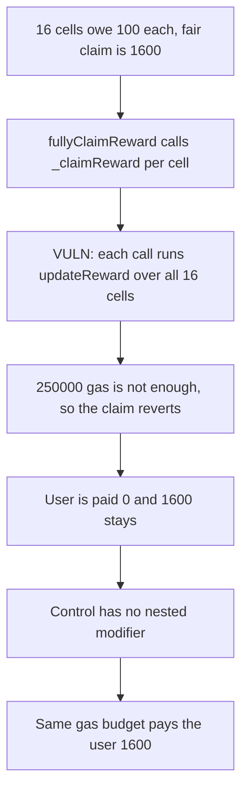

# Beraji KO: nested `updateReward` makes a full claim pay 0 instead of 1600

> **Vulnerability classes:** vuln/dos/gas-limit · vuln/logic/reward-calculation

<!-- non-defihacklabs -->
<!-- source-auditvault: https://github.com/Auditware/AuditVault/blob/main/findings/49514-h-02-users-might-not-be-able-to-fully-claim-shieldify-none-b.md -->
<!-- date: 2025-03 -->

## Key info

| | |
|---|---|
| **Protocol** | Beraji KO |
| **Finding** | Shieldify H-02, AuditVault 49514 |
| **Vulnerable code** | `StakingKo._claimReward` modifier `updateReward` |
| **Harm** | Four locks and four rewards owe 1600. The nested claim cannot finish in 250000 gas, so the user is paid 0 and 1600 stays. The control pays 1600 in the same budget |
| **Chain** | local synthetic |

## TL;DR

`fullyClaimReward` loops every lock and every reward and calls `_claimReward`. `_claimReward` is also marked `updateReward`, and that modifier loops every lock and every reward again. With 4 and 4 that is 16 outer calls, each walking 16 cells. A 250000 gas stipend reverts the nested claim. `paid` stays 0. The fair total is 1600, and that 1600 stays in the contract. The same stipend on a claim without the modifier pays 1600.

## The vulnerable code

```solidity
modifier updateReward() {
    uint256 n = COUNT;
    for (uint256 i; i < n; i++) {
        for (uint256 j; j < n; j++) {
            // @> VULN: updateReward walks every lock and reward again inside each _claimReward
            scratch = uint256(keccak256(abi.encode(scratch, i, j)));
        }
    }
    _;
}

function _claimReward(uint256 lockId, uint256 rewardId) internal updateReward {
```

The fix removes `updateReward` from `_claimReward`. `fullyClaimReward` already walks the cells.

## Root cause

The modifier and the outer loop cover the same set. Every cell of the full claim pays for a full pass over the set. Gas grows with the square of locks times rewards, which is the report's 50 by 50 shape. This reduction uses 4 by 4 so the gap fits in one call: the nested claim needs about 328000 gas and the flat claim about 192000.

## Preconditions

`COUNT` is 4. Each cell owes 100. The reward contract holds 1600. The claim is forwarded with a 250000 gas stipend. `run()` does not warp.

## Attack walkthrough

1. Mint 1600 into the nested staking contract and 1600 into the control.
2. Call `fullyClaimReward` with 250000 gas. The nested `updateReward` does not finish. The call reverts. Paid is 0. The 1600 is still there.
3. Call the control `fullyClaimReward` with the same 250000 gas. It pays 1600.

## Diagrams



## Impact

The user is paid 0. The fair claim is 1600. The unpaid rewards stay in the staking contract. The control pays the user 1600.

## How to reproduce

```bash
cd 49514-h-02-users-might-not-be-able-to-fully-claim-shieldify-none-b_exp
forge test -vv
```

`run()` does not warp. The nested claim pays 0. The control pays 1600.

## Sources

- AuditVault finding: https://github.com/Auditware/AuditVault/blob/main/findings/49514-h-02-users-might-not-be-able-to-fully-claim-shieldify-none-b.md
- Shieldify Beraji-KO review: https://github.com/shieldify-security/audits-portfolio-md/blob/main/Beraji-KO-Security-Review.md
- Reviewed tree: https://github.com/Beraji-Labs/staking-ko/blob/290103f27365cc419fe0a934feaf5f18e6e12d3a/contracts/StakingKo.sol
