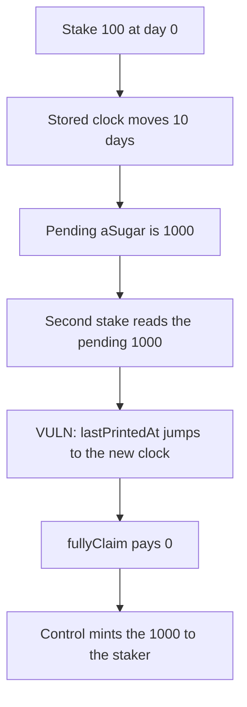

# Beraji KO: a second stake moves `lastPrintedAt` and wipes 1000 unclaimed aSugar

> **Vulnerability classes:** vuln/logic/reward-calculation · vuln/logic/state-update

<!-- non-defihacklabs -->
<!-- source-auditvault: https://github.com/Auditware/AuditVault/blob/main/findings/49515-h-03-stakers-can-lose-their-earned-asugar-shieldify-none-ber.md -->
<!-- date: 2025-03 -->

## Key info

| | |
|---|---|
| **Protocol** | Beraji KO |
| **Finding** | Shieldify H-03, AuditVault 49515 |
| **Vulnerable code** | `StakingKo.deligateStake` |
| **Harm** | A 100 stake accrues 1000 aSugar over 10 days. Staking again sets `lastPrintedAt` to the new clock and does not mint that 1000 to the staker. `fullyClaim` then pays 0. The control mints the 1000 to the staker |
| **Chain** | local synthetic |

## TL;DR

aSugar pending is `staked * (clock - lastPrintedAt) / 1 days`. The first stake of 100 at clock `1700000000` stores that stamp. Ten days later the pending amount is 1000. `deligateStake` mints only the new stake's aSugar, which is 0 here, and writes `lastPrintedAt = clock`. The 1000 is not paid to the staker. `fullyClaim` then sees a zero duration and pays 0. The control mints the pending 1000 to the staker before moving the stamp. The clock is a stored value, so `run()` does not warp.

## The vulnerable code

```solidity
uint256 lost = pending(_account);
wiped += lost;
if (lost != 0) sugar.mint(forfeit, lost);
staked[_account] += _amount;
// @> VULN: lastPrintedAt jumps to clock and the pending aSugar is not minted to the staker
lastPrintedAt[_account] = clock;
uint256 asgAmount = 0;
uint256 totalASugar = _buffAmount(asgAmount);
_mintASugar(_account, totalASugar);
```

The report's marked line is `totalASugar = _buffAmount(...)`, which is only the new stake. The stamp update is what drops the previous window. The fix mints `pending` to the staker before writing `lastPrintedAt`.

## Root cause

The accrual window is the gap since `lastPrintedAt`. A second stake replaces that stamp and mints aSugar only for the tokens in the current call. Anything accrued since the previous stamp is not minted and can no longer be claimed.

## Preconditions

The staker deposits 100, then another 100. The stored clock moves from `1700000000` to that value plus 10 days. Accrual is one-to-one with token-days, so the gap is 1000 aSugar. `run()` does not read `block.timestamp`.

## Attack walkthrough

1. Set the clock to day 0 and open a stake of 100. `lastPrintedAt` is day 0.
2. Set the clock 10 days later. Pending aSugar is 1000.
3. `deligateStake` of another 100 reads that 1000, does not mint it to the staker, and sets `lastPrintedAt` to the new clock.
4. `fullyClaim` pays 0.
5. The control does the same two stakes and the same clock gap, and mints the 1000 to the staker.

## Diagrams



## Impact

The staker loses 1000 aSugar. The claim that should pay it returns 0. The same stake and the same 10 day gap on the control contract pays the staker 1000.

## How to reproduce

```bash
cd 49515-h-03-stakers-can-lose-their-earned-asugar-shieldify-none-ber_exp
forge test -vv
```

`run()` does not warp. The wiped amount is 1000. The control staker balance is 1000.

## Sources

- AuditVault finding: https://github.com/Auditware/AuditVault/blob/main/findings/49515-h-03-stakers-can-lose-their-earned-asugar-shieldify-none-ber.md
- Shieldify Beraji-KO review: https://github.com/shieldify-security/audits-portfolio-md/blob/main/Beraji-KO-Security-Review.md
- Reviewed tree: https://github.com/Beraji-Labs/staking-ko/blob/290103f27365cc419fe0a934feaf5f18e6e12d3a/contracts/StakingKo.sol
