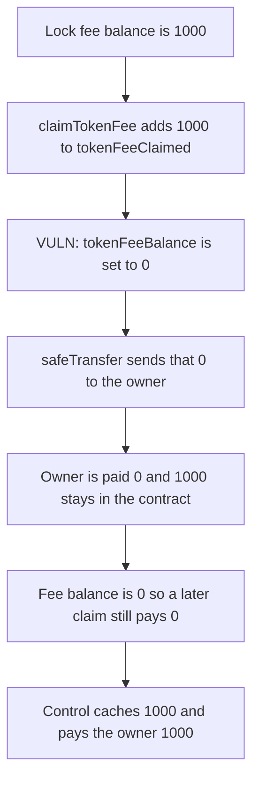

# Beraji KO: `claimTokenFee` zeros the fee and then transfers 0, so 1000 stays

> **Vulnerability classes:** vuln/logic/fee-calculation · vuln/logic/incorrect-order-of-operations

<!-- non-defihacklabs -->
<!-- source-auditvault: https://github.com/Auditware/AuditVault/blob/main/findings/49516-h-04-owner-cannot-claim-token-fees-shieldify-none-beraji-ko.md -->
<!-- date: 2025-03 -->

## Key info

| | |
|---|---|
| **Protocol** | Beraji KO |
| **Finding** | Shieldify H-04, AuditVault 49516 |
| **Vulnerable code** | `StakingKo.claimTokenFee` |
| **Harm** | A 1000 token fee is cleared and then transferred. The owner receives 0. The 1000 stays in the contract, and the fee balance is 0 so a later claim still pays 0. The control caches 1000 and pays the owner 1000 |
| **Chain** | local synthetic |

## TL;DR

`claimTokenFee` does `lock.tokenFeeBalance = 0` and then `safeTransfer(msg.sender, lock.tokenFeeBalance)`. The transfer amount is the value just written, which is 0. The call succeeds. The owner is paid 0. The 1000 that was accrued stays in the staking contract, and because the balance is now 0 the `if (lock.tokenFeeBalance != 0)` guard skips that lock forever. The control copies the balance into `fee` first and transfers `fee`, so the owner receives 1000.

## The vulnerable code

```solidity
if (lock.tokenFeeBalance != 0) {
    lock.tokenFeeClaimed += lock.tokenFeeBalance;
    // @> VULN: the fee is cleared before it is used as the transfer amount
    lock.tokenFeeBalance = 0;
    pool.stakingToken.safeTransfer(msg.sender, lock.tokenFeeBalance);
}
```

The fix is `uint256 fee = lock.tokenFeeBalance` before the clear, and `safeTransfer(msg.sender, fee)`.

## Root cause

The transfer reads the same storage slot the previous statement just set to 0. `tokenFeeClaimed` records the pre-clear amount, so the books say the fee was claimed, while the token movement uses the post-clear amount.

## Preconditions

One lock has `tokenFeeBalance` of 1000 and the contract holds those 1000 tokens. The caller is the owner. `run()` does not warp.

## Attack walkthrough

1. Accrue 1000 into the lock. The contract balance is 1000.
2. The owner calls `claimTokenFee`.
3. The balance is added into `tokenFeeClaimed`, then set to 0.
4. `safeTransfer` sends 0. The owner's balance does not change. The contract still holds 1000.
5. The control accrues 1000, caches it, and transfers the cache. The owner receives 1000 and the control contract is empty.

## Diagrams



## Impact

The owner cannot collect the 1000 staking fee. The tokens remain in the contract with no remaining balance to claim. The control pays the owner 1000.

## How to reproduce

```bash
cd 49516-h-04-owner-cannot-claim-token-fees-shieldify-none-beraji-ko_exp
forge test -vv
```

`run()` does not warp. The vulnerable contract still holds 1000. The control owner receives 1000.

## Sources

- AuditVault finding: https://github.com/Auditware/AuditVault/blob/main/findings/49516-h-04-owner-cannot-claim-token-fees-shieldify-none-beraji-ko.md
- Shieldify Beraji-KO review: https://github.com/shieldify-security/audits-portfolio-md/blob/main/Beraji-KO-Security-Review.md
- Reviewed tree: https://github.com/Beraji-Labs/staking-ko/blob/290103f27365cc419fe0a934feaf5f18e6e12d3a/contracts/StakingKo.sol
