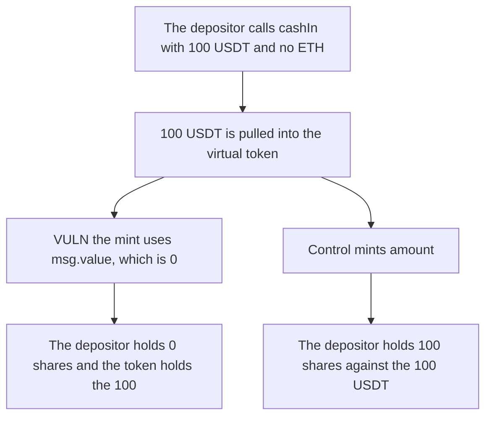

# VirtualToken cashIn mints msg.value and locks the ERC20 deposit

> **Vulnerability classes:** vuln/logic/mint-amount · vuln/defi/deposit

<!-- non-defihacklabs -->
<!-- source-auditvault: https://github.com/Auditware/AuditVault/blob/main/findings/49608-h-01-loss-of-user-funds-in-virtualtokens-cashin-function-due.md -->
<!-- date: 2024-12 -->

## Key info

| Field | Value |
|---|---|
| **Loss** | 100 USDT is pulled into the virtual token and the depositor is minted 0 shares |
| **Vulnerable contract** | `VirtualToken.cashIn` |
| **Attacker EOA** | `0x1111111111111111111111111111111111111111` |
| **Attack contract** | `Exploit` at `0x15452ec016c4dc8c549e7fe6ff4b26324ea8b7a4` |
| **Attack tx** | `Exploit.run()` |
| **Chain / block / date** | Ethereum model · block 0 · 2024-12 |
| **Compiler** | solc 0.8.27, cancun, via IR |
| **Bug class** | An ERC20 cash-in mints `msg.value` instead of `amount` |



## TL;DR

`cashIn` pulls `amount` of the underlying token, then mints `msg.value`. For an ERC20 that value is 0. A call with 100 USDT and no ETH leaves the virtual token holding 100 and the depositor holding 0 shares.

The fixed `cashIn` mints `amount`. The same 100 USDT deposit credits 100 shares.

## The vulnerable code

```solidity
function cashIn(uint256 amount) external payable {
    asset.transferFrom(msg.sender, address(this), amount);
    lastValue = msg.value;
    _mint(msg.sender, msg.value); // @> VULN: ERC20 cash-in mints msg.value, which is 0
}
```

## Impact

The depositor pays 100 USDT and receives nothing back. The 100 sits in the virtual token.

## How to reproduce

```bash
cd 49608-h-01-loss-of-user-funds-in-virtualtokens-cashin-function-due_exp
forge test -vv
```

`test_exploit_erc20_mints_zero` asserts 0 shares and 100 USDT inside the token. `test_control_mints_the_amount` asserts 100 shares.

## Sources

- AuditVault finding: https://github.com/Auditware/AuditVault/blob/main/findings/49608-h-01-loss-of-user-funds-in-virtualtokens-cashin-function-due.md
- Code4rena report: 2024-12-lambowin
