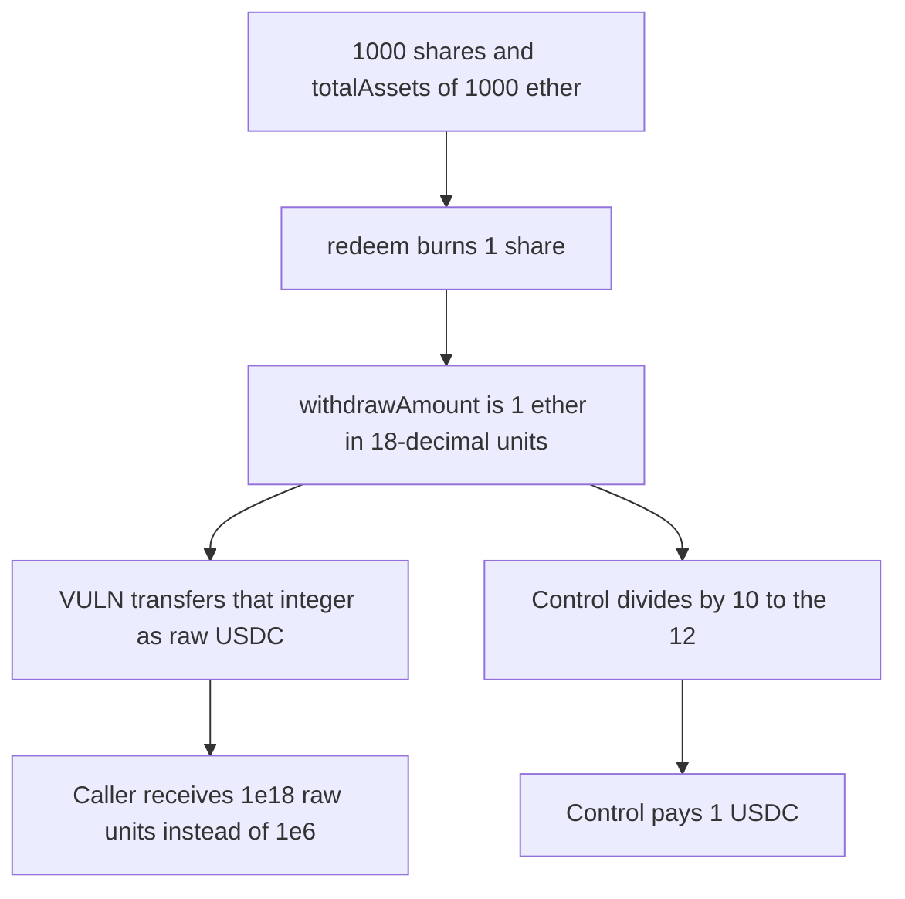

# BakerFi: redeem pays 1e18 raw USDC for one 18-decimal share

> **Vulnerability classes:** vuln/arithmetic/decimal-mismatch

<!-- non-defihacklabs -->
<!-- source-auditvault: https://github.com/Auditware/AuditVault/blob/main/findings/49643-h-04-there-are-multiple-issues-with-the-decimal-conversions.md -->
<!-- date: 2024-12 -->

## Key info

| Field | Value |
|---|---|
| **Loss** | 1 share that is worth 1 USDC withdraws 1e12 USDC |
| **Vulnerable contract** | `StrategyLeverage._undeploy` |
| **Attacker EOA** | `0x0000000000000000000000000000000000049643` |
| **Attack contract** | `Exploit` |
| **Attack tx** | `Exploit.run()` |
| **Chain / block / date** | Ethereum model · block 0 · 2024-12 |
| **Compiler** | solc 0.8.27, cancun, via IR |
| **Bug class** | 18-decimal `withdrawAmount` is spent as 6-decimal raw units |

## TL;DR

`StrategyLeverage` keeps `totalAssets` in 18 decimals. `_redeemInternal` computes `withdrawAmount = shares * totalAssets / totalSupply` in that scale and passes it to `_undeploy`. `_undeploy` transfers that integer as raw USDC. USDC has 6 decimals, so one internal token, which is `1e18` in the vault's units and `1e6` raw, is paid as `1e18` raw. That is `1e12` times the fair amount. The strategy still holds `999 ether` of raw units afterward, which is the other depositors' USDC minus the extra that was taken.

## Background

Code4rena's December 2024 BakerFi invitational, finding H-04 by 0xlemon. The report lists several decimal mismatches. This reproduction is the redeem path: `totalAssets()` is documented as 18-decimal, `withdrawAmount` is derived from it, and the AAVE and Morpho `_withdraw` helpers are supposed to scale that amount down to the token's decimals before pulling. They do not. The team mitigated the set in baker-fi/bakerfi-contracts pull 24.

## The vulnerable code

```solidity
uint256 withdrawAmount = (shares * totalAssets) / (totalSupply + shares);
if (withdrawAmount == 0) revert NoAssetsToWithdraw();
totalAssets -= withdrawAmount;
retAmount = _undeploy(withdrawAmount);

function _undeploy(uint256 amount) internal returns (uint256) {
    // @> VULN: withdrawAmount is 18-decimal and _undeploy spends it as raw USDC (6 decimals)
    require(usdc.transfer(msg.sender, amount), "pull");
    return amount;
}
```

The vault is seeded with `totalAssets = 1000 ether` and `totalSupply = 1000 ether`. Redeeming `1 ether` of shares produces `withdrawAmount = 1 ether`. Fair raw USDC is `1 ether / 1e12 = 1e6`.

## Root cause

The strategy's internal accounting is 18 decimals for every asset, including 6-decimal USDC. The undeploy path treats the internal amount as the token's raw amount. Scaling by `10**(18 - decimals)` is missing on the way out.

## Preconditions

- The underlying token has 6 decimals.
- The strategy holds at least `1e18` raw units, here `1000 ether` of raw USDC, so the oversized transfer succeeds.
- The caller owns `1 ether` of the 18-decimal shares.

## Attack walkthrough

1. `run` records the fair raw amount, `1e6`.
2. `redeem(1 ether)` burns one share. `withdrawAmount` is `1 ether`.
3. `totalAssets` drops by that 18-decimal amount. The books move by one token.
4. `_undeploy` transfers `1e18` raw units to the caller.
5. The caller's USDC balance is `1 ether`. The strategy has `999 ether` of raw units left.
6. The control divides by `1e12` and transfers `1e6`.

## Diagrams



## Impact

The caller receives `1e18` raw USDC, which is 1e12 USDC, for a share that represents 1 USDC. The extra `1e18 - 1e6` raw units are other depositors' funds. The strategy's raw balance falls by `1 ether` while its 18-decimal accounting only retired one token. The control pays `1e6` and leaves `1000 ether - 1e6` raw units in the strategy.

## Remediation

Scale `withdrawAmount` from 18 decimals to the token's decimals before `_undeploy`, `_withdraw`, and the debt and swap helpers listed in H-04. The team's mitigation aligns the vault decimals with the underlying token so the conversion is not required on every path.

## How to reproduce

```bash
cd 49643-h-04-there-are-multiple-issues-with-the-decimal-conversions_exp
forge test -vv
```

`test_exploit_redeems_1e12_times_the_fair_usdc` asserts a `1e18` payout against a `1e6` fair amount. `test_control_scales_18_to_6_and_pays_1_usdc` asserts a `1e6` payout. Captured output is `output.txt`.

## Sources

- AuditVault finding: https://github.com/Auditware/AuditVault/blob/main/findings/49643-h-04-there-are-multiple-issues-with-the-decimal-conversions.md
- Contest: https://code4rena.com/reports/2024-12-bakerfi-invitational
- Mitigation: https://github.com/baker-fi/bakerfi-contracts/pull/24
