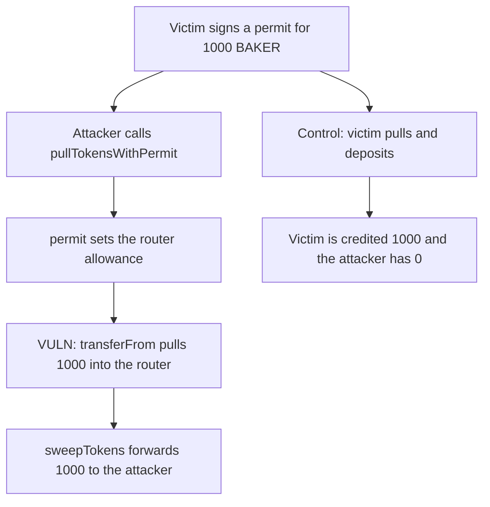

# pullTokensWithPermit lets any caller spend a user's permit

> **Vulnerability classes:** vuln/access-control/permit-frontrun

<!-- non-defihacklabs -->
<!-- source-auditvault: https://github.com/Auditware/AuditVault/blob/main/findings/49644-h-05-the-implementation-of-pulltokenswithpermit-poses-a-risk.md -->
<!-- date: 2024-12 -->

## Key info

| Field | Value |
|---|---|
| **Loss** | 1000 BAKER taken from the victim. The attacker EOA ends holding all of it |
| **Vulnerable contract** | `VaultRouter.pullTokensWithPermit` |
| **Attacker EOA** | `0x1111111111111111111111111111111111111111` |
| **Attack contract** | `Exploit` at `0x15452EC016c4dc8c549E7fe6Ff4b26324Ea8b7A4` |
| **Attack tx** | `Exploit.run()` |
| **Chain / block / date** | Ethereum model · block 0 · 2024-12 |
| **Compiler** | solc 0.8.27, cancun, via IR |
| **Bug class** | Permit signature is not bound to the caller |

## TL;DR

`pullTokensWithPermit` calls `permit` and then `transferFrom` and never checks that `msg.sender` is the token owner. A victim signs a permit that lets the router pull 1000 BAKER. An attacker submits that signature first, the tokens land on the router, and `sweepTokens` sends them to the attacker. The victim's own transaction then sees a used nonce. If the victim pulls and deposits instead, the router credits the victim and the attacker balance stays 0.

## The vulnerable code

```solidity
function pullTokensWithPermit(address owner, uint256 amount, uint256 deadline, uint8 v, bytes32 r, bytes32 s)
    external
{
    pulls = amount;
    token.permit(owner, address(this), amount, deadline, v, r, s);
    bool ok = token.transferFrom(owner, address(this), amount); // @> VULN: any caller spends the owner's permit and pulls the tokens
    require(ok, "pull");
}
```

## Root cause

The permit names the owner, the router, and the amount. It does not name the caller or the action that follows. The router applies the signature for whoever submitted it, then holds a bare token balance that `sweepTokens` pays to `msg.sender`.

## Preconditions

- The victim holds 1000 BAKER and has signed a permit for the router, value 1000, nonce 0.
- `pullTokensWithPermit` and `sweepTokens` are permissionless.
- The attacker sees the signature before the victim's transaction is mined.

## Attack walkthrough

1. The victim is minted 1000 BAKER.
2. The attacker calls `pullTokensWithPermit` with the victim's `v`, `r`, and `s`.
3. `permit` sets the router allowance and burns the nonce.
4. `transferFrom` moves 1000 from the victim to the router.
5. `sweepTokens` sends that balance to the exploit, which forwards it to the attacker EOA.
6. The control uses the same signature from the victim, then `deposit`. The victim's share balance is 1000 and the attacker still has 0.

## Diagrams



## Impact

The victim loses 1000 BAKER. The attacker EOA receives the full amount. The victim cannot replay the same permit, because the nonce has already been consumed.

## Remediation

Do not expose a free-standing pull. Bind the permit to the caller's action, or require `msg.sender == owner`, and move the tokens straight into the user's deposit in the same call so they are never a bare router balance.

## How to reproduce

```bash
cd 49644-h-05-the-implementation-of-pulltokenswithpermit-poses-a-risk_exp
forge test -vv
```

## Sources

- AuditVault finding: https://github.com/Auditware/AuditVault/blob/main/findings/49644-h-05-the-implementation-of-pulltokenswithpermit-poses-a-risk.md
- Code4rena: https://code4rena.com/reports/2024-12-bakerfi-invitational
- Quoted function: https://github.com/code-423n4/2024-12-bakerfi/blob/3873b82ae8b321473f3afaf08727e97be0635be9/contracts/core/hooks/UsePermitTransfers.sol
