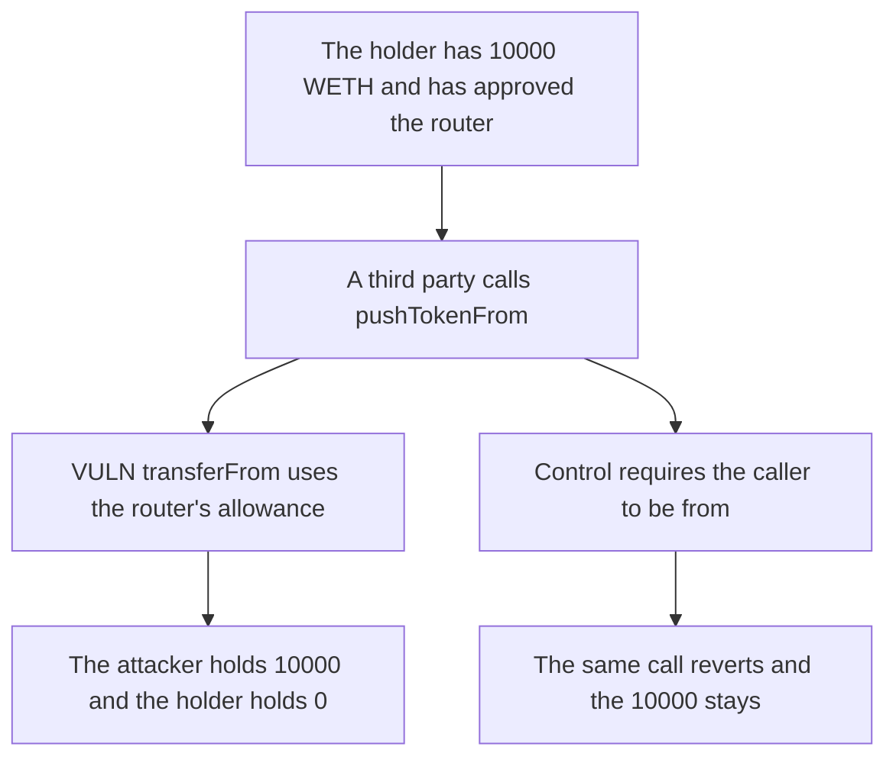

# VaultRouter pushTokenFrom spends another user's ERC20 approval

> **Vulnerability classes:** vuln/access-control/allowance-router · vuln/defi/token-drain

<!-- non-defihacklabs -->
<!-- source-auditvault: https://github.com/Auditware/AuditVault/blob/main/findings/49645-h-06-malicious-actors-can-exploit-user-approved-allowances-o.md -->
<!-- date: 2024-12 -->

## Key info

| Field | Value |
|---|---|
| **Loss** | A third party moves 10000 WETH from an account that approved the router |
| **Vulnerable contract** | `Router.pushTokenFrom` |
| **Attacker EOA** | `0x1111111111111111111111111111111111111111` |
| **Attack contract** | `Exploit` at `0x15452ec016c4dc8c549e7fe6ff4b26324ea8b7a4` |
| **Attack tx** | `Exploit.run()` |
| **Chain / block / date** | Ethereum model · block 0 · 2024-12 |
| **Compiler** | solc 0.8.27, cancun, via IR |
| **Bug class** | `pushTokenFrom` checks the router's allowance and does not require the caller to be `from` |



## TL;DR

Users approve `VaultRouter` so a later command can pull their tokens. `pushTokenFrom` only checks that allowance. `from` and `to` are arguments. A caller who is not the owner can send the approved balance anywhere.

The holder has 10000 WETH and has approved the router. The third party pushes all 10000 to themselves. The holder is left with 0.

The control requires `msg.sender == from`. The same call reverts and the 10000 stays with the holder.

## The vulnerable code

```solidity
function pushTokenFrom(Token token, address from, address to, uint256 amount) external {
    require(token.allowance(from, address(this)) >= amount, "NotEnoughAllowance");
    token.transferFrom(from, to, amount); // @> VULN: the caller is not required to be `from`
}
```

## Impact

An approval given to the router for deposits is spendable by anyone. Here that is 10000 WETH.

## How to reproduce

```bash
cd 49645-h-06-malicious-actors-can-exploit-user-approved-allowances-o_exp
forge test -vv
```

`test_exploit_third_party_pushes_the_approval` asserts the attacker holds 10000. `test_control_caller_must_be_from` asserts the call reverts and the holder keeps 10000.

## Sources

- AuditVault finding: https://github.com/Auditware/AuditVault/blob/main/findings/49645-h-06-malicious-actors-can-exploit-user-approved-allowances-o.md
- Code4rena report: 2024-12-bakerfi
