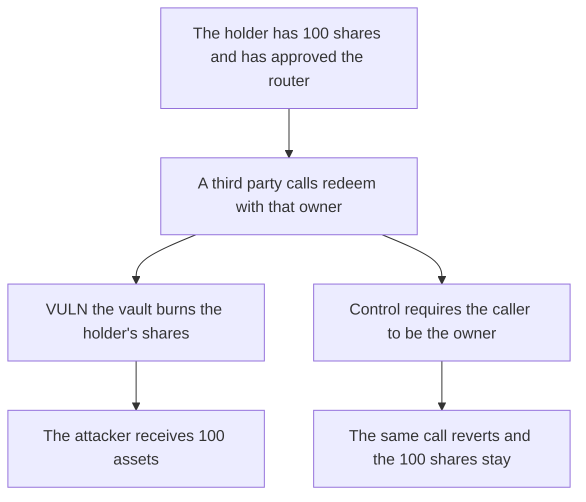

# VaultRouter redeems another owner's ERC4626 shares

> **Vulnerability classes:** vuln/access-control/vault-redeem · vuln/defi/share-theft

<!-- non-defihacklabs -->
<!-- source-auditvault: https://github.com/Auditware/AuditVault/blob/main/findings/49646-h-07-malicious-actors-can-exploit-user-approved-allowances-o.md -->
<!-- date: 2024-12 -->

## Key info

| Field | Value |
|---|---|
| **Loss** | A third party redeems 100 shares that another account approved to the router and receives 100 assets |
| **Vulnerable contract** | `Router.redeem` |
| **Attacker EOA** | `0x1111111111111111111111111111111111111111` |
| **Attack contract** | `Exploit` at `0x15452ec016c4dc8c549e7fe6ff4b26324ea8b7a4` |
| **Attack tx** | `Exploit.run()` |
| **Chain / block / date** | Ethereum model · block 0 · 2024-12 |
| **Compiler** | solc 0.8.27, cancun, via IR |
| **Bug class** | The redeem command takes `owner` from calldata |



## TL;DR

The ERC4626 redeem command reads `owner` and `receiver` from the call. It does not require the caller to be `owner`. A user who approved the router so they can redeem their own shares has approved every caller.

The holder has 100 shares and has approved the router. A third party redeems those shares to themselves. The holder has 0 shares. The attacker holds 100 assets.

The control requires `msg.sender == owner`. The call reverts and the shares stay.

## The vulnerable code

```solidity
function redeem(Vault vault, uint256 shares, address receiver, address owner) external returns (uint256 assets) {
    assets = vault.redeem(shares, receiver, owner); // @> VULN: owner is taken from calldata, not from msg.sender
}
```

## Impact

A share approval given to the router is spendable by anyone. Here that redeems 100 shares into 100 assets for the caller.

## How to reproduce

```bash
cd 49646-h-07-malicious-actors-can-exploit-user-approved-allowances-o_exp
forge test -vv
```

`test_exploit_third_party_redeems_the_owner` asserts the attacker holds 100 assets. `test_control_caller_must_be_owner` asserts the call reverts and the holder keeps 100 shares.

## Sources

- AuditVault finding: https://github.com/Auditware/AuditVault/blob/main/findings/49646-h-07-malicious-actors-can-exploit-user-approved-allowances-o.md
- Code4rena report: 2024-12-bakerfi
