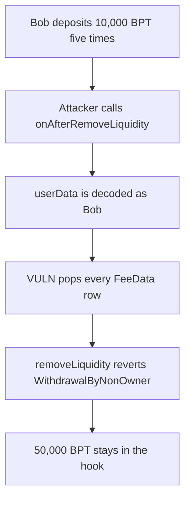

# QuantAMM: missing onlyVault lets a caller pop every depositor's FeeData

> **Vulnerability classes:** vuln/access-control/missing-modifier · vuln/dos/frozen-funds

<!-- non-defihacklabs -->
<!-- source-auditvault: https://github.com/Auditware/AuditVault/blob/main/findings/49676-critical-malicious-user-can-delete-all-users-deposited-liqui.md -->
<!-- date: 2024-12 -->

## Key info

| Field | Value |
|---|---|
| **Loss** | 50,000 BPT stuck in the hook after five deposits are deleted |
| **Vulnerable contract** | `Hook.onAfterRemoveLiquidity` |
| **Attacker EOA** | `0x4967600000000000000000000000000000000001` |
| **Attack contract** | `Exploit` |
| **Attack tx** | `Exploit.run()` |
| **Chain / block / date** | Ethereum model · block 0 · 2024-12 |
| **Compiler** | solc 0.8.27, cancun, via IR |
| **Bug class** | `onAfterRemoveLiquidity` trusts `userData` and has no `onlyVault` |

## TL;DR

Bob deposits 10,000 BPT five times. `onAfterRemoveLiquidity` is supposed to be called by the vault. Without `onlyVault`, the attacker passes Bob's address in `userData` and the hook pops all five `FeeData` rows. Bob's `removeLiquidityProportional` then reverts `WithdrawalByNonOwner`, and the 50,000 BPT stays in the hook. The fixed hook rejects the outsider call, the rows remain, and Bob withdraws.

## Background

CodeHawks QuantAMM, 20 December 2024 to 15 January 2025, reported by perseverance. The hook's `onAfterRemoveLiquidity` deletes per-user fee rows that record BPT amount and token id. The recommended fix is the `onlyVault` modifier.

## The vulnerable code

```solidity
modifier onlyVault() {
    if (onlyFromVault) require(msg.sender == vault, "vault");
    _;
}
address user;
assembly {
    user := shr(96, mload(add(userData, 32)))
}
// @> VULN: onlyVault is absent, so this pop deletes FeeData for the user encoded by the caller
rows.pop();
```

The vulnerable deployment sets `onlyFromVault` to false, so the modifier does not check the caller.

## Root cause

The user whose rows are deleted comes from caller-supplied `userData`, and the function is not restricted to the vault.

## Preconditions

- Bob has five `FeeData` rows of 10,000 BPT each. The tokens sit on the hook.
- The caller can pass `abi.encodePacked(bob)` and `bptAmountIn` equal to the sum.

## Attack walkthrough

1. Bob deposits 10,000 BPT five times. The hook holds 50,000.
2. The attacker calls `onAfterRemoveLiquidity` with Bob packed into `userData`.
3. The loop pops every row. `feeLength(bob)` is 0.
4. Bob's removal sums the rows, finds 0, and reverts `WithdrawalByNonOwner`.
5. The hook still holds 50,000 BPT.
6. With `onlyVault` on, the same call reverts, the five rows stay, and Bob withdraws all 50,000.

## Diagrams


