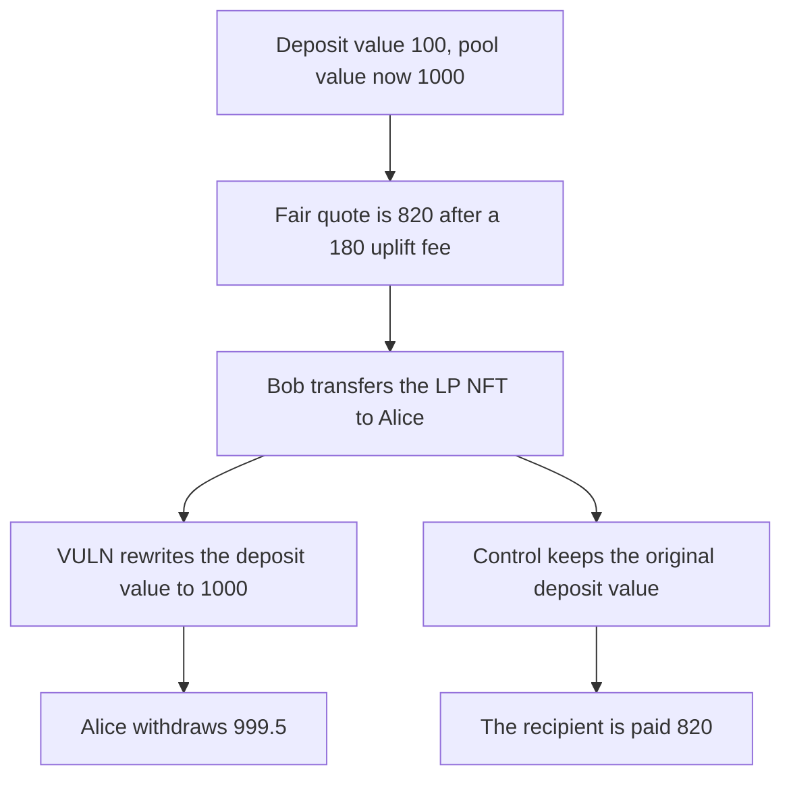

# Transferring a QuantAMM LP NFT resets the uplift deposit and the withdrawal pays 999.5 instead of 820

> **Vulnerability classes:** vuln/defi/fee-manipulation · vuln/logic/fee-calculation

<!-- non-defihacklabs -->
<!-- source-auditvault: https://github.com/Auditware/AuditVault/blob/main/findings/49678-fee-evasion-via-lp-token-transfer-resets-deposit-value-codeh.md -->
<!-- date: 2024-12 -->

## Key info

| Field | Value |
|---|---|
| **Loss** | 179.5 of pool token that should have been the uplift fee. Alice receives 999.5. The fair quote on the original deposit is 820 |
| **Vulnerable contract** | `UpliftHook.afterUpdate` |
| **Attacker EOA** | `0x1111111111111111111111111111111111111111` |
| **Attack contract** | `Exploit` at `0x15452ec016c4dc8c549e7fe6ff4b26324ea8b7a4` |
| **Attack tx** | `Exploit.run()` |
| **Chain / block / date** | Ethereum model · block 0 · 2024-12 |
| **Compiler** | solc 0.8.27, cancun, via IR |
| **Bug class** | `lpTokenDepositValue` is overwritten with the current pool value on NFT transfer |

## TL;DR

The uplift fee is 20% of the gain from the deposit value to the current pool value, with a 5 bps floor when there is no gain. A position deposited at 100 against a pool now worth 1000 owes 180 and should pay out 820. Transferring the LP NFT to Alice rewrites the deposit value to 1000. Alice's removal pays 999.5. The 179.5 difference is the fee the transfer erased. Keeping the original deposit value on transfer still pays 820.

## Background

Codehawks finding on QuantAMM's `UpliftOnlyExample`, reported by ni8mare, against the December 2024 Cyfrin QuantAMM review. `afterUpdate` runs on LP NFT transfer and assigned `lpTokenDepositValue` to the current pool value. The project's own test logged Bob withdrawing 820 and Alice, after a transfer, withdrawing 999.5.

## The vulnerable code

```solidity
uint256 lpTokenDepositValueNow = NOW_VALUE;
FeeData memory row = feeOf[_from];
require(row.tokenID == _tokenID, "id");
row.lpTokenDepositValue = lpTokenDepositValueNow;
// @> VULN: the transfer resets the deposit record to the current pool value and discards the original deposit
row.blockTimestampDeposit = uint32(block.number);
row.upliftFeeBps = upliftFeeBps;
feeOf[_to] = row;
```

`quote` charges `(now - deposit) * 2000 / 10000` when `now` is larger, else `now * 5 / 10000`. After the reset, deposit equals 1000, so the fee is 0.5 and the payout is 999.5.

`UpliftHookFixed.afterUpdate` copies the row without touching `lpTokenDepositValue`. Removal still pays 820.

## Root cause

The fee base is the deposit value at entry. Transfer is not a new deposit, but `afterUpdate` treats it as one and samples the pool at the transfer. Any uplift that accrued before the transfer is no longer in the fee.

## Preconditions

- An LP position whose deposit value is 100 and whose current pool value is 1000. The hook is funded with 1000 of the pool token.
- The LP NFT can be transferred. Bob transfers token id 1 to Alice.
- Alice then calls `removeLiquidity`.

## Attack walkthrough

1. The fair quote on deposit value 100 is 820.
2. Bob transfers the NFT to Alice. `afterUpdate` sets the deposit value to 1000 and stamps the block number.
3. Alice removes. `quote` sees no uplift and applies the 5 bps floor.
4. Alice receives 999.5. That is 179.5 more than the fair 820.
5. The fixed transfer leaves the deposit value at 100. The recipient is paid 820.

## Diagrams



## Impact

The protocol does not collect the 180 uplift fee. Alice receives 999.5 of a 1000 pool instead of 820. The 179.5 gap is value that the uplift fee was supposed to retain.

## Remediation

On transfer, push the existing `FeeData` to the recipient and do not assign `lpTokenDepositValue` or `blockTimestampDeposit`. That is the change in the report and in `UpliftHookFixed`.

## How to reproduce

```bash
cd 49678-fee-evasion-via-lp-token-transfer-resets-deposit-value-codeh_exp
forge test -vv
```

`test_exploit_transfer_resets_uplift_fee` asserts the fair quote is 820 and Alice receives 999.5. `test_control_transfer_keeps_original_deposit_value` asserts the recipient receives 820. Captured output is `output.txt`.

## Sources

- AuditVault finding: https://github.com/Auditware/AuditVault/blob/main/findings/49678-fee-evasion-via-lp-token-transfer-resets-deposit-value-codeh.md
- QuantAMM hook: https://github.com/Cyfrin/2024-12-quantamm/blob/a775db4273eb36e7b4536c5b60207c9f17541b92/pkg/pool-hooks/contracts/hooks-quantamm/UpliftOnlyExample.sol
