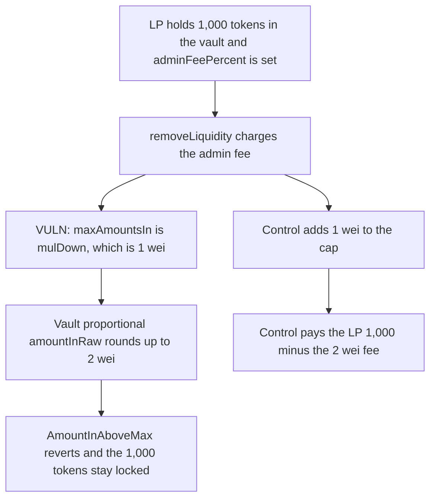

# Removing QuantAMM liquidity reverts on a 1 wei admin-fee cap and locks 1,000 tokens

> **Vulnerability classes:** vuln/dos/frozen-funds · vuln/arithmetic/rounding-direction

<!-- non-defihacklabs -->
<!-- source-auditvault: https://github.com/Auditware/AuditVault/blob/main/findings/49682-slight-miscalculation-in-maxamountsin-for-admin-fee-logic-in.md -->
<!-- date: 2024-12 -->

## Key info

| Field | Value |
|---|---|
| **Loss** | 1,000 tokens stay in the vault. The LP receives 0 |
| **Vulnerable contract** | `UpliftOnlyExample.onAfterRemoveLiquidity` |
| **Attacker EOA** | `0x0000000000000000000000000000000000049682` (any LP) |
| **Attack contract** | `Exploit` |
| **Attack tx** | `Exploit.run()` |
| **Chain / block / date** | Ethereum model · block 0 · 2024-12 |
| **Compiler** | solc 0.8.27, cancun, via IR |
| **Bug class** | `maxAmountsIn` is `mulDown` of the admin fee, 1 wei under the vault |

## TL;DR

When the admin fee is non-zero, `onAfterRemoveLiquidity` redeposits that fee with `addLiquidity`. `maxAmountsIn` is `exitFee.mulDown(adminFeePercent)`, which rounds down. The vault's proportional add rounds the required amount up. Here the cap is 1 wei and the vault wants 2. `AmountInAboveMax` reverts the whole withdrawal, so the LP's 1,000 tokens never leave the vault. Adding 1 wei to the cap lets the same exit pay the LP 1,000 minus the 2 wei fee.

## Background

Cyfrin's December 2024 QuantAMM contest. `UpliftOnlyExample.onAfterRemoveLiquidity` charges an uplift fee and, when `adminFeePercent > 0`, adds the admin slice back as proportional liquidity. The vault favors itself by one rounding step. The hook's cap does not.

## The vulnerable code

```solidity
if (localData.adminFeePercent > 0) {
    // @> VULN: maxAmountsIn is mulDown of the admin fee, 1 wei under the vault's proportional amountInRaw
    vault.addLiquidity(
        AddLiquidityParams({
            pool: localData.pool,
            to: vault.getQuantAMMAdmin(),
            maxAmountsIn: localData.accruedQuantAMMFees,
            minBptAmountOut: mulDown(localData.feeAmount, localData.adminFeePercent) / 1e18,
            kind: PROPORTIONAL,
            userData: bytes("")
        })
    );
}
```

`accruedQuantAMMFees[0]` is `mulDown(2, 0.5e18) = 1`. `minBptAmountOut` is 2. The vault computes `balance * 2 / supply = 2` and reverts because 2 > 1.

## Root cause

The hook rounds the fee down and the vault rounds the matching deposit up. The two numbers are not the same value, and the vault treats any excess as a hard revert rather than a smaller fill.

## Preconditions

- `adminFeePercent` is greater than 0. This run uses 50 percent.
- The LP has liquidity in the pool. This run uses 1,000 tokens.
- Anyone who can remove liquidity hits the revert. No separate admin transaction is required at exit time.

## Attack walkthrough

1. 1,000 tokens sit in the vault. The admin-fee cap computed by `mulDown` is 1 wei.
2. `removeLiquidity` calls `onAfterRemoveLiquidity`.
3. `addLiquidity` asks for 2 wei and the cap is 1.
4. The vault reverts `AmountInAboveMax`.
5. The hook catches the revert. The LP is paid 0. The 1,000 tokens stay in the vault.
6. The control adds 1 wei to `maxAmountsIn`. The exit pays the LP 998 tokens and leaves the 2 wei fee.

## Diagrams



## Impact

The LP cannot exit. All 1,000 tokens remain in the vault and the user balance stays 0. Every later removal with a non-zero admin fee hits the same revert. The control completes the exit and returns the principal minus the 2 wei fee.

## Remediation

Raise `maxAmountsIn` by 1 wei before the proportional `addLiquidity`, or lower `minBptAmountOut` so the vault's rounded-up amount fits under the cap. Do not let that revert abort the user's withdrawal.

## How to reproduce

```bash
cd 49682-slight-miscalculation-in-maxamountsin-for-admin-fee-logic-in_exp
forge test -vv
```

`test_exploit_admin_fee_rounds_remove_into_a_full_lock` asserts a 1 wei gap and a 1,000 token lock. `test_control_one_wei_buffer_lets_the_user_exit` asserts the user receives 1,000 minus 2 wei. Captured output is `output.txt`.

## Sources

- AuditVault finding: https://github.com/Auditware/AuditVault/blob/main/findings/49682-slight-miscalculation-in-maxamountsin-for-admin-fee-logic-in.md
- Blamed lines: https://github.com/Cyfrin/2024-12-quantamm/blob/a775db4273eb36e7b4536c5b60207c9f17541b92/pkg/pool-hooks/contracts/hooks-quantamm/UpliftOnlyExample.sol#L541
