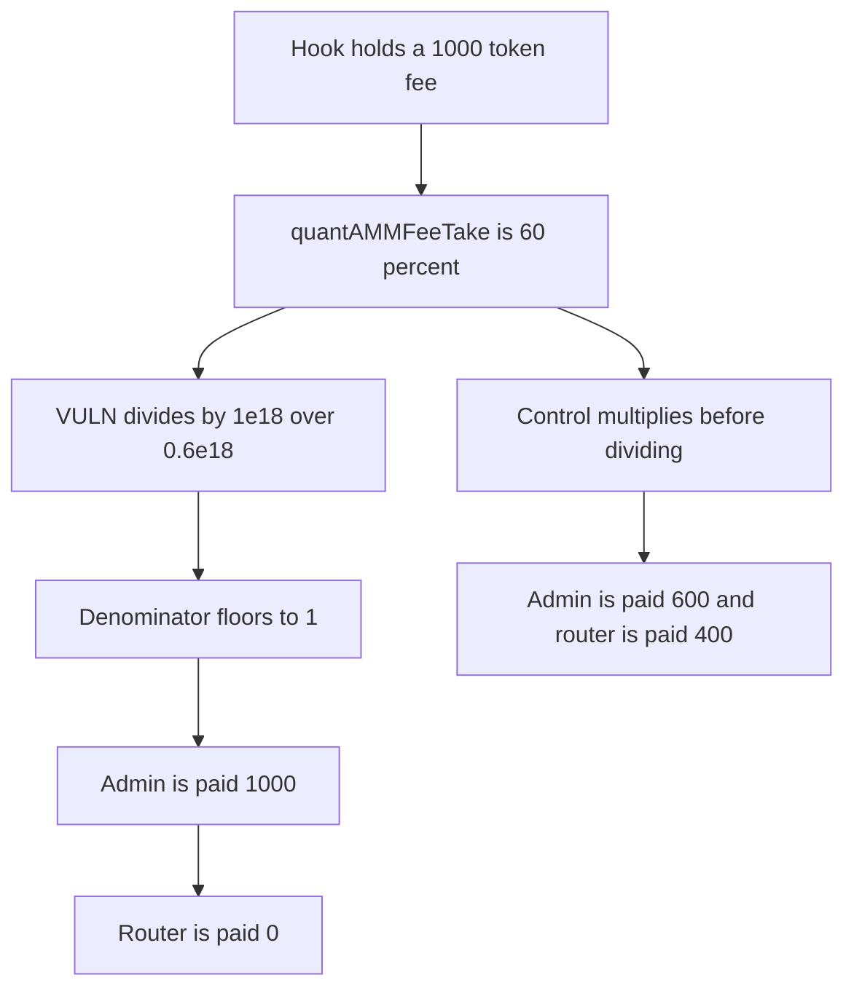

# QuantAMM: uplift admin fee rounds the denominator first

> **Vulnerability classes:** `vuln/arithmetic/division-before-multiply` · `vuln/arithmetic/precision-loss`

<!-- non-defihacklabs -->
<!-- source-auditvault: https://github.com/Auditware/AuditVault/blob/main/findings/49683-loss-of-fees-for-router-upliftonlyexample-due-to-division-ro.md -->
<!-- date: 2024-12 -->

## Key info

| Field | Value |
|---|---|
| **Loss** | Admin is paid 1000 of a 1000 token hook fee. The router is paid 0 instead of 400 |
| **Vulnerable contract** | `UpliftOnlyExample.onAfterSwap` |
| **Attacker EOA** | `0x1111111111111111111111111111111111111111` (the admin payee) |
| **Attack contract** | `Exploit` |
| **Attack tx** | `Exploit.run()` |
| **Chain / block / date** | Ethereum model · block 0 · 2024-12 |
| **Compiler** | solc 0.8.27, cancun, via IR |

## TL;DR

`adminFee = hookFee / (1e18 / quantAMMFeeTake)` floors the denominator before the second division. At the report's 60% row, `quantAMMFeeTake` is `0.6e18`, `1e18 / 0.6e18` is 1, and the admin fee is the entire hook fee. On a 1000 token fee the admin receives 1000 and the router receives 0. `hookFee * quantAMMFeeTake / 1e18` pays the admin 600 and the router 400.

## The vulnerable code

```solidity
if (quantAMMFeeTake > 0) {
    if (fixedMode) {
        adminCut = hookFee * quantAMMFeeTake / WAD;
    } else {
        adminCut = hookFee / (WAD / quantAMMFeeTake); // @> VULN: denominator floors, so a 60% take becomes 100%
    }
    ownerCut = hookFee - adminCut;
}
adminFee = adminCut;
ownerFee = ownerCut;
```

The report's replacement:

```solidity
uint256 adminFee = hookFee * quantAMMFeeTake / 1e18;
```

## Root cause

Integer division rounds toward zero on every operator. `1e18 / 0.6e18` is not 1.666. It is 1. Dividing the hook fee by 1 leaves nothing for `ownerFee`. The same table in the report shows the break getting worse above 50%: at `0.5001e18` the denominator is also 1 and the router loss is almost the entire fee. 60% is used here because the published table gives a router loss of `0.4 * hookFee`.

## Preconditions

- `quantAMMFeeTake` is `0.6e18`.
- The hook holds 1000 tokens of hook fee when `onAfterSwap` runs.
- The admin and the router are different accounts.

## Attack walkthrough

1. `onAfterSwap` reads a hook fee of 1000.
2. The unfixed branch divides by `1e18 / 0.6e18`, which is 1.
3. `adminFee` is stored as 1000. `ownerFee` is stored as 0.
4. The admin transfer sends 1000. The router transfer is skipped.
5. The control multiplies first. The admin receives 600 and the router receives 400.

## Diagrams



## Impact

The router loses 400 tokens on this settlement, which is the whole owner share of a 60% take. The admin is paid 1000 instead of 600. The report's table shows the same formula zeroes the router share for every take from just over 50% through 90%.

## How to reproduce

```bash
cd 49683-loss-of-fees-for-router-upliftonlyexample-due-to-division-ro_exp
forge test -vv
```

`test_exploit_sixty_percent_take_pays_admin_everything` asserts admin fee 1000 and router fee 0. `test_control_multiply_first_splits_60_40` asserts 600 and 400.

## Sources

- AuditVault finding: https://github.com/Auditware/AuditVault/blob/main/findings/49683-loss-of-fees-for-router-upliftonlyexample-due-to-division-ro.md
- Blamed line: https://github.com/Cyfrin/2024-12-quantamm/blob/main/pkg/pool-hooks/pkg/pool-hooks/contracts/hooks-quantamm/UpliftOnlyExample.sol#L335
