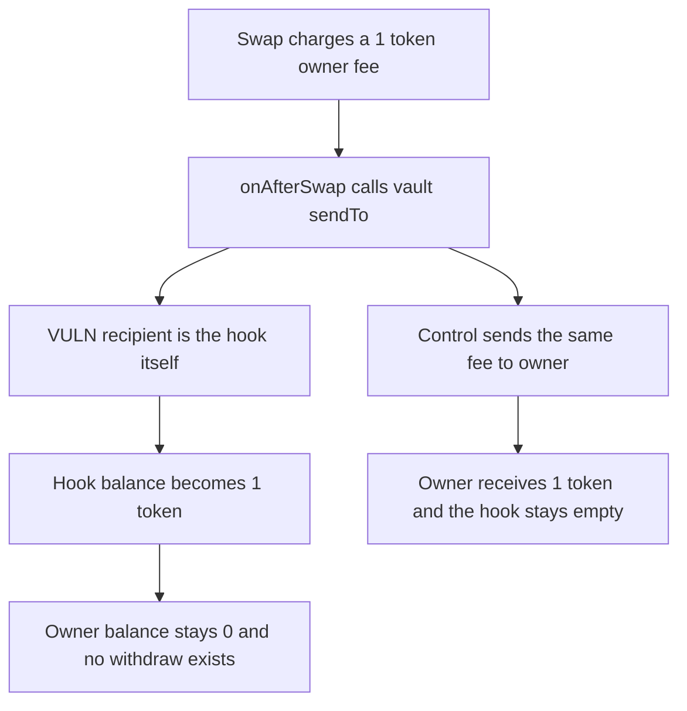

# QuantAMM: the uplift hook locks the owner swap fee in itself

> **Vulnerability classes:** `vuln/dos/frozen-funds` · `vuln/logic/missing-check`

<!-- non-defihacklabs -->
<!-- source-auditvault: https://github.com/Auditware/AuditVault/blob/main/findings/49688-owner-fee-will-be-locked-in-upliftonlyexample-contract-due-t.md -->
<!-- date: 2024-12 -->

## Key info

| Field | Value |
|---|---|
| **Loss** | 1 token of owner fee locked in `UpliftOnlyExample`. Owner balance stays 0 |
| **Vulnerable contract** | `UpliftOnlyExample.onAfterSwap` |
| **Attacker EOA** | `0x1111111111111111111111111111111111111111` |
| **Attack contract** | `Exploit` |
| **Attack tx** | `Exploit.run()` |
| **Chain / block / date** | Ethereum model · block 0 · 2024-12 |
| **Compiler** | solc 0.8.27, cancun, via IR |
| **Bug class** | `sendTo` pays `address(this)` and the hook has no withdraw |

## TL;DR

`onAfterSwap` tells the vault to send the owner fee to the hook contract. The hook never exposes a transfer out. After a swap that charges 1 token, the hook holds that token and the owner balance is still 0. Sending the same fee to `owner()` leaves the hook empty.

## Background

CodeHawks contest on Cyfrin's December 2024 QuantAMM repository. `UpliftOnlyExample.onAfterSwap` is the post-swap hook. The report's Foundry log showed the hook USDC balance rising to 1e18 while the owner stayed at 0.

## The vulnerable code

```solidity
if (ownerFee > 0) {
    // @> VULN: owner fee is sent to this hook, which has no function that can transfer it out
    _vault.sendTo(feeToken, address(this), ownerFee);
    emit SwapHookFeeCharged(address(this), feeToken, ownerFee);
}
```

`Vault.sendTo` transfers `ownerFee` of `feeToken` from the vault to the `to` argument. That argument is `address(this)`.

## Root cause

The recipient is the hook, not `owner()`. No later function moves tokens out of the hook.

## Preconditions

- The vault holds at least the fee. This run prefunds 1 token.
- A swap calls `onAfterSwap` with `ownerFee` of 1 token. Any caller of the hook can do that. The owner is not required.

## Attack walkthrough

1. `onAfterSwap` is called with a 1 token fee.
2. `sendTo` transfers that token from the vault to the hook.
3. The hook balance is 1 token. The owner balance is 0. The vault balance is 0.
4. The control hook passes `owner()` as the recipient. The owner receives the token and the hook stays empty.

## Diagrams



## Impact

Every owner fee charged by this hook is stuck in the contract. The owner cannot collect it. This run locks 1 token. The same path locks every later fee.

## Remediation

Call `_vault.sendTo(feeToken, owner(), ownerFee)`.

## How to reproduce

```bash
cd 49688-owner-fee-will-be-locked-in-upliftonlyexample-contract-due-t_exp
forge test -vv
```

`test_exploit_owner_fee_locked_in_hook` asserts the hook holds 1 token and the owner holds 0. `test_control_fee_reaches_owner` asserts the reverse. Captured output is `output.txt`.

## Sources

- AuditVault finding: https://github.com/Auditware/AuditVault/blob/main/findings/49688-owner-fee-will-be-locked-in-upliftonlyexample-contract-due-t.md
- Hook: https://github.com/Cyfrin/2024-12-quantamm/blob/a775db4273eb36e7b4536c5b60207c9f17541b92/pkg/pool-hooks/contracts/hooks-quantamm/UpliftOnlyExample.sol
