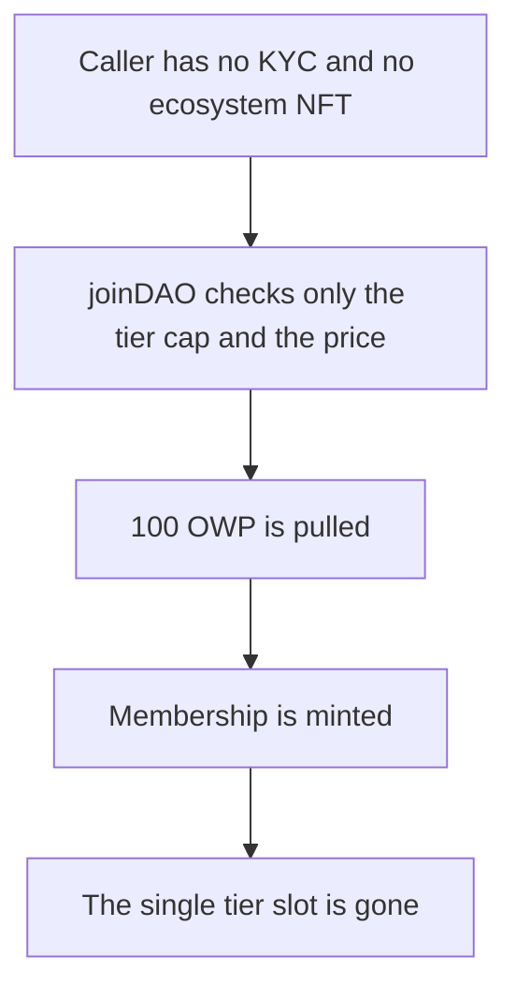

# One World — joinDAO mints the only membership with no KYC and no ecosystem NFT

> **Vulnerability classes:** `vuln/access-control/missing-auth` · `vuln/access-control/missing-modifier`

> **Reproduction:** a self-contained Foundry PoC that compiles and runs offline
> with only `forge-std` — no fork and no RPC. Trace: [output.txt](output.txt).
> PoC: [test/49835-missing-kyc-and-nft-ownership-verification-for-ecosystem-acc_exp.sol](test/49835-missing-kyc-and-nft-ownership-verification-for-ecosystem-acc_exp.sol).

<!-- non-defihacklabs -->
<!-- source-auditvault: https://github.com/Auditware/AuditVault/blob/main/findings/49835-missing-kyc-and-nft-ownership-verification-for-ecosystem-acc.md -->
<!-- date: 2024-11 -->

---

## Key info

| | |
|---|---|
| **Impact** | **HIGH** — an account with no KYC and no ecosystem NFT mints the only DAO membership and fills the tier |
| **Protocol** | One World `MembershipFactory.joinDAO` |
| **Vulnerable code** | `membership.mint` after the price transfer, with no identity check |
| **Bug class** | Product KYC and NFT gates exist only off-chain |
| **Finding** | CodeHawks — One World, 6–13 Nov 2024 · id 49835 |
| **Report** | [CodeHawks contest](https://codehawks.cyfrin.io/c/2024-11-one-world) |
| **Source** | [AuditVault finding](https://github.com/Auditware/AuditVault/blob/main/findings/49835-missing-kyc-and-nft-ownership-verification-for-ecosystem-acc.md) |
| **Compiler** | solc 0.8.27, cancun, via IR |

---

## TL;DR

Joining the ecosystem is supposed to require KYC and an ecosystem NFT. `joinDAO` checks the tier index and the remaining supply, pulls the price, and mints. It never reads `OWPIdentity` and never reads the NFT balance.

An unverified account approves 100 OWP, calls `joinDAO` on the only tier, and receives membership id balance 1. `tierMinted` becomes 1, so a later verified user finds the tier full. The fixed factory reverts with `KYC` and then with `ecosystem NFT`.

## The vulnerable code

```solidity
require(tierAmount > tierMinted, "Tier full.");
uint256 price = tierPrice;
uint256 platformFees = (20 * price) / 100;
tierMinted += 1;
currency.transferFrom(msg.sender, owpWallet, platformFees);
currency.transferFrom(msg.sender, daoMembershipAddress, price - platformFees);
membership.mint(msg.sender, 1); // @> VULN: no KYC check and no ecosystem-NFT check
```

```diff
 function joinDAO(address daoMembershipAddress, uint256 tierIndex) external {
+    require(identity.isKYC(msg.sender), "KYC");
+    require(ecosystemNft.balanceOf(msg.sender) > 0, "ecosystem NFT");
     require(noOfTiers > tierIndex, "Invalid tier.");
```

## Attack walkthrough

1. `OWPIdentity.isKYC` is false and the ecosystem NFT balance is 0.
2. The caller approves 100 OWP and calls `joinDAO` for tier 0. The tier cap is 1.
3. The factory pulls 20 OWP to the platform wallet and 80 OWP to the DAO.
4. It mints one membership. The tier is now full.

## Diagrams



## Impact

Anyone who can pay the tier price receives a membership the product restricts to KYC'd NFT holders. With a cap of one, that caller also consumes the seat a verified user was supposed to get.

## Sources

- [AuditVault 49835](https://github.com/Auditware/AuditVault/blob/main/findings/49835-missing-kyc-and-nft-ownership-verification-for-ecosystem-acc.md)
- [CodeHawks One World, November 2024](https://codehawks.cyfrin.io/c/2024-11-one-world)
- [Contest repo](https://github.com/Cyfrin/2024-11-one-world) — `contracts/dao/MembershipFactory.sol` `joinDAO`
