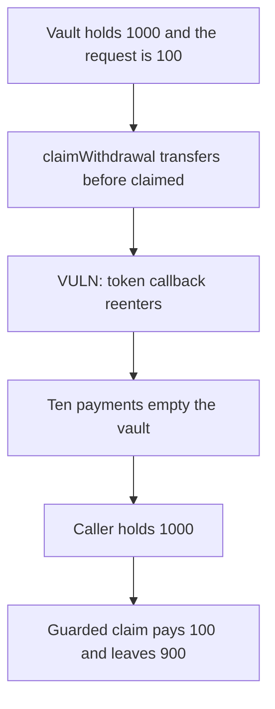

# Enjoyoors — claimWithdrawal pays before the request is marked claimed

> **Vulnerability classes:** vuln/reentrancy/single-function · vuln/dependency/unsafe-external-call

<!-- non-defihacklabs -->
<!-- source-auditvault: https://github.com/Auditware/AuditVault/blob/main/findings/49875-reentrancy-vulnerability-in-claimwithdrawal-function-mixbyt.md -->
<!-- date: 2024-12 -->

## Key info

| | |
|---|---|
| **Protocol** | Enjoyoors |
| **Finding** | MixBytes, December 2024, AuditVault 49875 |
| **Vulnerable code** | `_claimWithdrawal` transfers, then sets `claimed` |
| **Harm** | A 100 claim is paid 10 times. The caller receives 1000. The guarded order pays 100 and leaves 900. |
| **Chain** | local synthetic (audited Ethereum contracts) |

## TL;DR

`_claimWithdrawal` sends the request amount and only then sets `request.claimed = true`. A token that callbacks on transfer, the ERC-777 case in the report, reenters `claimWithdrawal` while `claimed` is still false.

The vault holds 1000: this request is 100, and 900 is still other depositors' cash. Each reentry pays another 100 until the cash is below 100. The caller receives 1000. Setting `claimed` before the transfer pays 100 once and leaves 900.

## The vulnerable code

The audited line is `IERC20(token).safeTransfer(request.user, amount)` followed by `request.claimed = true`.

```solidity
require(request.user == msg.sender, "user");
// @> VULN: the token is sent before claimed is set, so the callback reenters.
token.transfer(request.user, amount);
request.claimed = true;
```

The control flips the flag first:

```solidity
request.claimed = true;
token.transfer(request.user, amount);
```

## Root cause

The external token call sits in the middle of the claim. `claimed` is the only lock, and it is written after the call. The callback is the claimant, so `request.user == msg.sender` still holds.

## Preconditions

The claimed token callbacks the recipient. The vault's token balance is larger than this one request because other users have deposited. Here the request is 100 and the cash is 1000. The approver delay is not what the finding breaks; once the claim is callable, one transaction repeats it. No warp.

## Attack walkthrough

1. Vault cash is 1000. The honest payment is 100.
2. `claimWithdrawal` transfers 100 before setting `claimed`.
3. The token calls `tokensReceived`. Cash is still at least 100, so the callback claims again.
4. Ten payments later the caller holds 1000 and the vault holds 0.
5. `1000 - 100 = 900` was other depositors' cash.

Control pays 100 and leaves 900.

## Diagrams



## Impact

The claimant receives 1000 tokens on a 100 request. 900 of that was cash still owed to other depositors. The guarded claim pays 100.

## Remediation

Set `claimed` before the token transfer, and add `nonReentrant` on the claim.

## How to reproduce

```bash
cd 49875-reentrancy-vulnerability-in-claimwithdrawal-function-mixbyt_exp
forge test -vv
```

## Sources

- AuditVault finding: https://github.com/Auditware/AuditVault/blob/main/findings/49875-reentrancy-vulnerability-in-claimwithdrawal-function-mixbyt.md
- MixBytes report: https://github.com/mixbytes/audits_public/blob/master/Enjoyoors/EVM%20Vaults/README.md#1-reentrancy-vulnerability-in-_claimwithdrawal-function
- Vulnerable source: https://github.com/eq-lab/enjoyoors-evm-contracts/blob/efbc1b269e0f84c631437156a6fa878d51935822/contracts/vault/actions/EnjoyoorsVaultWithdrawals.sol
