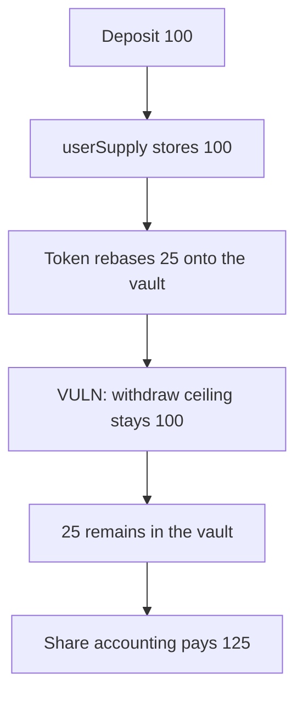

# Enjoyoors — rebase rewards sit above userSupply and cannot be withdrawn

> **Vulnerability classes:** vuln/dos/frozen-funds · vuln/logic/reward-calculation

<!-- non-defihacklabs -->
<!-- source-auditvault: https://github.com/Auditware/AuditVault/blob/main/findings/49876-stuck-rebase-rewards-due-to-internal-balance-tracking-mixbyt.md -->
<!-- date: 2024-12 -->

## Key info

| | |
|---|---|
| **Protocol** | Enjoyoors |
| **Finding** | MixBytes, December 2024, AuditVault 49876 |
| **Vulnerable code** | `_deposit` does `userSupply[token][msg.sender] += amount` |
| **Harm** | A 100 deposit rebases by 25. Withdraw pays 100. The 25 stays in the vault. Share accounting pays 125. |
| **Chain** | local synthetic (audited Ethereum contracts) |

## TL;DR

The vault remembers the token amount it was given, not a share of the tokens it holds. A rebasing token can increase the vault's balance without a deposit. `withdraw` refuses any amount above `userSupply`, so the rebase cannot be paid out.

Deposit 100. Rebase 25 onto the vault. Cash is 125 and `userSupply` is 100. Withdraw of 100 succeeds and 25 remains. There is no later function that pays the residual. Share accounting, `shares * cash / totalShares`, pays 125 and leaves 0.

## The vulnerable code

The audited assignment is `userSupply[token][msg.sender] += amount`.

```solidity
token.transferFrom(msg.sender, address(this), amount);
totalSupply[token_] += amount;
// @> VULN: userSupply[token][msg.sender] += amount ignores later rebases.
userSupply[token_][msg.sender] += amount;
```

The share withdrawal the report recommends:

```solidity
paid = shares * cash / all;
```

## Root cause

`userSupply` is a sum of deposit amounts. The token balance is not that sum once the token rebases. The withdrawal ceiling is the sum, so the extra balance is unowned.

## Preconditions

The listed token rebases, the way stETH or an aToken does. This run uses an explicit `rebase` of 25 on a 100 deposit so the gap does not depend on a second block. No warp.

## Attack walkthrough

1. Deposit 100. `userSupply` becomes 100.
2. Rebase 25 onto the vault. Cash is 125. `userSupply` is still 100.
3. Withdraw 100, the maximum the mapping allows.
4. The depositor received 100. The vault still holds 25.
5. The share payout of the same position is 125.

## Diagrams



## Impact

The depositor cannot withdraw the 25 rebase units. They stay in the vault with no claim path. The share-based withdrawal pays 125 and leaves nothing behind.

## Remediation

Track shares of the vault's token balance, and pay `shares * balance / totalShares` on the way out. Or refuse rebasing tokens and use the wrapped asset.

## How to reproduce

```bash
cd 49876-stuck-rebase-rewards-due-to-internal-balance-tracking-mixbyt_exp
forge test -vv
```

## Sources

- AuditVault finding: https://github.com/Auditware/AuditVault/blob/main/findings/49876-stuck-rebase-rewards-due-to-internal-balance-tracking-mixbyt.md
- MixBytes report: https://github.com/mixbytes/audits_public/blob/master/Enjoyoors/EVM%20Vaults/README.md#2-stuck-rebase-rewards-due-to-internal-balance-tracking
- Vulnerable source: https://github.com/eq-lab/enjoyoors-evm-contracts/blob/efbc1b269e0f84c631437156a6fa878d51935822/contracts/vault/actions/EnjoyoorsVaultDeposits.sol
