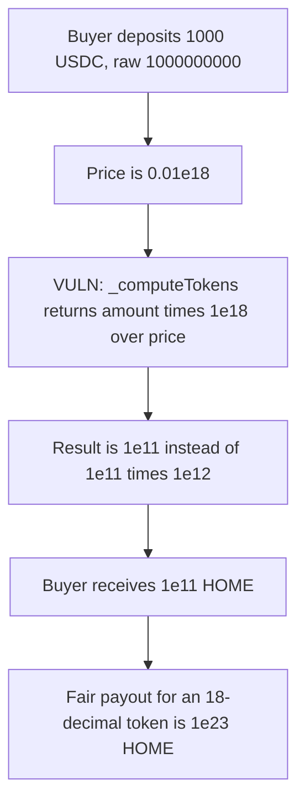

# DefiApp — sale tokens are not scaled to 18 decimals

> **Vulnerability classes:** vuln/arithmetic/decimal-mismatch · vuln/logic/price-calculation

> **Reproduction:** self-contained Foundry PoC, no fork and no cheatcodes in the exploit. Trace: [output.txt](output.txt).

<!-- non-defihacklabs -->
<!-- source-auditvault: https://github.com/Auditware/AuditVault/blob/main/findings/49882-h-01-sale-token-amount-is-not-adjusted-per-its-decimals-pash.md -->
<!-- date: 2025-01 -->

## Key info

| | |
|---|---|
| **Impact** | **HIGH** — a buyer who pays 1000 USDC (`1000000000` raw) receives `1e11` HOME instead of the fair `1e23` |
| **Protocol** | DefiApp `PublicSale` |
| **Vulnerable code** | `PublicSale._computeTokens` |
| **Bug class** | Missing decimal scale on the sale-token output |
| **Finding** | Pashov Audit Group — DefiApp, 2025-01-08 · H-01 · #49882 |
| **Report** | [DefiApp-security-review_2025-01-08.md](https://github.com/pashov/audits/blob/master/team/md/DefiApp-security-review_2025-01-08.md) |
| **Source** | [AuditVault](https://github.com/Auditware/AuditVault/blob/main/findings/49882-h-01-sale-token-amount-is-not-adjusted-per-its-decimals-pash.md) |
| **Audited code** | `defi-app/defi-app-contracts@b64eb41a74dc02655eb3e10ef2b6fe34b4ff51c6` `src/token/PublicSale.sol` |
| **Compiler** | solc 0.8.27, cancun, via_ir |

## TL;DR

`_computeTokens` divides a 6-decimal USDC amount by an 18-decimal price and stops there. The comment says to multiply by `1e12` so the result matches an 18-decimal sale token. That multiply is missing. At price `0.01e18`, 1000 USDC buys a fair `1e23` raw HOME (100,000 tokens). The function returns `1e11`, which is `1e12` times too small. The sale then transfers that dust amount into the buyer's vesting balance.

## The vulnerable code

```solidity
function _computeTokens(uint256 _amountUSDC, uint256 _price) private pure returns (uint256) {
    // _price = price * 10^18 --> precision scaling
    // _amount = (input_amount * 10^6 (USDC/T)) * 10^18 (_price)
    // (_amount * 1e18) / _price = (10^6 * 10^18) / 10^18 = 10^6 precision
    // 10^6 * 10^12 = 10^18 --> scale for future token's decimals
    // @> VULN: the 1e12 scale named in the comment is never applied
    return ((_amountUSDC * 1e18) / _price);
    // FIX: return ((_amountUSDC * 1e18) / _price) * 1e12;
}
```

## Root cause

USDC has 6 decimals and the price is scaled by `1e18`. `(amount * 1e18) / price` lands on 6-decimal precision. An 18-decimal token needs another `10^(18-6) = 1e12`. The function returns the unscaled value, and `depositUSDC` transfers that value out of the sale inventory.

## Preconditions

The sale token has 18 decimals. The price is the report's example, `0.01e18`. The buyer deposits 1000 USDC (`1000 * 10^6`). No other role is required.

## Attack walkthrough

1. Buyer pays `1000000000` raw USDC (1000 USDC).
2. `_computeTokens(1000e6, 0.01e18)` returns `(1000e6 * 1e18) / 1e16 = 1e11`.
3. The sale transfers `100000000000` raw HOME to the buyer.
4. The fair 18-decimal amount is `1e11 * 1e12 = 1e23` (`100000 ether`). The buyer is short by a factor of `1e12`.

Control: multiplying the same expression by `1e12` delivers `1e23` HOME for the same 1000 USDC.

## Diagrams



## Impact

The buyer pays 1000 USDC and is credited `1e11` sale tokens instead of `1e23`. That is 100,000 tokens of dust versus 100,000 whole tokens. Every purchaser of an 18-decimal sale token is underpaid by `1e12`.

## Remediation

Scale the result by `10^(saleToken.decimals - 6)`. For the 18-decimal HOME token that factor is `1e12`:

```solidity
return ((_amountUSDC * 1e18) / _price) * 1e12;
```

## Sources

- AuditVault finding: https://github.com/Auditware/AuditVault/blob/main/findings/49882-h-01-sale-token-amount-is-not-adjusted-per-its-decimals-pash.md
- Pashov report: https://github.com/pashov/audits/blob/master/team/md/DefiApp-security-review_2025-01-08.md
- Audited source: https://github.com/defi-app/defi-app-contracts/blob/b64eb41a74dc02655eb3e10ef2b6fe34b4ff51c6/src/token/PublicSale.sol
