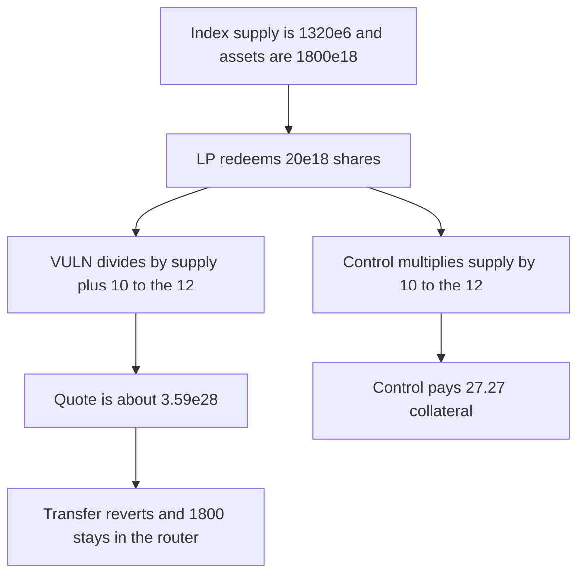

# Zaros: adding 10 to the 12 to index supply freezes 1800 collateral on redeem

> **Vulnerability classes:** `vuln/arithmetic/decimal-mismatch` · `vuln/dos/frozen-funds`

<!-- non-defihacklabs -->
<!-- source-auditvault: https://github.com/Auditware/AuditVault/blob/main/findings/49975-lps-will-not-recieve-their-full-amount-of-collateral-on-rede.md -->
<!-- date: 2025-01 -->

## Key info

| Field | Value |
|---|---|
| **Loss** | 1800 collateral locked in the router. Redeem quotes about 3.59e28 and reverts |
| **Vulnerable contract** | `VaultRouterBranch.getIndexTokenSwapRate` |
| **Attacker EOA** | `0x1111111111111111111111111111111111111111` |
| **Attack contract** | `Exploit` |
| **Attack tx** | `Exploit.run()` |
| **Chain / block / date** | Ethereum model · block 0 · 2025-01 |
| **Compiler** | solc 0.8.27, cancun, via IR |
| **Bug class** | Denominator adds `10**decimalOffset` instead of multiplying total supply by it |

## TL;DR

The index token has 6 decimals, so `decimalOffset` is 12. Redeem divides by `totalSupply + 10**12` instead of `totalSupply * 10**12`. With the report's numbers, 20e18 shares against 1320e6 supply and 1800e18 assets quote about 3.59e28. The router only holds 1800e18, the transfer reverts, and the LP receives nothing. Multiplying supply by `10**12` quotes 27.2727e18, which the router pays.

## Background

CodeHawks Zaros Part 2, January 2025. `VaultRouterBranch.getIndexTokenSwapRate` is the redeem preview. The report's example is `sharesIn = 20e18`, `totalSupply = 1320e6`, `totalAssets = 1800e18`.

## The vulnerable code

```solidity
uint8 decimalOffset = SYSTEM_DECIMALS - indexToken.decimals();
uint256 totalAssetsMinusVaultDebt = collateral.balanceOf(address(this));
// @> VULN: totalSupply is added to 10**decimalOffset instead of multiplied, so the redeem quote is not 18-decimal collateral
previewAssetsOut = sharesIn * totalAssetsMinusVaultDebt / (indexToken.totalSupply() + 10 ** uint256(decimalOffset));
```

`20e18 * 1800e18 / (1320e6 + 1e12)` is `35952542643710302400830903207`. The scaled denominator `1320e6 * 1e12` produces `27272727272727272727`.

## Root cause

The offset is added to a raw 6-decimal supply. It was meant to scale that supply up to 18 decimals. The quote is then far larger than the collateral the vault holds, so the payout transfer cannot succeed.

## Preconditions

- Index decimals are 6. System decimals are 18. Supply is 1320e6.
- The router holds 1800e18 collateral.
- The LP redeems 20e18 shares, the input from the report.

## Attack walkthrough

1. 1800 collateral is minted into the router.
2. `getIndexTokenSwapRate(20e18)` returns the oversized quote.
3. The fair scaled quote is 27.2727e18, which fits in the vault.
4. `redeem` tries to transfer the oversized quote and reverts.
5. The router still holds 1800. The LP balance is 0.
6. The control router multiplies supply by `10**12`, pays 27.2727e18, and leaves the rest.

## Diagrams



## Impact

The LP cannot redeem. All 1800 collateral stays in the router. Any redeem whose quote exceeds the balance reverts the same way, so the collateral is frozen until the denominator is scaled.

## Remediation

Divide by `totalSupply * 10**decimalOffset`, which is the change in the report. Apply the same change to `getVaultAssetSwapRate`.

## How to reproduce

```bash
cd 49975-lps-will-not-recieve-their-full-amount-of-collateral-on-rede_exp
forge test -vv
```

`test_exploit_redeem_reverts_and_locks_collateral` asserts the revert and a balance of 1800. `test_control_scaled_supply_pays_fair_collateral` asserts a payout of `27272727272727272727`. Captured output is `output.txt`.

## Sources

- AuditVault finding: https://github.com/Auditware/AuditVault/blob/main/findings/49975-lps-will-not-recieve-their-full-amount-of-collateral-on-rede.md
- Contest: https://codehawks.cyfrin.io/c/2025-01-zaros-part-2
