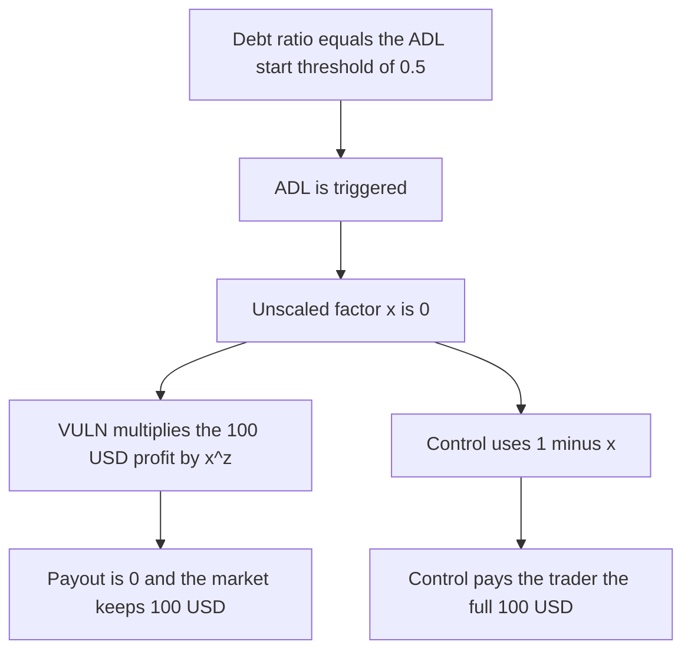

# Zaros: ADL start pays a trader 0 of a 100 USD profit and the market keeps it

> **Vulnerability classes:** `vuln/logic/wrong-condition` · `vuln/logic/reward-calculation`

<!-- non-defihacklabs -->
<!-- source-auditvault: https://github.com/Auditware/AuditVault/blob/main/findings/49978-incorrect-autodeleveragefactor-codehawks-zaros-part-2-git.md -->
<!-- date: 2025-01 -->

## Key info

| Field | Value |
|---|---|
| **Loss** | 100 USD of trader PnL. The payout is 0 and the market keeps the 100 |
| **Vulnerable contract** | `Market.settle` applying `getAutoDeleverageFactor` |
| **Attacker EOA** | `0x000000000000000000000000000000000000c33a` |
| **Attack contract** | `Exploit` |
| **Attack tx** | `Exploit.run()` |
| **Chain / block / date** | Ethereum model · block 0 · 2025-01 |
| **Compiler** | solc 0.8.27, cancun, via IR |
| **Bug class** | ADL factor is x^z, so it is 0 at the start threshold and 1 at the end |

## TL;DR

`getAutoDeleverageFactor` sets the factor to `x^z`, where `x` is 0 when the debt ratio equals the ADL start threshold and 1 when it equals the end threshold. Settlement multiplies a positive PnL by that factor. At the moment ADL turns on, a 100 USD profit is paid as 0 and stays in the market. The control uses `(1 - x)^z`, which is 1 at the start, and pays the trader the full 100 USD.

## Background

CodeHawks contest `2025-01-zaros-part-2`, finding by 0xtimefliez. The factor is applied in `getAdjustedProfitForMarketId` and then credited in `SettlementBranch` when the trader's PnL is positive. The report's example is a factor of 0 at the start threshold and 1 at the end threshold, so traders receive none of their PnL when the market first enters ADL.

## The vulnerable code

```solidity
UD60x18 unscaledDeleverageFactor = Math.min(marketDebtRatio, autoDeleverageEndThresholdX18).sub(
    autoDeleverageStartThresholdX18
).div(autoDeleverageEndThresholdX18.sub(autoDeleverageStartThresholdX18));

autoDeleverageFactorX18 = unscaledDeleverageFactor.pow(autoDeleverageExponentZX18);
```

viaIR inlines `pow` for exponent 1, so the executed payout is the next line. The stored factor is still the result of that formula:

```solidity
lastFactor = UD60x18.unwrap(factor);
// @> VULN: x^z is 0 at the ADL start threshold, so the trader's profit is multiplied by zero
payout = pnl * lastFactor / 1e18;
```

The recommended change from the report is `UD60x18_UNIT.sub(unscaledDeleverageFactor).pow(...)`.

## Root cause

The curve is increasing in the debt ratio. ADL is defined to start cutting profits at the start threshold and to cut them fully at the end threshold. This implementation does the opposite: a ratio equal to the start yields 0, and a ratio equal to the end yields 1.

## Preconditions

- Delegated credit is 1,000 USD and debt is 500 USD, so the debt ratio is 0.5.
- The start threshold is 0.5, the end threshold is 0.8, and the exponent is 1.
- ADL is triggered because the ratio is greater than or equal to the start.
- The trader's positive PnL is 100 USD, held where settlement can pull it.

## Attack walkthrough

1. Settlement runs while the ratio equals the start threshold. ADL is on.
2. The unscaled factor is `(0.5 - 0.5) / (0.8 - 0.5) = 0`. Raised to exponent 1 it is still 0.
3. The payout is `100 * 0`. The trader is paid nothing.
4. The market pulls the 100 USD and keeps all of it.
5. The stored factor is 0 and the trader balance is 0.
6. The control computes `(1 - 0)^1 = 1`, pays the trader 100 USD, and leaves the market empty.

## Diagrams



## Impact

A trader with 100 USD of positive PnL receives 0 at the start of ADL. The 100 USD stays in the market. The same formula would pay the full profit at the end threshold, which is the inversion the report describes. The control pays the trader 100 USD.

## Remediation

Set the factor to `(1 - unscaledDeleverageFactor) ^ exponent`, which is the diff in the CodeHawks report. At the start threshold the factor is then 1 and the trader is paid in full. It falls toward 0 only as the ratio approaches the end threshold.

## How to reproduce

```bash
cd 49978-incorrect-autodeleveragefactor-codehawks-zaros-part-2-git_exp
forge test -vv
```

`test_exploit_adl_start_pays_trader_zero` asserts factor 0, trader balance 0, and 100 USD left in the market. `test_control_one_minus_x_pays_full_pnl` asserts factor 1, the trader receives 100 USD, and the market is empty. Captured output is `output.txt`.

## Sources

- AuditVault finding: https://github.com/Auditware/AuditVault/blob/main/findings/49978-incorrect-autodeleveragefactor-codehawks-zaros-part-2-git.md
- CodeHawks submission: https://codehawks.cyfrin.io/c/2025-01-zaros-part-2/s/797
- Blamed function: https://github.com/Cyfrin/2025-01-zaros-part-2/blob/main/src/market-making/leaves/Market.sol#L174
