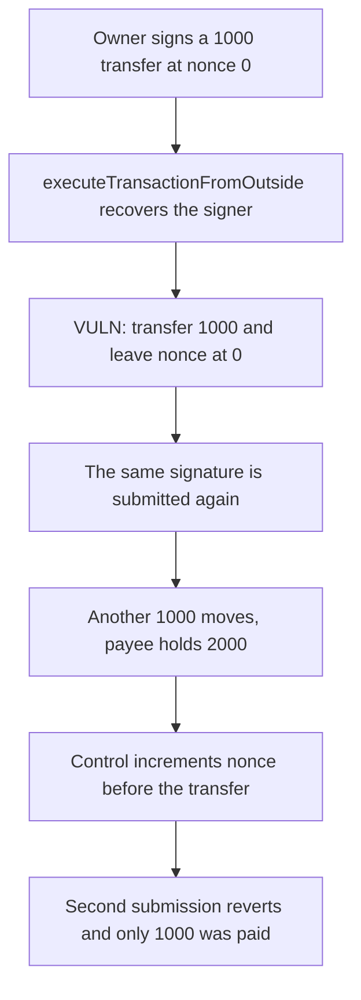

# Clave: `executeTransactionFromOutside` pays 1000 twice from one nonce-0 signature

> **Vulnerability classes:** vuln/auth/signature-replay · vuln/logic/state-update

<!-- non-defihacklabs -->
<!-- source-auditvault: https://github.com/Auditware/AuditVault/blob/main/findings/50017-h-01-executetransactionfromoutside-does-not-increment-the-no.md -->
<!-- date: 2024-11 -->

## Key info

| | |
|---|---|
| **Protocol** | Clave |
| **Finding** | Pashov H-01, AuditVault 50017 |
| **Vulnerable code** | `Wallet.executeTransactionFromOutside` |
| **Harm** | One owner signature for a 1000 transfer at nonce 0 pays 1000 and then pays 1000 again. The wallet nonce stays 0. The control increments nonce, rejects the second submission, and pays 1000 once |
| **Chain** | local synthetic |

## TL;DR

The outside execution recovers the signer of `keccak256(abi.encode(domain, nonce, to, amount))` and transfers the amount. It never writes `nonce`. The same 65-byte signature, precomputed from a key held for this reproduction, is accepted a second time and moves another 1000. The control does `nonce += 1` before the transfer, so the second submission of that signature reverts and the payee receives 1000 once.

## The vulnerable code

```solidity
function executeTransactionFromOutside(address to, uint256 amount, bytes calldata signature) external {
    bytes32 signedHash = keccak256(abi.encode(domain, nonce, to, amount));
    require(_recover(signedHash, signature) == SIGNER, "sig");
    // @> VULN: nonce stays unchanged, so this signed transfer can run again
    token.transfer(to, amount);
}
```

The report's `executeTransactionFromOutside` validates the signed hash and calls `_executeTransaction` without incrementing the wallet nonce. The fix is to increment `nonce` in that function, which is what the control does.

## Root cause

The digest includes the nonce, but the nonce storage is not updated on the outside path. A signature that was valid for nonce 0 is still valid after it has been used. An operator that later submits the same signed transaction executes it again.

## Preconditions

The signer is `0xA03ED8a2e824B880A3D0af7015E1480Be7E1b606`. The signature was produced offline with `cast wallet sign --no-hash` over `abi.encode(domain, 0, payee, 1000 ether)`. The vulnerable wallet's domain is 1 and its payee is `0xb0b`. It holds 2000. `run()` does not warp.

## Attack walkthrough

1. Fund the wallet with 2000.
2. Submit the nonce-0 signature. 1000 moves. Nonce is still 0.
3. Submit the same bytes again. Another 1000 moves. The payee holds 2000.
4. The control wallet, domain 2, accepts its own nonce-0 signature, increments nonce, and pays 1000.
5. The second control submission reverts. Its payee stays at 1000 and the wallet still holds the other 1000.

## Diagrams



## Impact

The payee receives 2000 from one authorization of 1000. The extra 1000 is the replay. The control pays its payee 1000 and refuses the second submission.

## How to reproduce

```bash
cd 50017-h-01-executetransactionfromoutside-does-not-increment-the-no_exp
forge test -vv
```

`run()` does not warp. The vulnerable payee ends at 2000. The control payee ends at 1000.

## Sources

- AuditVault finding: https://github.com/Auditware/AuditVault/blob/main/findings/50017-h-01-executetransactionfromoutside-does-not-increment-the-no.md
- Pashov Clave review (2 November 2024): https://github.com/pashov/audits/blob/master/team/md/Clave-security-review_2024-11-02.md
