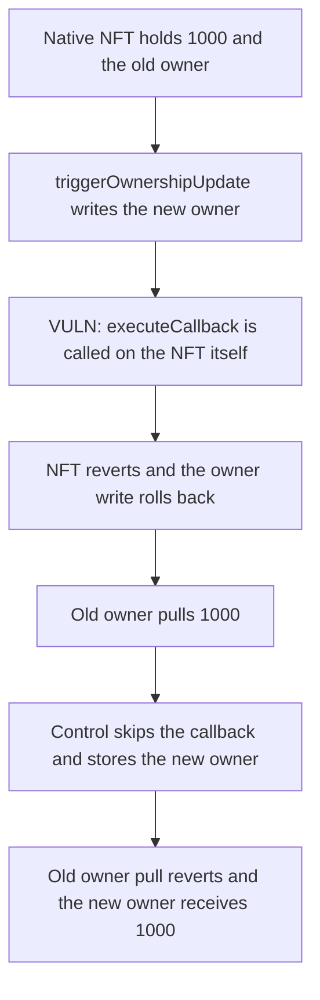

# NFTMirror: `executeCallback` on the native NFT rolls back the ownership update, so the old owner still pulls 1000

> **Vulnerability classes:** vuln/logic/incorrect-state-transition · vuln/dependency/unsafe-external-call

<!-- non-defihacklabs -->
<!-- source-auditvault: https://github.com/Auditware/AuditVault/blob/main/findings/50037-h-01-executecallback-call-causes-that-ownership-cannot-be-up.md -->
<!-- date: 2024-12 -->

## Key info

| | |
|---|---|
| **Protocol** | NFTMirror |
| **Finding** | Pashov H-01, AuditVault 50037 |
| **Vulnerable code** | `Beacon.triggerOwnershipUpdate` |
| **Harm** | The native-chain callback reverts, so the new owner is not stored. The old owner still pulls 1000. The control skips the callback, stores the new owner, and that owner receives 1000 |
| **Chain** | local synthetic |

## TL;DR

`triggerOwnershipUpdate` sets the new owner and then calls `executeCallback` on `shadowAddress`. On the NFT's native chain that address is the NFT itself, and the NFT's `executeCallback` reverts. The owner write rolls back. The old owner is unchanged and pulls 1000. The control beacon does not call the callback. The new owner is stored, the old owner's pull reverts, and the new owner receives 1000.

## The vulnerable code

```solidity
function triggerOwnershipUpdate(address shadowAddress, address newOwner, bytes32 guid) external {
    NFT(shadowAddress).setOwner(newOwner);
    INFTShadow _shadow = INFTShadow(shadowAddress);
    // @> VULN: on the native chain shadowAddress is the NFT, so executeCallback reverts and the owner write rolls back
    _shadow.executeCallback(guid);
}
```

The report's fix is to call `executeCallback` only when the update is not running on the NFT's native chain.

## Root cause

`_updateOwnership` always ends in `_shadow.executeCallback(guid)`. The decoded `shadowAddress` is the NFT contract when the message is applied on the native chain. That contract has no successful callback, so the whole update reverts and the previous owner remains.

## Preconditions

The NFT holds 1000 and its owner is the old owner. The beacon calls `executeCallback` on that same NFT. The control beacon only calls `setOwner`. `run()` does not warp.

## Attack walkthrough

1. Mint 1000 to the native NFT and 1000 to the control NFT.
2. `triggerOwnershipUpdate` sets the new owner and calls `executeCallback`. The NFT reverts with `no callback on native nft`.
3. The owner is still the old owner. That owner pulls 1000.
4. The control update stores the new owner and does not call the callback.
5. The old owner's pull reverts. The new owner pulls 1000.

## Diagrams



## Impact

The ownership update that should have removed the old owner does not stick. The old owner moves 1000. On the control path the update completes and the new owner receives 1000.

## How to reproduce

```bash
cd 50037-h-01-executecallback-call-causes-that-ownership-cannot-be-up_exp
forge test -vv
```

`run()` does not warp. The old owner ends with 1000 from the native NFT. The control NFT's new owner ends with 1000.

## Sources

- AuditVault finding: https://github.com/Auditware/AuditVault/blob/main/findings/50037-h-01-executecallback-call-causes-that-ownership-cannot-be-up.md
- Pashov NFTMirror review (30 December 2024): https://github.com/pashov/audits/blob/master/team/md/NFTMirror-security-review_2024-12-30.md
