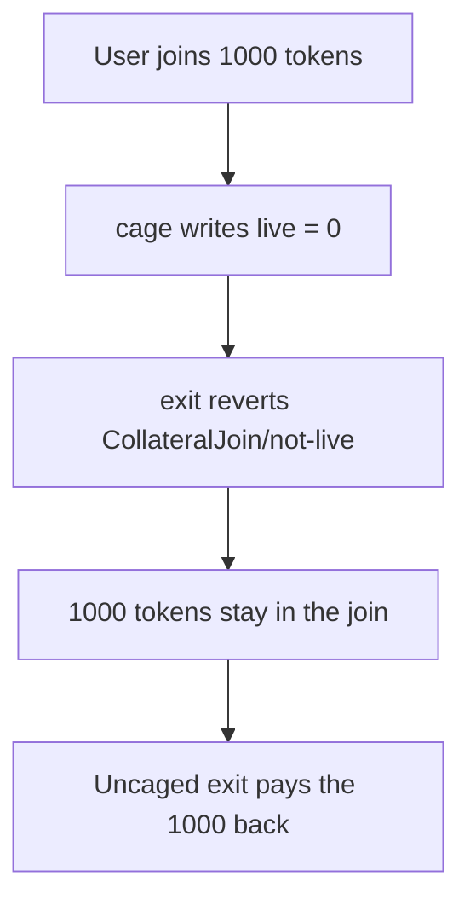

# Cage locks 1,000 joined tokens with no way to exit

> **Vulnerability classes:** vuln/dos/frozen-funds
>
> **Reproduction:** self-contained synthetic Foundry reduction; see [output.txt](output.txt).

<!-- non-defihacklabs -->
<!-- source-auditvault: https://github.com/Auditware/AuditVault/blob/main/findings/50695-user-funds-may-get-locked-in-join-contracts-halborn-damfinan.md -->
<!-- date: 2023-03 -->

## Key info

| Field | Value |
|---|---|
| **Loss** | 1,000 tokens stay in StakeJoin after `cage`. Control exit returns the 1,000 |
| **Vulnerable contract** | `StakeJoin.cage` / `StakeJoin.exit` |
| **Attacker EOA** | `0x1111111111111111111111111111111111111111` |
| **Attack contract** | `Exploit` |
| **Attack tx** | `Exploit.run()` |
| **Chain / block / date** | Ethereum model · block 0 · 2023-03 |
| **Compiler** | solc 0.8.27, cancun, via IR |
| **Bug class** | `cage` sets `live = 0` and nothing sets it back, so `exit` reverts |

## TL;DR

`StakeJoin.cage` writes `live = 0`. `exit` requires `live == 1` and reverts `CollateralJoin/not-live`. The contract has no call that sets `live` back to 1. A user who joined 1,000 tokens cannot take them out. An identical join that is never caged pays the 1,000 back.

## Background

Halborn reviewed Dam Finance LMCV part 2. `RewardJoin` and `StakeJoin` can be stopped by an authorized `cage`. The report shows a user joining 1,000 tokens, the admin caging the contract, and `exit` reverting. The same `live` flag gates `RewardJoin.exit`. This reduction is the `StakeJoin` path quoted in the finding.

## The vulnerable code

```solidity
function cage() external {
    // @> VULN: cage clears live and no function sets it back to 1
    live = 0;
}

function exit(address usr, uint256 wad) external {
    require(live == 1, "CollateralJoin/not-live");
    staked[msg.sender] -= wad;
    require(token.transfer(usr, wad), "CollateralJoin/failed-transfer");
}
```

The control join has the same `exit` and is never caged, so `live` stays 1.

## Root cause

Stopping the join and unlocking it are not a pair. `cage` is a one-way write. Every later `exit` hits `CollateralJoin/not-live` and the tokens already pulled in by `join` stay on the contract.

## Preconditions

- The user has joined 1,000 tokens. The join's token balance and the stake record are both 1,000.
- `cage` runs in this transaction. No time warp is required.
- The control join receives the same 1,000 and is not caged.

## Attack walkthrough

1. Both joins take 1,000 tokens. `cage` sets `live` to 0. `exit` reverts. `exitReverted` is 1 ([output.txt:9](output.txt)).
2. The buggy join still holds 1000000000000000000000 tokens ([output.txt:11](output.txt)).
3. The uncaged join pays 1000000000000000000000 back ([output.txt:13](output.txt)).
4. `[PASS]` ([output.txt:6](output.txt)).

## Diagrams



## Impact

The user who joined 1,000 tokens cannot withdraw them. The stake record is still 1,000 and the tokens are still on the join. The same exit on a join that was not caged returns the 1,000.

## Remediation

Let an authorized caller set `live` back to 1, or add an exit path that does not require `live == 1` after the join has been caged. Do not leave `cage` as a one-way write.

```diff
 function cage() external {
-    live = 0;
+    live = live == 1 ? 0 : 1;
 }
```

## How to reproduce

```bash
cd 50695-user-funds-may-get-locked-in-join-contracts-halborn-damfinan_exp
forge test -vv
```

## Sources

- AuditVault finding: [50695-user-funds-may-get-locked-in-join-contracts-halborn-damfinan](https://github.com/Auditware/AuditVault/blob/main/findings/50695-user-funds-may-get-locked-in-join-contracts-halborn-damfinan.md)
- Halborn, Dam Finance LMCV part 2: https://www.halborn.com/audits/damfinance/lmcv-part-2-smart-contract-security-assessment
- Quoted `StakeJoin.exit` and `RewardJoin.cage` from the finding
