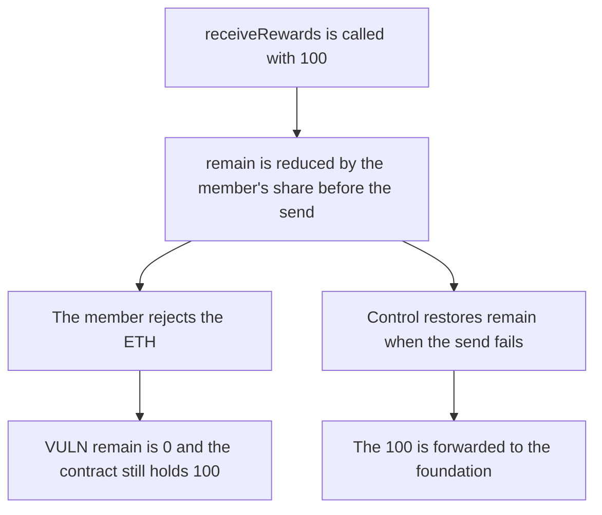

# A failed reward send still consumes the remainder

> **Vulnerability classes:** vuln/logic/failed-transfer · vuln/defi/reward-accounting

<!-- non-defihacklabs -->
<!-- source-auditvault: https://github.com/Auditware/AuditVault/blob/main/findings/50856-unaccounted-funds-in-rewards-distribution-logic-halborn-core.md -->
<!-- date: 1970-01 -->

## Key info

| Field | Value |
|---|---|
| **Loss** | 100 of rewards stays in the contract. remain is already 0, so the failed share is not forwarded |
| **Vulnerable contract** | `Rewards.receiveRewards` |
| **Attacker EOA** | `0x1111111111111111111111111111111111111111` |
| **Attack contract** | `Exploit` at `0x15452ec016c4dc8c549e7fe6ff4b26324ea8b7a4` |
| **Attack tx** | `Exploit.run()` with value 100 |
| **Chain / block / date** | Ethereum model · block 0 · 1970-01 |
| **Compiler** | solc 0.8.27, cancun, via IR |
| **Bug class** | `remain` is reduced before `send`, and a failed send does not restore it |



## TL;DR

`receiveRewards` computes each whitelist share, subtracts it from `remain`, and then `send`s it. The quoted code subtracts first. A member that rejects ETH leaves the coins in the contract, and `remain` no longer includes them, so the later forward of `remain` does not move them.

A call with 100 and one member who rejects it ends with `remain` 0 and 100 still in the contract. The control restores `remain` on failure and forwards that 100 to the foundation. The contract is left empty.

The finding has no month, so the date marker is 1970-01.

## The vulnerable code

```solidity
remain -= share;
(bool ok,) = member.call{value: share}("");
failed = !ok;
stuck = address(this).balance; // @> VULN: the failed share was already removed from remain
```

## Impact

The member's 100 is neither delivered nor left in `remain`. It sits in the contract outside the distribution that was supposed to assign it.

## How to reproduce

```bash
cd 50856-unaccounted-funds-in-rewards-distribution-logic-halborn-core_exp
forge test -vv
```

`test_exploit_failed_send_leaves_100_unaccounted` asserts remain 0 and a balance of 100. `test_control_failed_send_forwards_the_remainder` asserts the foundation receives 100 and the contract is empty.

## Sources

- AuditVault finding: https://github.com/Auditware/AuditVault/blob/main/findings/50856-unaccounted-funds-in-rewards-distribution-logic-halborn-core.md
- Halborn report: CoreDAO BTC hardfork enhancement
